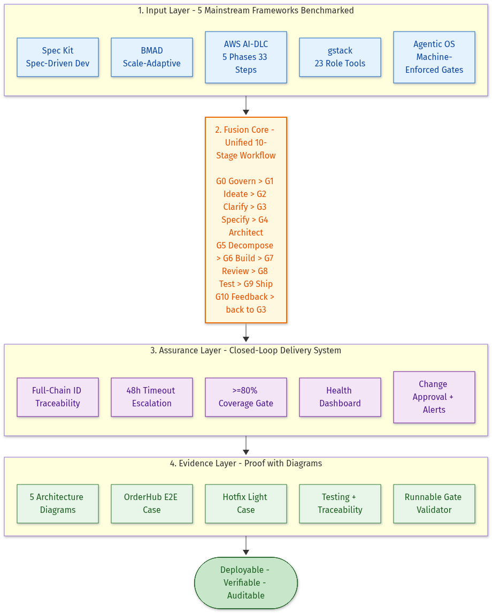

# AI Workflow Hub · The Most Comprehensive AI Software Development Workflow

> A **comprehensive, actionable, bilingual (CN/EN)** knowledge base for AI-driven software development workflows.
> It benchmarks the 5 leading frameworks in the industry, distills the full lifecycle from "requirements → shipping → feedback loop",
> and integrates a battle-tested **closed-loop delivery system** (ID traceability / exception handling / quality gates / monitoring & alerting / versioning / knowledge base / change management).

[简体中文](./README.md) · [Unified Workflow](./docs/02-unified-framework/unified-workflow.en.md) · [Closed-Loop System](./docs/03-user-system/closed-loop-system.en.md) · [Landscape](./docs/01-landscape/overview.en.md)

> 🆕 **Diagrams & proof**: [Architecture Diagrams](./architecture/README.en.md) (5 diagrams) · [End-to-End Cases](./cases/README.en.md) (OrderHub full flow + Hotfix) · [Test System & Runnable Gate Validator](./tests/README.en.md)

## At a Glance



> The figure above has four layers (top to bottom): **Input** (benchmarking 5 leading frameworks) → **Fusion Core** (unified 10-stage workflow) → **Assurance** (closed-loop delivery system) → **Evidence** (architecture diagrams / cases / tests). Every diagram has a real PNG, visible right inside the documents.

---

## What Is This

This is not a codebase — it is a knowledge system combining **methodology + workflow + roles + gates + governance**, answering one core question:

> **When AI Agents participate in the entire software development lifecycle, what is the human's role? What should be done at each stage, what should be produced, and when do we release?**

We dissect the 5 best AI development workflow frameworks, compare them side by side, extract the best of each, and fuse them into a **unified 10-stage workflow**. We then layer on a complete **closed-loop delivery assurance system**, so the process is not only "benchmarkable" but truly "deliverable".

**Three design goals:**

| Goal | Description |
|---|---|
| 🎯 Comprehensive | Covers 5 major frameworks + 1 proprietary closed-loop system, full lifecycle vertically, all roles horizontally |
| 🔗 Composable | Unified framework is pluggable by stage — use any framework's Skill / Agent / template |
| 🛡️ Enforceable | Quality gates + exception escalation + monitoring & alerting + change approval make AI output verifiable and auditable |

---

## 1. Five Leading Frameworks (Landscape)

| # | Project | Stars | One-Line Positioning | Core Contribution | License |
|---|---|---:|---|---|---|
| 1 | [github/spec-kit](https://github.com/github/spec-kit) | ~150k | Spec-Driven Development toolkit | `/constitution → specify → plan → tasks → implement → converge` 6-step flow + extensible Extension/Preset/Workflow | MIT |
| 2 | [bmad-code-org/BMAD-METHOD](https://github.com/bmad-code-org/BMAD-METHOD) | ~55k | Agile AI-Driven Development (AiDD) | Scale-adaptive flow (small changes go straight to build, big projects get deep planning) + product/architecture/UX/dev/test roles | MIT |
| 3 | [awslabs/aidlc-workflows](https://github.com/awslabs/aidlc-workflows) | ~6.1k | AI-Driven Development Life Cycle | **5 phases, 33 stages + 14 agents + 11 workflow profiles + 134-event audit trail** | MIT-0 |
| 4 | [garrytan/gstack](https://github.com/garrytan/gstack) | ~142k | Role-based Claude Code toolset | 23 opinionated role tools (CEO / Designer / Eng Manager / Release Manager / Doc Engineer…) | MIT |
| 5 | [KbWen/agentic-os](https://github.com/KbWen/agentic-os) | ~240 | Governance framework for AI coding agents | `plan → build → review → test → ship` 5 steps + **machine-enforced gates, evidence, audit trail** | MIT |

> Also included as **inspiration & reference baseline**: [cilangzzz/software-dev-ai-workflow](https://github.com/cilangzzz/software-dev-ai-workflow) (~48★, 8 stages + 8 roles + 27 general skills + quality gates Gate 1-5). This project systematically extends its "role agent + stage orchestration" thinking.

> ⚠️ Star counts are a snapshot as of 2026-11-18 and change over time.

📖 See [Landscape & Project-by-Project Analysis](./docs/01-landscape/overview.en.md)

---

## 2. Unified Workflow Framework (10 Stages)

The main flow distilled from the five frameworks, spanning requirements to operations:

```
G0 Governance  →  G1 Idea Assessment  →  G2 Clarify & Inception  →  G3 Specify  →  G4 Plan & Architecture
     ↓
G5 Task Breakdown  →  G6 Build  →  G7 Review  →  G8 Test & Verify  →  G9 Ship
     ↓
G10 Learn & Iterate  ──────────────→ back to G3 (requirements feedback loop)
```

Every stage defines: **Input → Activities → Deliverables → Release Gate → Corresponding Framework Practice → Roles**.

📖 Full definition: [Unified Workflow Framework](./docs/02-unified-framework/unified-workflow.en.md)

---

## 3. Closed-Loop Delivery Assurance (Our System)

Derived from *"AI Product Full-Flow Closed-Loop Delivery System Design (Optimized Edition)"*, this adds **10 optimization points** on top of a seven-stage standardized SOP, covering 15 old-vs-new process comparisons:

| Module | Optimization | Status |
|---|---|---|
| ID Traceability | New ID flow arrows showing full-chain binding | ✅ |
| Exception Handling | Timeout escalation: auto-escalate if unresolved for 48 hours | ✅ |
| Quality Gates | Standards such as "coverage < 80% = fail" | ✅ |
| Process Monitoring | Health dashboard with real-time metrics | ✅ |
| Version Management | Naming rule `v[version][feature]-[type]-[date]` | ✅ |
| Operations Model | Smart feedback routing: 3-category auto-classification | ✅ |
| Skill Versioning | 7-day minor + 30-day major release | ✅ |
| Knowledge Base | User-driven dynamic updates | ✅ |
| Change Management | Online form + AI assessment | ✅ |
| Monitoring & Alerting | Alert rule configuration + escalation path | ✅ |

📖 Full system: [Closed-Loop Delivery System](./docs/03-user-system/closed-loop-system.en.md)

---

## 4. Repository Structure

```
ai-workflow-hub/
├── README.md                       # Chinese entry point (with overview figure)
├── README.en.md                    # English entry point (with overview figure)
├── LICENSE                         # MIT
├── .gitignore
├── assets/                         # NEW: 52 real PNGs + manifest.json
│   ├── overview-zh.png             # Overview figure (Chinese, atop README)
│   ├── overview-en.png             # Overview figure (English)
│   └── <doc>-<index>.png           # 50 doc figures, 1:1 with Mermaid blocks
├── scripts/                        # NEW: Image render & embed tools
│   ├── render_images.py            # Mermaid → PNG (via Kroki online)
│   └── embed_images.py             # Embed PNGs into md (source kept folded)
├── architecture/                   # Architecture diagrams (PNG shown inline + Mermaid source folded)
│   ├── 01-system-context           # System context
│   ├── 02-workflow-stages          # 10-stage workflow + loop
│   ├── 03-agent-orchestration      # Agent orchestration & context passing
│   ├── 04-traceability             # ID traceability data flow
│   └── 05-gate-pipeline            # Quality gate pipeline (each: .md / .en.md)
├── cases/                          # NEW: End-to-end real-world cases
│   ├── case-01-ecommerce           # OrderHub: idea→launch→feedback loop (G0-G10)
│   └── case-02-hotfix              # Light case: login crash hotfix (G6-G9)
├── tests/                          # NEW: Test system & runnable gate validator
│   ├── test-strategy               # Test strategy & pyramid
│   ├── test-cases                  # Test cases & traceability matrix
│   ├── coverage-report             # Coverage report example (76%→89% story)
│   ├── gate-validation.py          # Real runnable gate validator (--demo)
│   └── gate-validation             # Script docs & CI/hook integration (each doc: .md / .en.md)
└── docs/
    ├── 01-landscape/
    │   └── overview.md / overview.en.md          # 5 frameworks + reference: comparison & analysis
    ├── 02-unified-framework/
    │   ├── unified-workflow.md / .en.md          # Unified 10-stage workflow (core)
    │   ├── agent-roles.md / .en.md               # 8 agent roles
    │   └── quality-gates.md / .en.md             # Quality gates G0-G10 + checklists
    ├── 03-user-system/
    │   └── closed-loop-system.md / .en.md        # Closed-loop system (10 optimizations + 15 comparisons)
    └── 04-appendix/
        ├── glossary.md / .en.md                  # CN/EN glossary
        └── quick-start.md / .en.md               # Quick start & framework selection guide
```

---

## 5. How to Use

1. **Quick overview** → this page + [Landscape](./docs/01-landscape/overview.en.md)
2. **Understand architecture visually** → [Architecture Diagrams](./architecture/README.en.md) (5 groups, each with a real PNG shown inline + expandable Mermaid source: system context, 10-stage flow, agent orchestration, ID traceability, gate pipeline)
3. **See real cases** → [OrderHub full-flow case](./cases/case-01-ecommerce.en.md) + [Hotfix light case](./cases/case-02-hotfix.en.md)
4. **See tests & gates** → [Test System](./tests/README.en.md), run `python3 tests/gate-validation.py --demo` to see the validator in action
5. **Deliver a process** → [Unified Workflow](./docs/02-unified-framework/unified-workflow.en.md) + [Quality Gates](./docs/02-unified-framework/quality-gates.en.md)
6. **Define team roles** → [Agent Roles](./docs/02-unified-framework/agent-roles.en.md)
7. **Complete delivery assurance** → [Closed-Loop System](./docs/03-user-system/closed-loop-system.en.md)
8. **Choose a framework** → [Quick Start & Selection](./docs/04-appendix/quick-start.en.md)

---

## 6. License & Acknowledgments

Content is open-sourced under the [MIT License](./LICENSE). All referenced third-party projects remain the property of their respective authors; this material is for methodology organization and learning/research only.

If this system helps you, feel free to Star ⭐ and contribute.

---

*Made with ❤️ by yunloong-Y · Bilingual CN/EN · Continuously updated*
