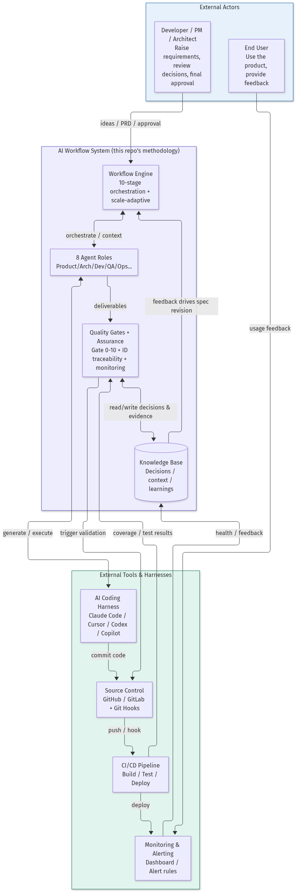
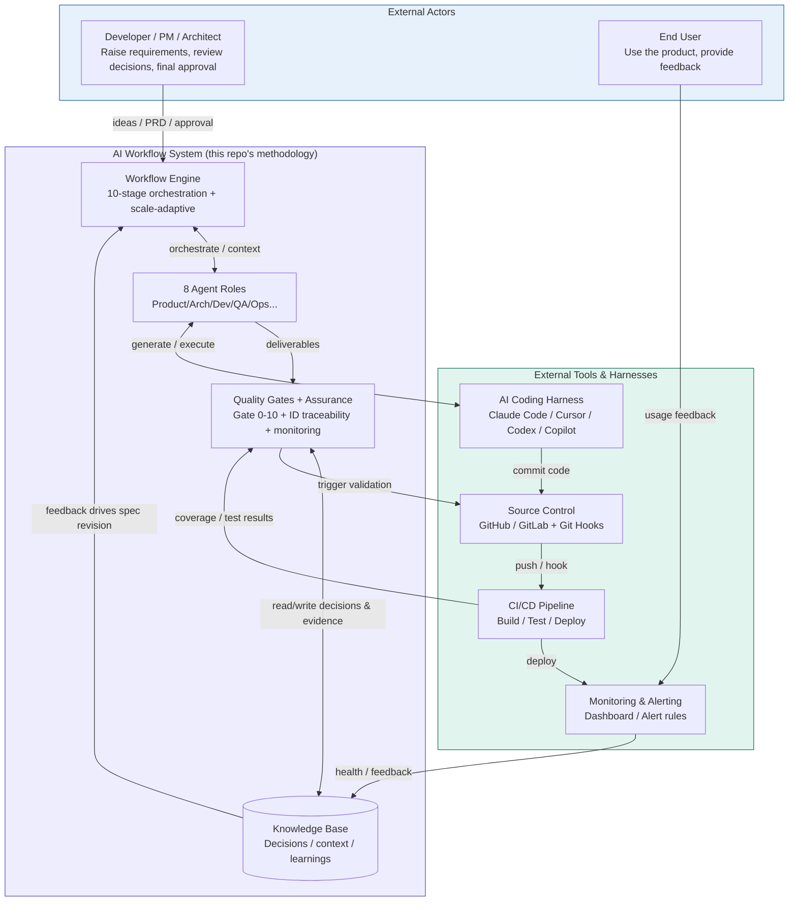

# Diagram 1 · System Context Architecture

> Question answered: How does this AI workflow system interact with external roles, tools, and systems as a whole?

[Diagram Index](./README.en.md) · [简体中文](./01-system-context.md)

---

## 1.1 System Context Diagram

<!-- IMG-EMBED -->
**图 1 · flowchart**

查看 Mermaid 源码（可编辑）

**How to read:**
- The system core has three parts: **workflow engine** (orchestration) + **agent roles** (execution) + **gate assurance** (verification).
- The **knowledge base** is the "memory" across the entire flow, making decisions persist across sessions and roles.
- External tools fall into three categories: AI coding harness (where work happens), source control/CI (how it's validated), monitoring (how it's observed).
- The key loop: `MON → KB → CORE`, i.e. "usage feedback → knowledge distillation → driving the next spec revision".

---

## 1.2 System Boundaries & Responsibilities

| Layer | Inside this system | Outside (external) |
|---|---|---|
| Process | 10-stage definition, scale-adaptive, gate rules | Specific Jira/TAPD project management systems |
| Execution | 8 role definitions, Skill/Agent orchestration | Specific LLM models (Claude/GPT) |
| Assurance | ID traceability rules, coverage standards, alert levels | Specific CI platforms (GitHub Actions/Jenkins) |
| Memory | Knowledge base structure, decision record spec | Specific vector DB / document systems |

> This system is **model-agnostic and tool-agnostic** (borrowing AI-DLC and Agentic OS), and can be grafted onto any coding harness and toolchain.
