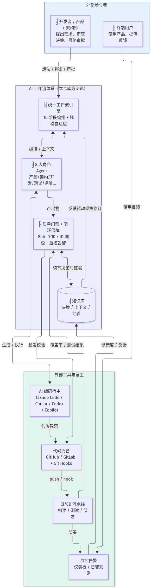
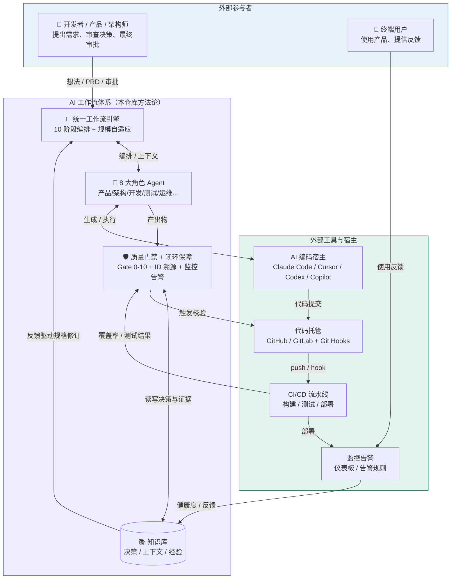

# 图 1 · 系统上下文架构

> 回答：这套 AI 工作流体系作为一个整体，与哪些外部角色、工具、系统交互？

[图集导航](./README.md) · [English](./01-system-context.en.md)

---

## 1.1 系统上下文图（System Context）

<!-- IMG-EMBED -->
**图 1 · flowchart**

查看 Mermaid 源码（可编辑）

**读图要点：**
- 体系的核心由三部分组成：**工作流引擎**（编排）+ **角色 Agent**（执行）+ **门禁保障**（验证）。
- **知识库**是贯穿全程的"记忆"，让决策跨会话、跨角色持久。
- 外部工具分三类：AI 编码宿主（在哪干活）、代码托管/CI（怎么落库校验）、监控告警（怎么观测）。
- 关键闭环：`MON → KB → CORE`，即"使用反馈 → 知识沉淀 → 驱动下一轮规格修订"。

---

## 1.2 体系边界与职责

| 层 | 属于本体系 | 不属于本体系（外部） |
|---|---|---|
| 流程 | 10 阶段定义、规模自适应、门禁规则 | 具体的 Jira/TAPD 项目管理系统 |
| 执行 | 8 角色定义、Skill/Agent 编排 | 具体的 LLM 模型（Claude/GPT） |
| 保障 | ID 溯源规则、覆盖率标准、告警分级 | 具体的 CI 平台（GitHub Actions/Jenkins） |
| 记忆 | 知识库结构、决策记录规范 | 具体的向量数据库/文档系统 |

> 这套体系是**模型无关、工具无关**的方法论（借鉴 AI-DLC 与 Agentic OS），可以嫁接到任意编码宿主与工具链上。
