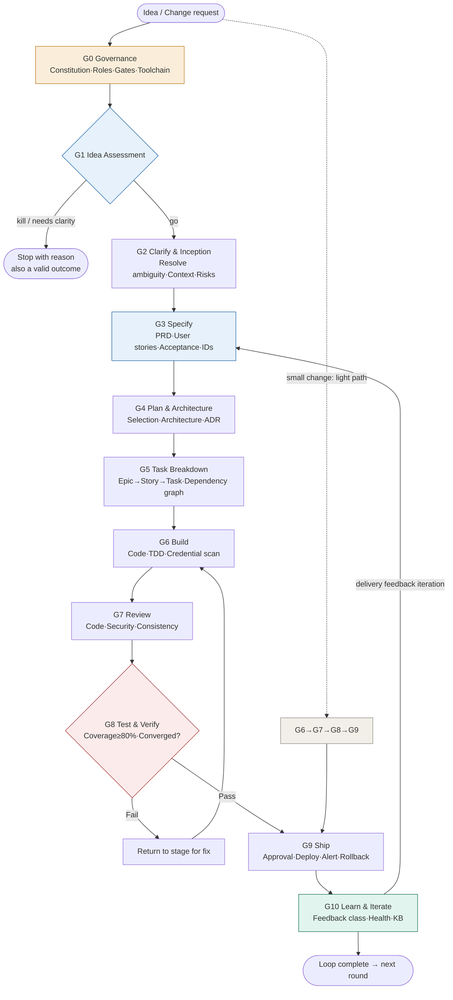
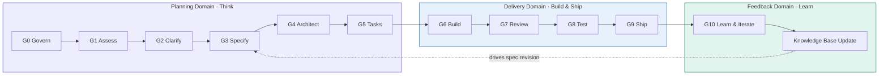

# Diagram 2 · 10-Stage Workflow Architecture

> Question answered: How does the flow run from idea to launch? How is the loop closed? How are changes tailored by scale?

[Diagram Index](./README.en.md) · [简体中文](./02-workflow-stages.md) · [Unified Workflow](../docs/02-unified-framework/unified-workflow.en.md)

---

## 2.1 Main Flow Diagram (Full 10 Stages + Loop)

**How to read:**
- **Three exits**: `kill` (stop with reason at assessment), `DONE` (loop complete), and fix loop.
- **Gate checkpoints**: G1 (`go` decision) and G8 (coverage + Converged) are key decision gates; failure triggers rollback to a prior stage.
- **The loop**: G10 feedback is not the end — it returns to G3 via "requirements delivery feedback iteration" to revise the spec.
- **Scale tailoring**: small changes take the dashed light path `G6→G7→G8→G9` (borrowing BMAD/Agentic OS).

---

## 2.2 Three-Domain View (Planning / Delivery / Feedback)

> Corresponding to BMAD's `Clarify → Plan → Build → Learn` delivery loop, this system refines it into 10 landable stages with gates.

---

## 2.3 Scale-Adaptive Path Comparison

| Change type | Start | Path | Gate intensity |
|---|---|---|---|
| Small change (typo / minor bug) | G6 | G6→G7→G8→G9 | Light (~5k tokens, borrowing Agentic OS) |
| Feature development | G2/G3 | G2→…→G9→G10 | Standard |
| Idea / new project | G1 | G1→(go)→G3→… | Includes assessment gate |
| Enterprise / regulated system | G0 | All 10 stages | Full + audit trail (borrowing AI-DLC) |
