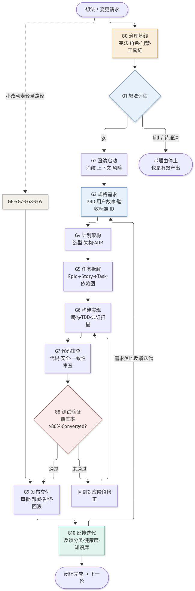
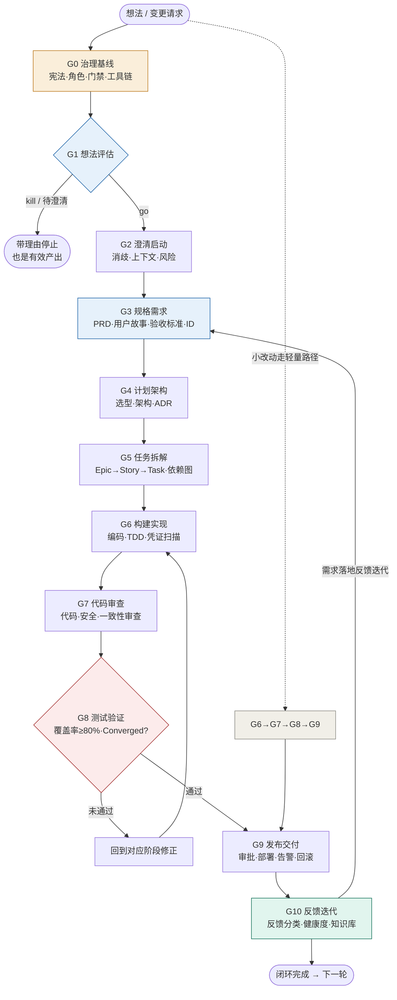
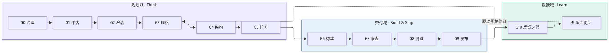
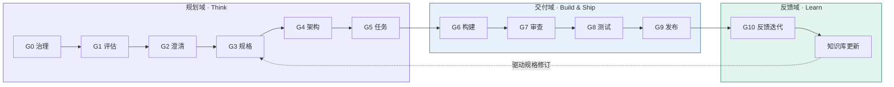

# 图 2 · 10 阶段工作流架构

> 回答：从想法到上线，流程如何流转？闭环如何形成？不同规模的变更如何裁剪？

[图集导航](./README.md) · [English](./02-workflow-stages.en.md) · [统一工作流正文](../docs/02-unified-framework/unified-workflow.md)

---

## 2.1 主流程图（完整 10 阶段 + 闭环）

<!-- IMG-EMBED -->
**图 1 · flowchart**

查看 Mermaid 源码（可编辑）

**读图要点：**
- **三个出口**：`kill`（想法评估阶段带理由停止）、`DONE`（闭环完成）、修正回环。
- **门禁卡点**：G1（`go` 决策）、G8（覆盖率+Converged）是关键判定门，未通过会回退修正。
- **闭环**：G10 的反馈不是终点，而是通过"需求落地反馈迭代"回到 G3 修订规格。
- **规模裁剪**：小改动通过虚线走轻量路径 `G6→G7→G8→G9`（借鉴 BMAD/Agentic OS）。

---

## 2.2 三阶段视图（规划域 / 交付域 / 反馈域）

<!-- IMG-EMBED -->
**图 2 · flowchart**

查看 Mermaid 源码（可编辑）

> 对应 BMAD 的 `Clarify → Plan → Build → Learn` 交付循环，本体系把它细化为可落地的 10 个带门禁的阶段。

---

## 2.3 规模自适应路径对照

| 变更类型 | 起点 | 路径 | 门禁强度 |
|---|---|---|---|
| 小改动（typo / 小 bug） | G6 | G6→G7→G8→G9 | 轻量（~5k tokens，借鉴 Agentic OS） |
| 功能开发 | G2/G3 | G2→…→G9→G10 | 标准 |
| 想法 / 新项目 | G1 | G1→(go)→G3→… | 含评估门 |
| 企业 / 受监管系统 | G0 | 全 10 阶段 | 全量 + 审计轨迹（借鉴 AI-DLC） |
