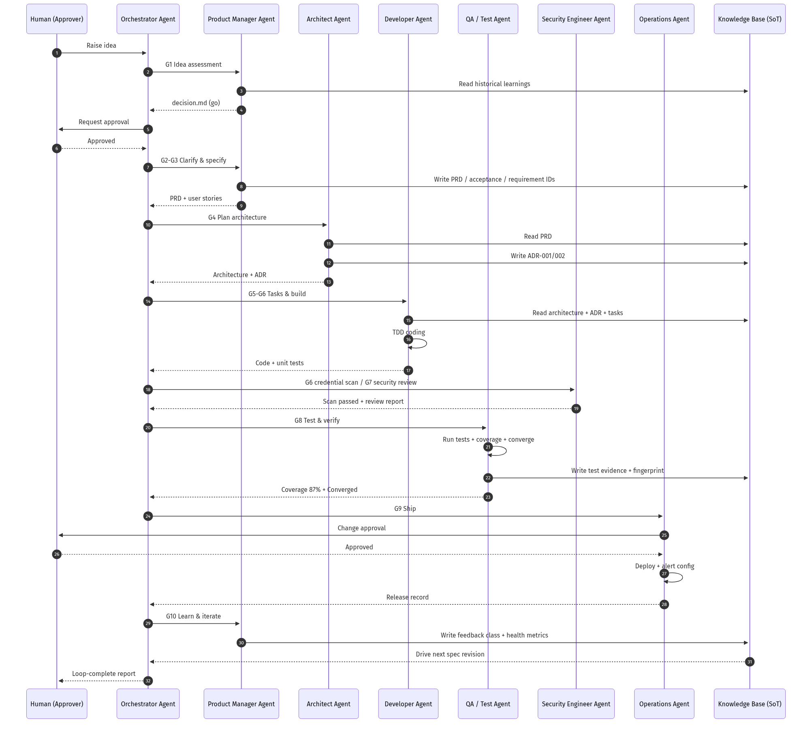
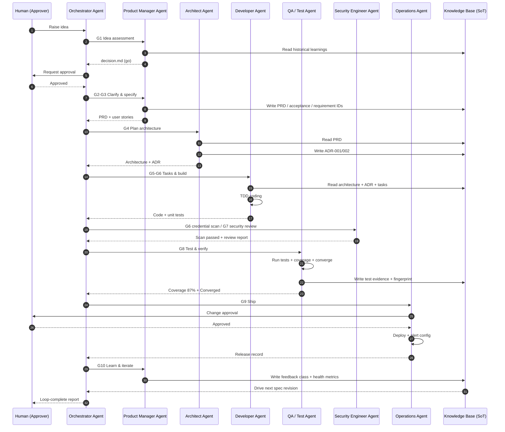
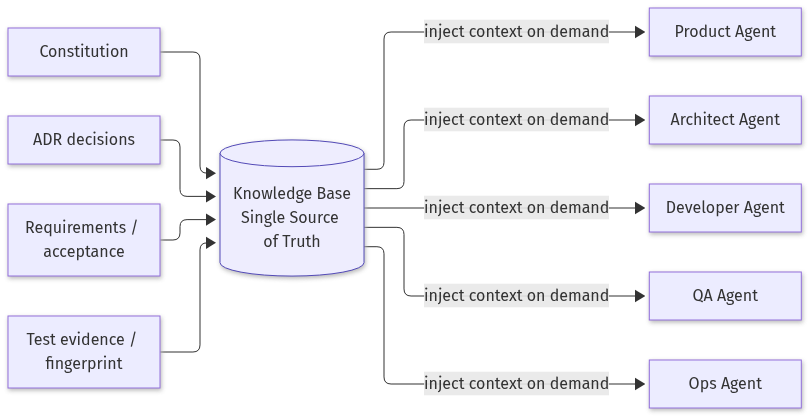
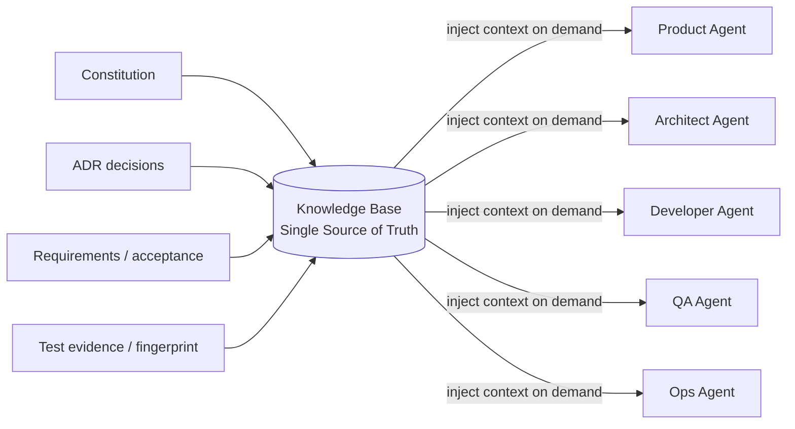

# Diagram 3 · Agent Orchestration Architecture

> Question answered: How do the 8 agent roles collaborate? How are context and decisions passed across stages and sessions?

[Diagram Index](./README.en.md) · [简体中文](./03-agent-orchestration.md) · [Agent Roles](../docs/02-unified-framework/agent-roles.en.md)

---

## 3.1 Role Collaboration Sequence Diagram

> Using "a new feature from requirements to launch" as an example, showing the call order and context flow across roles under orchestration.

<!-- IMG-EMBED -->
**图 1 · sequenceDiagram**

查看 Mermaid 源码（可编辑）

**How to read:**
- The **orchestrator** (borrowing AI-DLC's adaptive composer) is the hub — dispatching roles by stage and pausing at approval points.
- The **knowledge base is the single source of truth**: each role writes its outputs to KB, the next reads from KB — avoiding "re-explaining every chat" (BMAD's durable context).
- **Humans approve at key nodes**: G1 decision, G9 change/release.
- **Evidence is logged**: QA writes test evidence + fingerprint to KB, enabling machine-enforced gates (Agentic OS).

---

## 3.2 Context Passing Mechanism

<!-- IMG-EMBED -->
**图 2 · flowchart**

查看 Mermaid 源码（可编辑）

> **Core idea**: decisions and evidence are written to a single source of truth, read on demand by each role — the landing point of BMAD "durable context" and Agentic OS "memory that survives handoffs".
