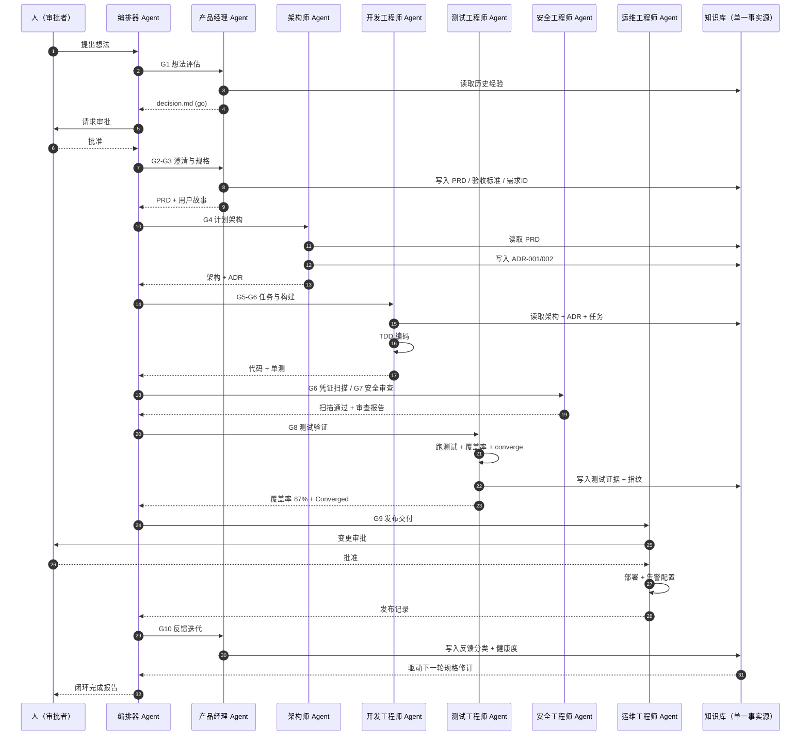
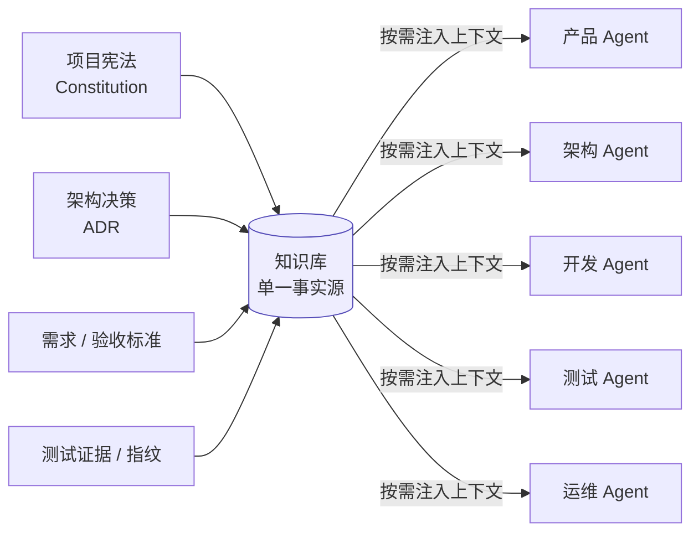

# 图 3 · Agent 编排架构

> 回答：8 大角色 Agent 如何协作？上下文与决策如何跨阶段、跨会话传递？

[图集导航](./README.md) · [English](./03-agent-orchestration.en.md) · [角色定义](../docs/02-unified-framework/agent-roles.md)

---

## 3.1 角色协作时序图

> 以"一个新功能从需求到上线"为例，展示各角色 Agent 在编排下的调用顺序与上下文流转。

**读图要点：**
- **编排器**（借鉴 AI-DLC 的 adaptive composer）是中枢，负责按阶段调度角色、在审批点暂停。
- **知识库是单一事实源**：每个角色的产出都写入 KB，下个角色从 KB 读取，避免"每次对话重新解释"（BMAD 的 durable context）。
- **人在关键节点审批**：G1 决策、G9 变更发布等需要人类把关。
- **证据留痕**：QA 把测试证据与指纹写入 KB，让"机器强制门禁"可校验（Agentic OS）。

---

## 3.2 上下文传递机制

> **核心思想**：决策与证据写入一个单一事实源，各角色按需读取——这正是 BMAD "durable context" 与 Agentic OS "memory that survives handoffs" 的落地点。
