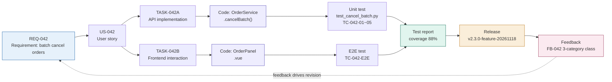
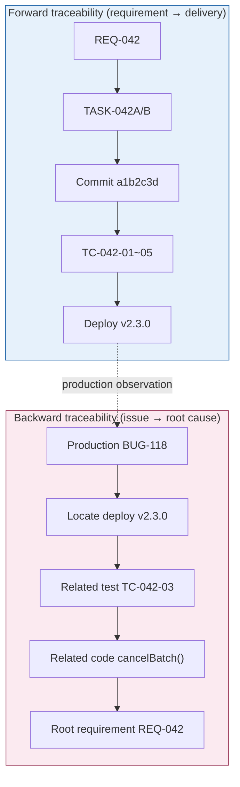

# Diagram 4 · ID Traceability Data Flow

> Question answered: How does a requirement (e.g. REQ-042) thread down to tasks, code, tests, and release? How is full-chain binding and visualization achieved?

[Diagram Index](./README.en.md) · [简体中文](./04-traceability.md) · [Closed-Loop System](../docs/03-user-system/closed-loop-system.en.md)

---

## 4.1 Full-Chain ID Flow Diagram

> This is the core of our "ID traceability visualization enhancement": ID flow arrows showing full-chain binding.

**How to read:**
- Each requirement gets a unique ID (`REQ-042`), threading down through stories, tasks, code, tests, release, and feedback.
- One requirement can fork into multiple tasks/code/tests, forming a **traceable graph**.
- Feedback `FB-042` returns to the requirement via dashed line, closing the loop — exactly "requirements delivery feedback iteration".
- Any node can be reverse-traced: from a production bug you can locate the exact requirement, task, code, and test.

---

## 4.2 Bidirectional Traceability Matrix

---

## 4.3 ID Naming Convention (Our System)

| Prefix | Meaning | Example | Produced at |
|---|---|---|---|
| `REQ-` | Requirement ID | REQ-042 | G3 Specify |
| `US-` | User story | US-042 | G3 Specify |
| `TASK-` | Task ID | TASK-042A | G5 Breakdown |
| `ADR-` | Architecture decision record | ADR-001 | G4 Architecture |
| `TC-` | Test case | TC-042-01 | G8 Test |
| `BUG-` | Defect ID | BUG-118 | G7/G10 |
| `FB-` | Feedback ID | FB-042 | G10 Feedback |
| `CR-` | Change request | CR-20261118-01 | G9 Change |

> Version naming convention (our system): `v[version][feature]-[type]-[date]`, e.g. `v2.3.0-feature-20261118`.
