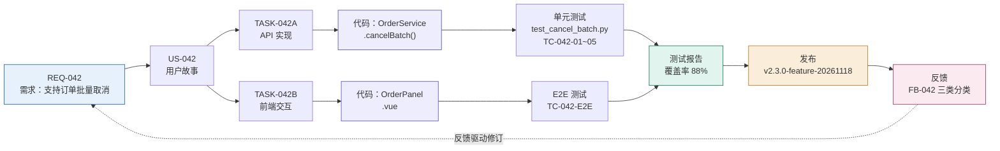
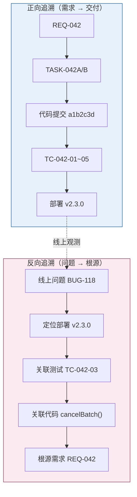

# 图 4 · ID 溯源数据流

> 回答：一条需求（如 REQ-042）如何向下贯穿到任务、代码、测试、发布？全链路绑定与可视化如何实现？

[图集导航](./README.md) · [English](./04-traceability.en.md) · [闭环体系](../docs/03-user-system/closed-loop-system.md)

---

## 4.1 ID 流向全链路图

> 这是自有闭环体系的"ID 溯源可视化增强"核心：用 ID 流向箭头展示全链路绑定。

**读图要点：**
- 每个需求分配唯一 ID（`REQ-042`），向下贯穿到故事、任务、代码、测试、发布、反馈。
- 一条需求可能分叉成多个任务/代码/测试，形成一张**可追溯的图**。
- 反馈 `FB-042` 通过虚线回到需求，形成闭环——这正是"需求落地反馈迭代"。
- 任一环节都可反向追溯：从线上 bug 可定位到具体需求、任务、代码、测试。

---

## 4.2 双向追溯矩阵

---

## 4.3 ID 命名规范表（自有体系）

| 前缀 | 含义 | 示例 | 产生阶段 |
|---|---|---|---|
| `REQ-` | 需求 ID | REQ-042 | G3 规格 |
| `US-` | 用户故事 | US-042 | G3 规格 |
| `TASK-` | 任务 ID | TASK-042A | G5 任务拆解 |
| `ADR-` | 架构决策记录 | ADR-001 | G4 架构 |
| `TC-` | 测试用例 | TC-042-01 | G8 测试 |
| `BUG-` | 缺陷 ID | BUG-118 | G7/G10 |
| `FB-` | 反馈 ID | FB-042 | G10 反馈 |
| `CR-` | 变更请求 | CR-20261118-01 | G9 变更 |

> 版本命名规范（自有体系）：`v[版本][功能]-[类型]-[日期]`，如 `v2.3.0-feature-20261118`。
