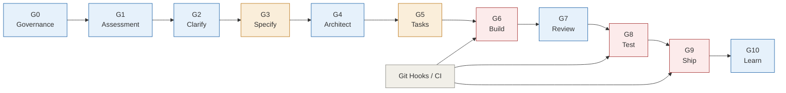
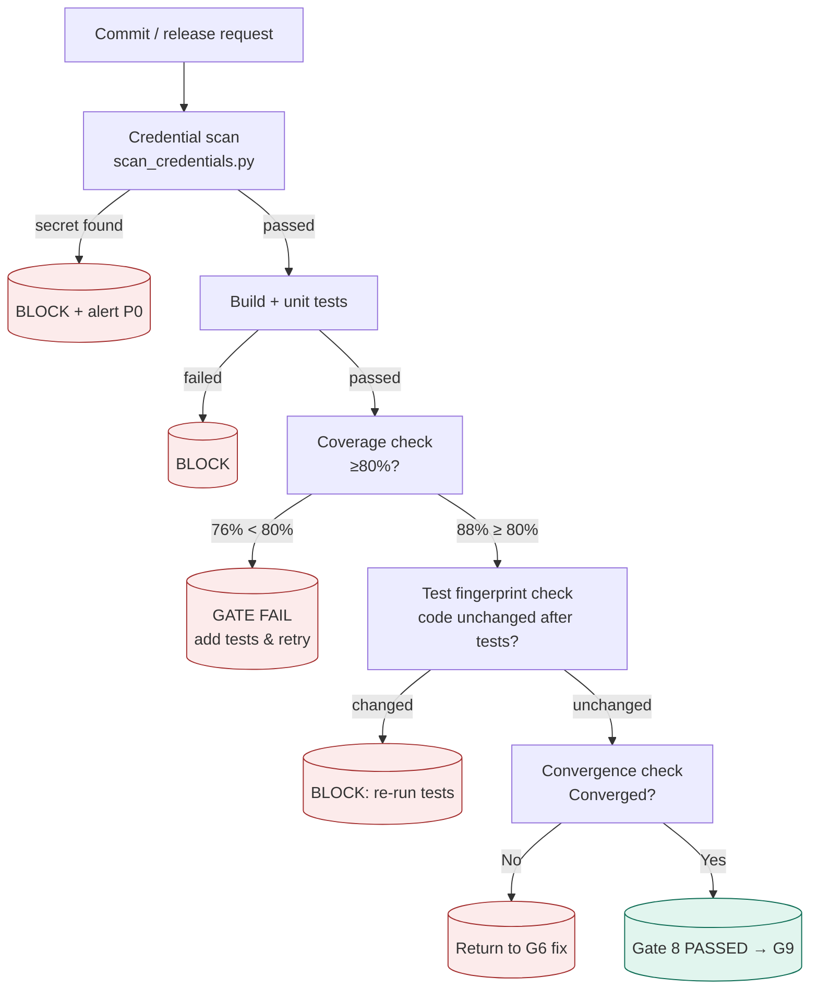
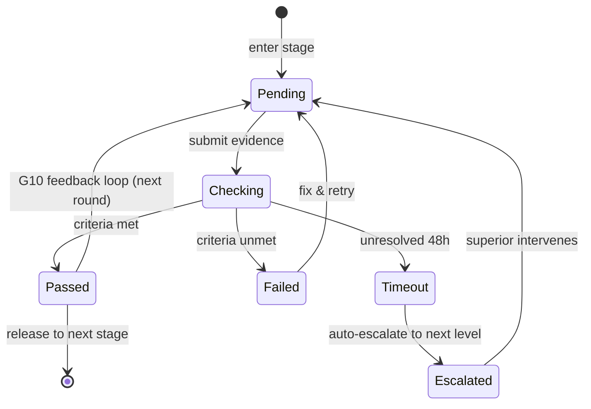

# Diagram 5 · Quality Gate Pipeline

> Question answered: How do Gates 0-10 check? Which are machine-enforced (unbypassable by agents)? Which rely on human approval?

[Diagram Index](./README.en.md) · [简体中文](./05-gate-pipeline.md) · [Quality Gates](../docs/02-unified-framework/quality-gates.en.md)

---

## 5.1 Gate Pipeline Diagram (with enforcement annotations)

**Enforcement legend:**
- 🔵 **Human approval** (manual): requires human judgment and sign-off (G0/G1/G2/G4/G7/G10).
- 🟡 **Checklist/validation** (check): checklist + ID validation (G3/G5).
- 🔴 **Machine-enforced** (machine): git hooks / CI enforce, unbypassable by agents (G6/G8/G9) — borrowing Agentic OS's core idea.

---

## 5.2 Machine-Enforced Gate Internal Flow (Gate 8 example)

> **Core warning (from Agentic OS)**: a rules file is just a prompt the agent can ignore; gates that truly work must be machine-enforced — credential scan, coverage, test fingerprint, phase evidence all wired into git hooks and CI.

---

## 5.3 Gate State Machine

> The state machine embodies our "exception handling mechanism": **auto-escalate after 48 hours**, failure rolls back for fixes, passing releases or enters the next closed loop.
