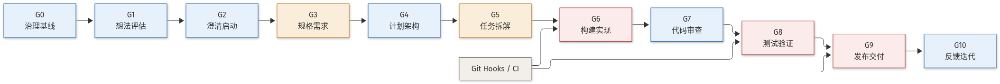
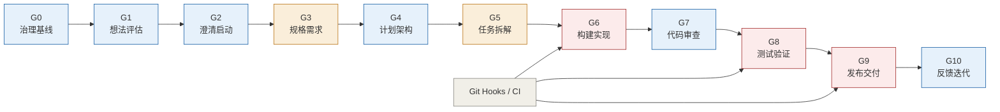
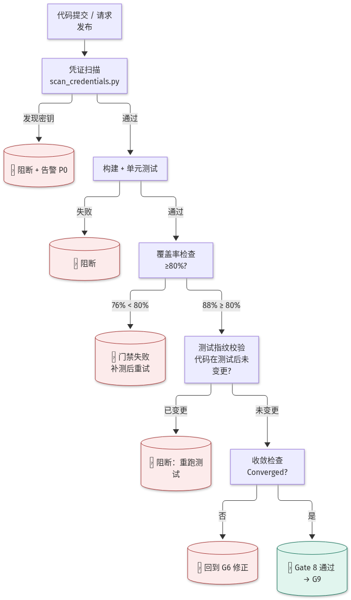
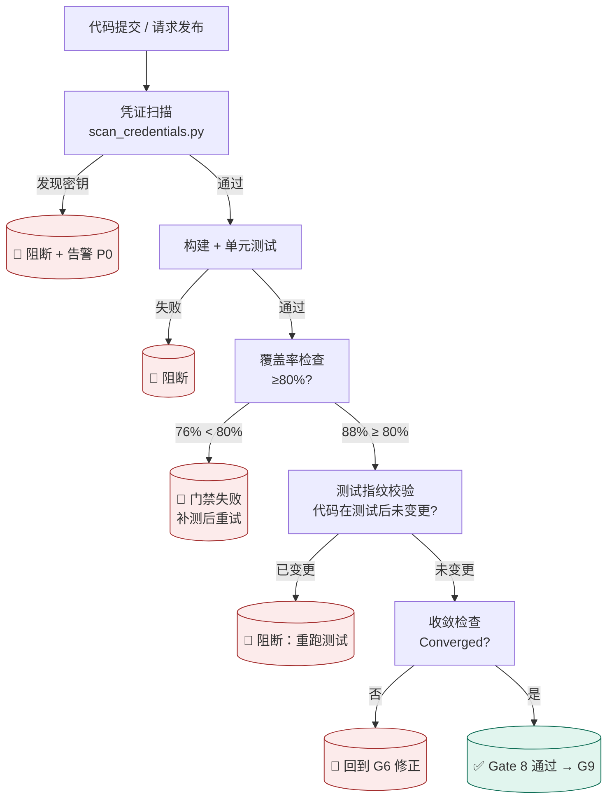
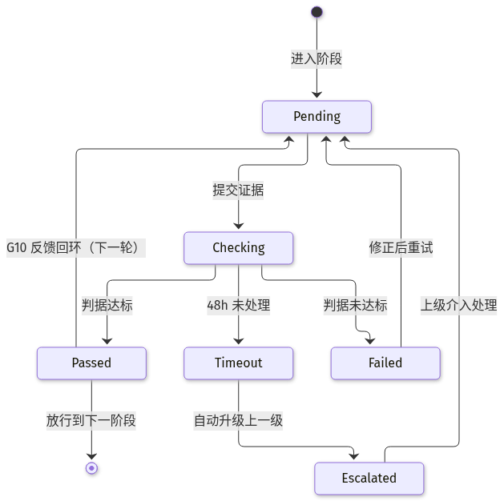
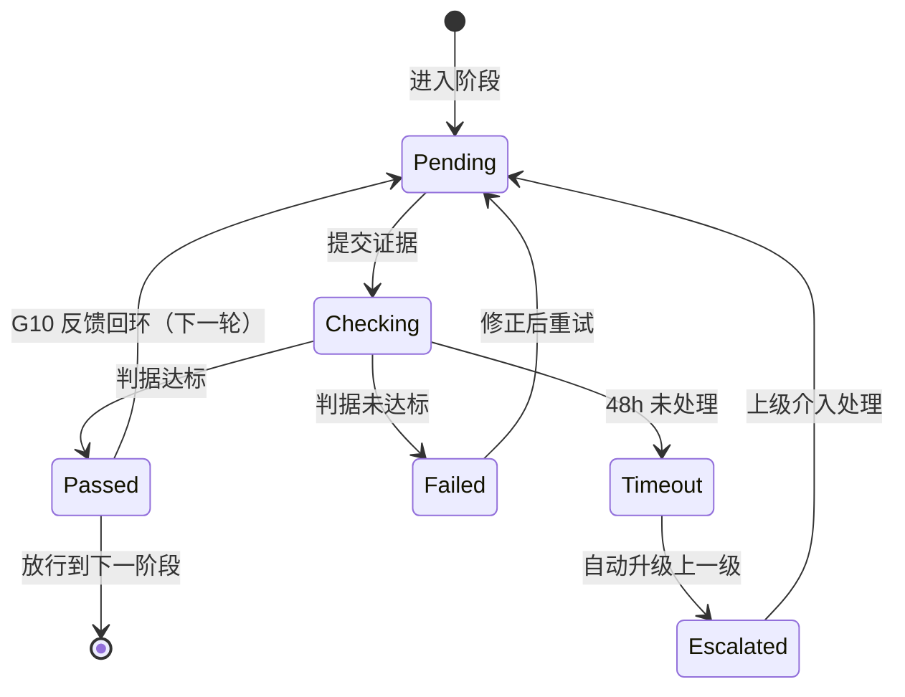

# 图 5 · 质量门禁流水线

> 回答：Gate 0-10 如何卡点？哪些是机器强制（Agent 绕不过去）？哪些靠人工审批？

[图集导航](./README.md) · [English](./05-gate-pipeline.en.md) · [质量门禁正文](../docs/02-unified-framework/quality-gates.md)

---

## 5.1 门禁流水线图（含强制方式标注）

<!-- IMG-EMBED -->
**图 1 · flowchart**

查看 Mermaid 源码（可编辑）

**强制方式图例：**
- 🔵 **人工审批**（manual）：需要人判断和签字（G0/G1/G2/G4/G7/G10）。
- 🟡 **清单/校验**（check）：清单检查 + ID 校验（G3/G5）。
- 🔴 **机器强制**（machine）：git hook / CI 强制执行，Agent 绕不过去（G6/G8/G9）——借鉴 Agentic OS 的核心思想。

---

## 5.2 机器强制门禁内部流程（以 Gate 8 为例）

<!-- IMG-EMBED -->
**图 2 · flowchart**

查看 Mermaid 源码（可编辑）

> **核心警示（来自 Agentic OS）**：rules 文件只是 Agent 可以忽略的提示；真正生效的门禁必须是机器强制的——凭证扫描、覆盖率、测试指纹、阶段证据都要接进 git hook 与 CI。

---

## 5.3 门禁状态机

<!-- IMG-EMBED -->
**图 3 · stateDiagram-v2**

查看 Mermaid 源码（可编辑）

> 状态机体现了自有体系的"异常处理机制"：**超时 48 小时自动升级**，失败回退修正，通过后放行或进入下一轮闭环。
