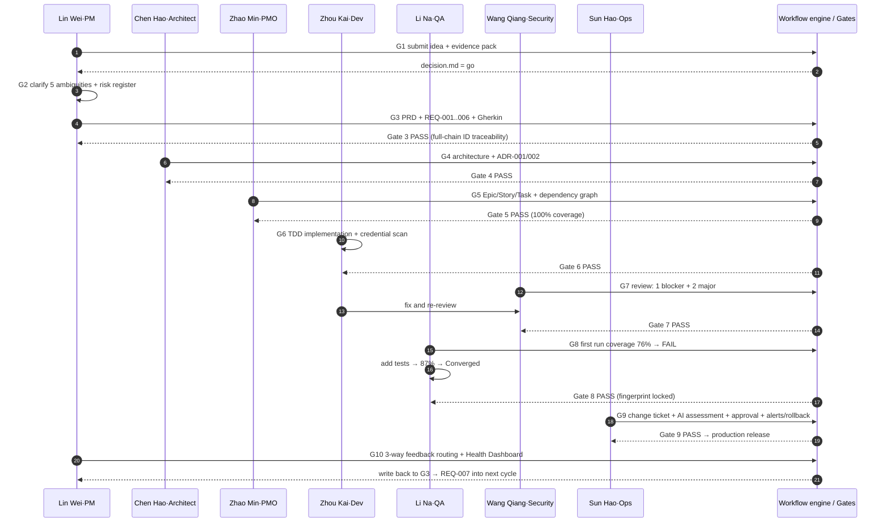
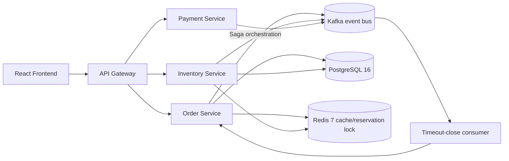
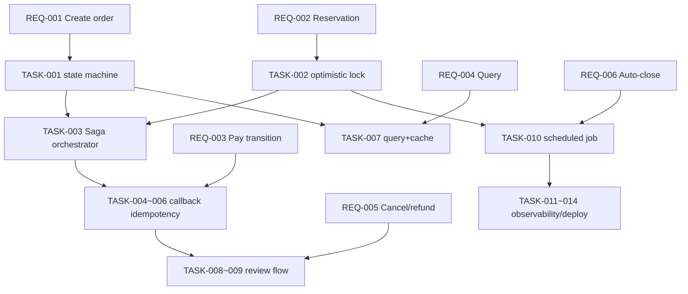

# Case 1 · E-commerce Order System OrderHub: From Idea to Production and Back Around the Loop

> This case runs the full [10-stage unified workflow](../docs/02-unified-framework/unified-workflow.en.md) from G0→G10 and back to G3, exercising all 8 roles, 11 Gates, ID traceability, ADRs, Converged, the change process and the Health Dashboard.
> All data (IDs, dates, names, command output, coverage) is synthetic for teaching, but the formats and criteria strictly follow this repository's methodology.

[Case index](./README.en.md) · [简体中文](./case-01-ecommerce.md) · [Unified Workflow](../docs/02-unified-framework/unified-workflow.en.md) · [Quality Gates](../docs/02-unified-framework/quality-gates.en.md)

---

## Background

| Item | Value |
|---|---|
| Project codename | OrderHub |
| One-liner | Build a unified order management center for a mid-size cross-border retailer, replacing three siloed inventory/order/payment scripts |
| Pain points | Oversell rate 2.3%; order-state-inconsistency complaints = 31% of support volume; 4 h/day of manual reconciliation during peak sales |
| Roles | Lin Wei (PM), Chen Hao (Architect), Zhao Min (PMO), Zhou Kai (Developer), Li Na (QA), Wang Qiang (Security), Sun Hao (Ops), Liu Yang (Data) |
| Tech stack | Java 17 · Spring Boot 3.2 · PostgreSQL 16 · Redis 7 · Kafka 3.6 · React 18 + TypeScript 5 |
| Time span | 2026-09-02 (G0) → 2026-11-14 go-live → 2026-11-20 (G10 feedback) |
| Release | `v1.0.0-orderhub-release-2026-11-14` |
| Gate outcome | Gate 0–10 all passed (Gate 8 failed first, then reworked) |

---

## End-to-End Overview (Mermaid sequence diagram)



---

## G0 · Governance Baseline (2026-09-02)

> PMO Zhao Min convenes the team to ratify the "constitution" once, referenced throughout all later stages.

### Project constitution (key points)

```
# OrderHub Constitution v1.0  (ratified 2026-09-02)
1. Quality: every public API must have contract tests; unit line coverage >=80%.
2. Security: all auth/payment code requires security review; no credentials in VCS (pre-commit scan).
3. Maintainability: decouple domain logic from framework; <=300 lines/file; naming convention.
4. Testing: TDD mandatory for features (red-green-refactor); integration tests via Testcontainers.
5. Change: production release via online form + AI assessment + human approval; version v[major][feature]-[type]-[date].
6. Data: use BigDecimal for money (no float/double); audit log on every write.
```

### Gate config and role matrix (excerpt)

| Gate | Criteria | Enforcement | Owner |
|---|---|---|---|
| G3 | Each REQ has Gherkin AC + full-chain ID traceability | Checklist + ID validation script | Lin Wei |
| G6 | Build passes, unit tests pass, no credential leakage | `scan_credentials.py` + `mvn test` | Zhou Kai / Wang Qiang |
| G8 | Coverage ≥80%, tests really run, Converged | CI + `record_test_run.py` fingerprint | Li Na |
| G9 | Change approval + alerts + rollback ready | `validate.sh` + human approval | Sun Hao / Zhao Min |

**Tech stack rationale**: Java 17 + Spring Boot 3.2 (existing team skill); React 18 + TS frontend; PostgreSQL 16 (transactions); Redis 7 (cache); Kafka 3.6 (event-driven). Single source of truth: `docs/orderhub/ssot/`.

> **Gate 0: PASS** — constitution ratified, 8 roles assigned, G3/G6/G8/G9 machine-verifiable via scripts + CI. Evidence: `g0/constitution-v1.0.md`, `g0/gate-config.yaml`.

---

## G1 · Idea Assessment (2026-09-04)

PM Lin Wei runs `/assess-intake → research → define → shape → decide` to gather evidence and decide.

### Assessment report (excerpt)

| Dimension | Evidence | Score |
|---|---|---|
| Value | Peak sales expected to recover ¥1.8M/year in oversell losses; support tickets target -40% | High |
| Feasibility | All 3 legacy systems have APIs for gradual migration; team has Java skills | Med-High |
| Risk | Inventory consistency is hard; only 10 weeks until peak window | Medium |
| Shape | Start monolith + modular, split by domain (order/inventory/payment) | Fit |

### `decision.md`

```
Decision ID: DEC-2026-0904-01
Decision: go
Rationale:
  - Sufficient evidence: logs from 3 legacy systems localize oversell to inventory-payment races (research/incident-2026-08.pdf).
  - Clear value: ROI payback estimated 14 months, above team's 12-month threshold.
  - Incremental: can gray-replace in order query → place → pay → cancel sequence.
Conditions: G4 must settle distributed transaction via ADR; v1 excludes multi-currency.
Owner: Lin Wei (PM)   Approver: Zhao Min (PMO)   Date: 2026-09-04
```

> **Gate 1: PASS** — decision `go`, sufficient evidence, with 3 preconditions attached.

---

## G2 · Clarify & Inception (2026-09-08)

### Key ambiguity Q&A

| # | Ambiguity | Resolution | Source |
|---|---|---|---|
| Q1 | Does "order created" mean payment succeeded or order placed? | Means "order placed"; payment is a separate state transition | Business owner Wang, 2026-09-06 meeting |
| Q2 | When is inventory deducted? | Reserved on order placement (30 min), confirmed on payment | Domain expert Chen Hao |
| Q3 | Does cancellation auto-refund? | Unpaid orders auto-close; paid orders need manual refund review | Legal/compliance |
| Q4 | Migrate historical orders? | Migrate last 12 months read-only; archive older | Data engineer Liu Yang |
| Q5 | Peak QPS target? | 5000 QPS at peak, place-order P99 < 500 ms | SRE Sun Hao |

### Risk register (excerpt)

| Risk ID | Description | Level | Mitigation |
|---|---|---|---|
| R-01 | Inventory oversell (concurrent deduction) | High | Reservation + optimistic version lock (see ADR-001) |
| R-02 | Payment status message loss | High | Kafka transactions + idempotent consumer |
| R-03 | Dual-write inconsistency with legacy | Medium | During gray release legacy is source of truth; shadow validation |

> **Gate 2: PASS** — all 5 key ambiguities resolved; context doc and risk register suffice for G3 specification.

---

## G3 · Specify & Requirements (2026-09-15)

### PRD excerpt

> Goal: reliable place/pay/query/cancel experience for buyers, near-real-time order view for operations; v1 focuses on single currency, single warehouse.
> Non-goals: multi-currency settlement, cross-border customs, merchant split-settlement (deferred to v2).

### Requirement IDs and traceability anchors

| Req ID | Title | Priority | Acceptance criteria |
|---|---|---|---|
| REQ-001 | Create order | P0 | AC-1.1 ~ 1.3 |
| REQ-002 | Inventory reservation & deduction | P0 | AC-2.1 ~ 2.2 |
| REQ-003 | Payment state transition | P0 | AC-3.1 ~ 3.2 |
| REQ-004 | Query order | P1 | AC-4.1 ~ 4.2 |
| REQ-005 | Cancel & refund | P1 | AC-5.1 ~ 5.2 |
| REQ-006 | Auto-close on timeout | P1 | AC-6.1 |

### User stories and Gherkin acceptance criteria (3 of 6)

```gherkin
# US-01 / REQ-001 Create order
Feature: Create order
  Scenario: Reserve stock and place order successfully when inventory is sufficient
    Given user U-1001 is logged in with cart containing SKU-A x 2
    And SKU-A available stock is 10
    When the user submits the order
    Then an order number in format ORD-{yyyyMMdd}-{6-digit-seq} is generated
    And order state = "CREATED"
    And SKU-A reservation increases by 2, available stock drops to 8
    And if unpaid after 30 minutes, REQ-006 auto-close is triggered

# US-03 / REQ-003 Payment state transition
Feature: Payment state transition
  Scenario: Idempotent payment-success callback
    Given order ORD-20261114-000123 is in state "CREATED"
    When the 3rd duplicate payment-success callback arrives (same payment_id)
    Then order state transitions only once to "PAID"
    And inventory reservation is confirmed as deduction
    And no duplicate shipment event is emitted

# US-06 / REQ-006 Auto-close on timeout
Feature: Auto-close on timeout
  Scenario: Auto-close after 30 minutes unpaid and release stock
    Given order ORD-20261114-000123 is "CREATED" and 31 minutes old
    When the scheduled job scans the order
    Then state becomes "CLOSED"
    And reserved stock is released, available stock rises by 2
```

> **Gate 3: PASS** — all 6 requirements have Gherkin AC; ID traceability map `ssot/id-map.csv` established with complete REQ→TASK→CODE→TEST→REL arrows (see traceability diagram below).

---

## G4 · Plan & Architecture (2026-09-24)

### Architecture design

- Layers: `API Gateway → Order / Inventory / Payment Service → PostgreSQL + Redis + Kafka`.
- Event-driven: place, pay, close decoupled via Kafka domain events; consumers guarantee idempotency.
- Consistency: order-inventory-payment use Saga orchestration (compensating transactions) instead of distributed transactions.

### Architecture diagram (Mermaid)



### ADR-001 · Distributed transaction approach

```
Status: Accepted | Date: 2026-09-18 | Deciders: Chen Hao, Zhou Kai, Liu Yang
Context:
  Order creation must touch order DB and inventory DB (R-01 oversell risk); no local transaction across services.
  Options: two-phase commit (2PC) / Saga / TCC.
Decision:
  Adopt Saga orchestration with Order Service as orchestrator;
  failed inventory reservation emits a compensation event to roll back the order; every step carries an idempotency key.
Consequences:
  + No cross-DB locks, high throughput, fits 5000 QPS.
  + Failures are compensable, clear state machine.
  - Eventual consistency; brief "CREATED but stock not yet deducted" window accepted.
  - Compensation adds complexity; requires monitoring (Saga failure alerts).
```

### ADR-002 · Primary store and cache selection

```
Status: Accepted | Date: 2026-09-20 | Deciders: Chen Hao, Liu Yang
Context: Orders need strong transactions and complex queries; inventory deduction needs high concurrency; hot orders are read-heavy.
Decision: PostgreSQL 16 as primary store (transactions/ACID); Redis 7 for reservation locks and hot-cache.
Consequences: + Reliable transactions; + better read performance; - cache consistency handled via Cache-Aside + short TTL (5s).
```

### Technology selection comparison

| Dimension | Saga (chosen) | 2PC | TCC |
|---|---|---|---|
| Performance | High (no global lock) | Low (blocking) | Medium |
| Complexity | Medium | Low | High (Try/Confirm/Cancel) |
| Consistency | Eventual | Strong | Eventual |
| Fit here | ✅ | ❌ unacceptable at peak | ❌ too costly |

> **Gate 4: PASS** — architecture aligns with PRD; ADR-001/002 complete (context-decision-consequences); security review passed (Saga idempotency keys, cache TTL justified).

---

## G5 · Task Breakdown (2026-09-29)

### Epic → Story → Task breakdown (excerpt)

| Epic | Story | Task ID | Task | Req binding | Depends on |
|---|---|---|---|---|---|
| E1 Order domain | S1.1 Place order | TASK-001 | Order aggregate/state-machine skeleton | REQ-001 | — |
| E1 | S1.2 Reservation | TASK-002 | Reservation API + optimistic lock | REQ-002 | TASK-001 |
| E1 | S1.3 Saga | TASK-003 | Saga orchestrator + compensation | REQ-001/002 | TASK-002 |
| E2 Payment domain | S2.1 Callback | TASK-004~006 | Pay callback + idempotency + event | REQ-003 | TASK-003 |
| E3 Query domain | S3.1 Query | TASK-007 | Order query API + cache | REQ-004 | TASK-001 |
| E4 Lifecycle | S4.1 Cancel | TASK-008~009 | Cancel/refund review flow | REQ-005 | TASK-004 |
| E4 | S4.2 Timeout | TASK-010 | Scheduled close + stock release | REQ-006 | TASK-002 |
| E5 Ops | S5.1 Observability | TASK-011~014 | Logs/metrics/alerts/deploy | All | TASK-010 |

### Requirement → task mapping and dependencies (Mermaid)



> **Gate 5: PASS** — 14 tasks cover all acceptance criteria of 6 requirements (100% coverage), dependencies clear and acyclic, IDs traceable.

---

## G6 · Build & Implement (2026-10-08 → 2026-11-04)

### Code directory structure (excerpt)

```
orderhub/
├── order-service/
│   └── src/main/java/com/yunze/orderhub/order/
│       ├── domain/    Order.java, OrderState.java, OrderItem.java
│       ├── service/   OrderService.java, OrderSagaOrchestrator.java
│       ├── infra/     OrderRepository.java, InventoryClient.java
│       └── api/       OrderController.java
│   └── src/test/java/.../OrderServiceTest.java
├── inventory-service/ ...
├── payment-service/ ...
├── deploy/ ci.yml, alerts.yaml, rollback.sh
└── docs/ssot/id-map.csv
```

### Representative code: `OrderService.pay()` (binds REQ-003 / TASK-006)

```java
@Service
@RequiredArgsConstructor
public class OrderService {
    private final OrderRepository repo;
    private final InventoryClient inventory;
    private final ApplicationEventPublisher events;

    /** REQ-003: payment-success transition; idempotency guaranteed by paymentId unique index */
    @Transactional
    public void markPaid(String orderNo, String paymentId) {
        Order order = repo.findByOrderNoForUpdate(orderNo)
                .orElseThrow(() -> new OrderNotFoundException(orderNo));
        if (order.getState() != CREATED) {
            log.info("idempotent skip, order={} state={}", orderNo, order.getState());
            return; // duplicate callback: already transitioned, no-op
        }
        order.setState(PAID);
        repo.save(order);
        inventory.confirmDeduction(order.getItems(), paymentId); // idempotency key = paymentId
        events.publishEvent(new OrderPaidEvent(orderNo, paymentId));
    }
}
```

### TDD example (red-green-refactor)

```
# RED:   UT-Order-014 asserts duplicate callback emits no duplicate shipment → fails (expected 1 event, got 3)
$ mvn -q -Dtest=OrderServiceTest#payShouldBeIdempotent test
[ERROR] Tests run: 1, Failures: 1  → RED ✅
# GREEN: add paymentId idempotency check + DB unique index → passes
$ mvn -q -Dtest=OrderServiceTest#payShouldBeIdempotent test
Tests run: 1, Failures: 0, Errors: 0  → GREEN ✅
# REFACTOR: extract IdempotencyGuard, stay green
```

### Credential scan result (Gate 6, machine-enforced)

```
$ python3 scan_credentials.py --root orderhub/
[SCAN] files=412  patterns=18  secrets_found=0
[PASS] No credential leakage. Gate 6 credential check PASSED.
$ mvn -q test  → BUILD SUCCESS (unit tests 96/96)
```

> **Gate 6: PASS** — 14 tasks done, build passes, unit tests 96/96, `scan_credentials.py` 0 leaks, no out-of-scope refactors.

---

## G7 · Code Review (2026-11-05)

Chaired by security engineer Wang Qiang, multi-role review with evidence retained.

### Findings

| ID | Severity | File:line | Issue | Fix status |
|---|---|---|---|---|
| F-01 | **Blocker** | `OrderService.java:38` | Inventory reservation doesn't catch `InventoryClient` timeout; order may hang | ✅ Fixed (compensation + retry) |
| F-02 | Major | `OrderSagaOrchestrator.java:71` | Compensation event lacks idempotency key; repeated consumption may double-rollback | ✅ Fixed (added idempotencyKey) |
| F-03 | Major | `OrderController.java:52` | Query API lacks authorization; users can see others' orders | ✅ Fixed (customerId ownership check) |
| F-04 | Minor | `README.md` | Missing local startup steps | ✅ Fixed |

### Traceable review evidence

```
review-evidence/
├── F-01 → fix commit 7ac91e2 → retest UT-Order-021 PASS → sign-off Wang Qiang 2026-11-06
├── F-02 → fix commit 8bd02f3 → idempotency test UT-Saga-009 PASS
└── F-03 → fix commit 9ce13a4 → security test ST-Auth-005 PASS
Source-bound: each finding bound to REQ/TASK and commit hash.
```

> **Gate 7: PASS** — 1 blocker + 2 major all fixed and re-reviewed; review is evidence-backed and source-bound; no blocking issues.

---

## G8 · Test & Verify (2026-11-07 → 2026-11-11)

### Test report and coverage (first run failed → rework)

| Test type | Cases | Passed | Coverage dimension | First | Final |
|---|---:|---:|---|---:|---:|
| Unit | 96 | 96 | Line | 76% ❌ | **87%** ✅ |
| Integration | 34 | 34 | Branch | 69% | 81% |
| E2E | 18 | 18 | Method | 82% | 91% |
| Total | 148 | 148 | — | — | — |

- **First Gate 8 FAIL**: line coverage 76% < 80% threshold. Root cause: Saga compensation branch (TASK-003) only tested the happy path.
- **Rework**: added 22 compensation/retry/idempotency cases → coverage rose to 87%.

### Convergence report and test fingerprint

```
$ python3 record_test_run.py --suite all --gate 8
[TEST RUN] exit_code=0  tests=148  failures=0
[COVERAGE] line=87%  branch=81%  method=91%  (threshold line>=80 PASS)
[CONVERGE] status=Converged  spec_hash=9f3a...  impl_hash=9f3a...
[CODE FINGERPRINT] sha256=4d1e9b... (locked at 2026-11-11 22:41)
[PASS] Gate 8 PASSED — tests really ran, Converged, code unchanged after test.
```

> **Gate 8: PASS** — coverage 87%≥80%, tests really run, `converge` report `Converged`, code fingerprint locked.

---

## G9 · Ship & Deploy (2026-11-13 → 2026-11-14)

### Change request (online form + AI assessment)

| Field | Value |
|---|---|
| Change ID | CR-2026-1113-007 |
| Release | `v1.0.0-orderhub-release-2026-11-14` |
| Window | 2026-11-14 02:00–04:00 (off-peak) |
| Impact | 3 services (order/inventory/payment) + 2 DB migrations |
| Rollback point | snapshot snap-20261114-0155 + previous image |

**AI assessment result**:

```
[AI-ASSESS] CR-2026-1113-007
  risk_level: MEDIUM
  checks: gate8_evidence=valid, fingerprint=matched, approvals=pending, rollback=ready
  recommendation: APPROVE_WITH_CONDITIONS
  conditions: canary 10%→50%→100%, observe P99/error rate 15 min per stage
```

### Approval record

| Approver | Role | Decision | Time |
|---|---|---|---|
| Zhao Min | Project Manager | Approved | 2026-11-13 15:20 |
| Chen Hao | Architect | Approved (with canary conditions) | 2026-11-13 16:05 |
| Sun Hao | Operations | Approved (rollback rehearsed) | 2026-11-13 17:40 |

### CI/CD config and alert rules (excerpt)

```yaml
# deploy/ci.yml
stages: [build, scan, test, converge, gate, deploy]
gate_job:
  script:
    - python3 scan_credentials.py --root .      # Gate 6
    - python3 record_test_run.py --suite all    # Gate 8
    - test "$(cat converge.txt)" = "Converged"
    - bash validate.sh                          # Gate 9
deploy:
  strategy: canary   # 10% → 50% → 100%
  health_gate: p99 < 500ms && error_rate < 0.5%
```

```yaml
# deploy/alerts.yaml
alerts:
  - name: OrderP99High      expr: order_p99_ms > 500    for: 5m  severity: P1
  - name: OrderErrorBurst   expr: order_error_rate > 0.01 for: 2m  severity: P0
  - name: SagaFailure       expr: saga_compensate_total > 5/5m severity: P1
  - name: OversellSuspected expr: inventory_negative_total > 0  severity: P0
```

### Rollback plan

1. Triggers: P0 alert or error rate > 1% for 2 minutes.
2. Steps: K8s switch back to previous image → stop Saga consumers → DB rollback to snapshot snap-20261114-0155 → verify order count consistency.
3. Rehearsal: one rollback drill completed 2026-11-13 (6 min 12 s).

> **Gate 9: PASS** — change AI-assessed + 3 approvals, `validate.sh` passed, alerts and rollback ready; canary release succeeded, full rollout at 02:47.

---

## G10 · Learn & Iterate (2026-11-15 → 2026-11-20)

### Three-way automatic feedback classification

| Category | Count | Example feedback | Route |
|---|---:|---|---|
| Feature | 12 | "Want bulk order export" | backlog → REQ-007 |
| Bug | 3 | "Stock not released after canceling a paid order" | defect BUG-2026-1118-002 → next sprint |
| UX | 8 | "Order list filtering too slow" | UX optimization → REQ-008 candidate |

### Health Dashboard (first week live)

| Metric | Value | Trend | Threshold |
|---|---:|---|---|
| Gate pass rate | 100% (11/11) | → | ≥95% |
| Avg gate handling time | 6.4 h | ↓ | < 12 h |
| 48h escalations | 0 | → | 0 |
| Test coverage trend | 87% | ↑ | ≥80% |
| Defect escape rate | 2.0% (3/148) | ↓ | < 5% |
| Feedback closure rate | 92% (21/23 classified into backlog) | ↑ | ≥90% |
| Knowledge-base update frequency | 3/week | → | ≥2/week |

### Knowledge-base updates

- New entries: `Saga compensation idempotency pattern`, `Redis reservation lock best practices`, `Cache-Aside consistency handling`.
- Updated: `Order state machine v2` (added CLOSED/REFUNDING states) — driven by user feedback.

### Driving the next spec revision (loop back to G3)

```
G10 feedback → REQ-007 "Bulk order export"
  - Source: 12 feature-class requests (high-frequency ops need)
  - Action: write back to G3 → author US-07 Gherkin → enter G4 architecture impact assessment
  - Conclusion: core Saga untouched; add read model only → light G3→G5→G6 path
  - Status: included in v1.1.0 sprint plan on 2026-11-20
```

> **Gate 10: PASS** — all 23 feedback items classified into 3 categories and backlog, knowledge base updated 3 times, UX issues tracked; REQ-007 written back to G3, loop closed.

---

## Retrospective

| Key practice | How this case shows it |
|---|---|
| Machine-enforced gates | G6 credential scan, G8 coverage/fingerprint, G9 `validate.sh` all intercepted by CI |
| Full-chain ID traceability | REQ-003 → TASK-006 → `OrderService.pay()` → UT-Order-014 → release version |
| Reasoned rework | Gate 8 first run 76% failed, exposing a Saga compensation test blind spot; 87% after adding tests |
| Scale-adaptive second half | G10-feedback-driven REQ-007 judged a light change, taking G3→G5→G6 instead of the full path |
| A genuinely closed loop | G10 writes back to G3 via REQ-007, rather than stopping at "shipped = done" |

> **Bottom line**: OrderHub's value isn't just "shipped successfully" — every Gate has evidence, every ID is traceable, and every feedback item can return to the spec. That is the meaning of a "full-process closed loop".
