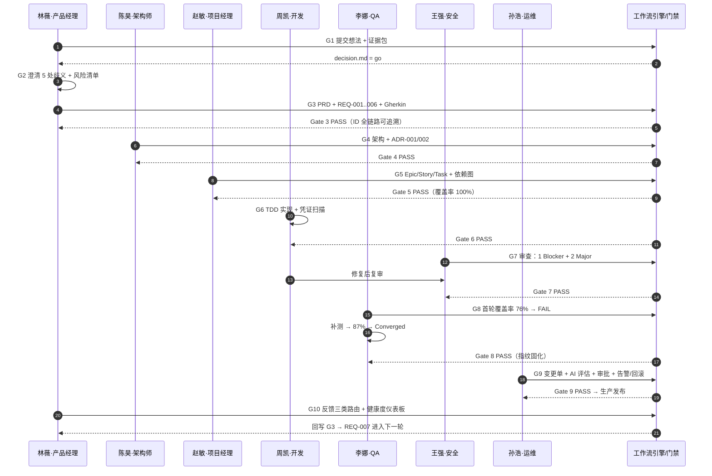
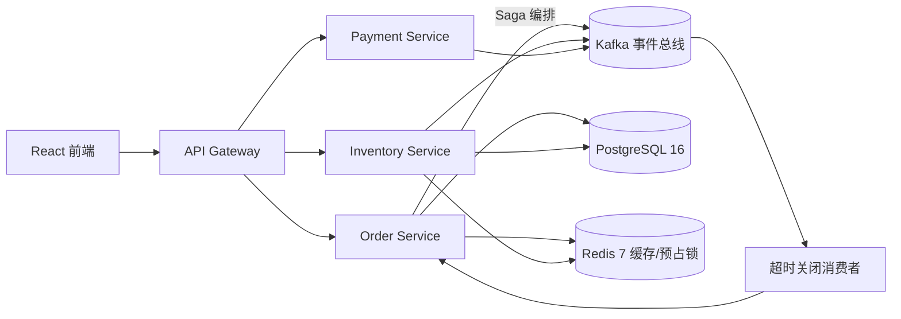
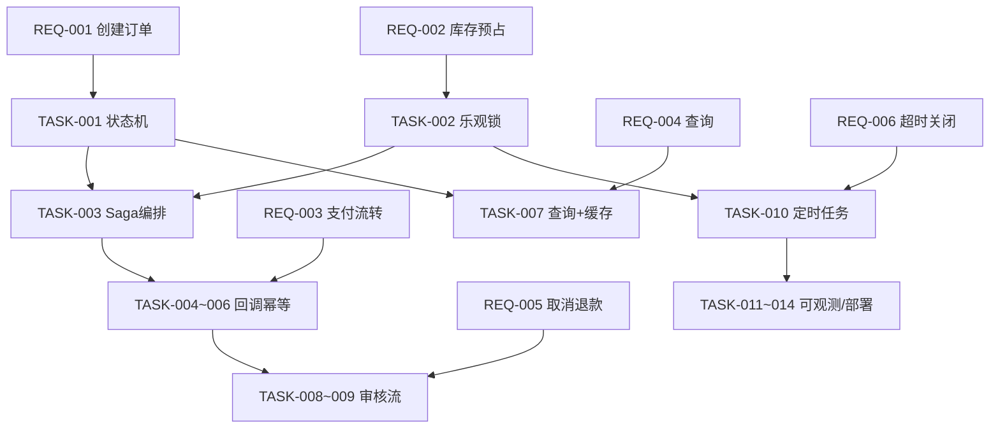

# 案例一 · 电商订单管理系统 OrderHub：从想法到上线再到反馈闭环

> 本案例完整贯穿[统一 10 阶段工作流](../docs/02-unified-framework/unified-workflow.md) G0→G10 并回到 G3，覆盖 8 大角色、11 个 Gate、ID 溯源、ADR、Converged、变更流程与健康度仪表板。
> 所有数据（ID、日期、人名、命令输出、覆盖率）均为教学构造，但格式与判据严格对齐仓库方法论。

[案例集首页](./README.md) · [English](./case-01-ecommerce.en.md) · [统一工作流](../docs/02-unified-framework/unified-workflow.md) · [质量门禁](../docs/02-unified-framework/quality-gates.md)

---

## 案例背景

| 项目 | 值 |
|---|---|
| 项目代号 | OrderHub |
| 一句话 | 为中型跨境电商搭建统一的订单管理中心，替换 3 套各自为政的库存/订单/支付脚本 |
| 业务痛点 | 超卖率 2.3%、订单状态不一致投诉占客服量 31%、大促期间人工对账 4 小时/天 |
| 参与角色 | 林薇（产品经理）、陈昊（架构师）、赵敏（项目经理）、周凯（开发）、李娜（QA）、王强（安全）、孙浩（运维）、刘洋（数据） |
| 技术栈 | Java 17 · Spring Boot 3.2 · PostgreSQL 16 · Redis 7 · Kafka 3.6 · React 18 + TypeScript 5 |
| 时间跨度 | 2026-09-02（G0）→ 2026-11-14 上线 → 2026-11-20（G10 反馈） |
| 版本 | `v1.0.0-orderhub-release-2026-11-14` |
| 门禁结果 | Gate 0–10 全部通过（Gate 8 首轮失败后返工） |

---

## 端到端全景（Mermaid 时序图）



---

## G0 · 治理基线（2026-09-02）

> 项目经理赵敏召集全员建立"宪法"，一次性固化，后续全程引用。

### 项目宪法（constitution）要点

```
# OrderHub Constitution v1.0  (ratified 2026-09-02)
1. 质量：所有对外 API 必须有契约测试；单元测试覆盖率门槛 ≥80%（行覆盖）。
2. 安全：任何鉴权/支付代码须经安全工程师审查；凭证禁止入代码库（pre-commit 扫描）。
3. 可维护性：领域逻辑与框架解耦；单文件 ≤ 300 行；命名遵循 ` nouns-verb ` 约定。
4. 测试：功能开发强制 TDD（红-绿-重构）；Integration 测试用 Testcontainers。
5. 变更：生产发布须经在线表单 + AI 评估 + 人工审批；版本号 v[主][功能]-[类型]-[日期]。
6. 数据：订单金额用 BigDecimal，禁用 float/double；所有写操作记录审计日志。
```

### 门禁配置与角色矩阵（节选）

| Gate | 判据 | 强制方式 | 负责人 |
|---|---|---|---|
| G3 | 每条 REQ 有 Gherkin 验收 + ID 全链路 | 清单 + ID 校验脚本 | 林薇 |
| G6 | 编译通过、单测通过、无凭证泄露 | `scan_credentials.py` + `mvn test` | 周凯 / 王强 |
| G8 | 覆盖率 ≥80%、测试真实运行、Converged | CI + `record_test_run.py` 指纹 | 李娜 |
| G9 | 变更审批 + 告警 + 回滚就绪 | `validate.sh` + 人工审批 | 孙浩 / 赵敏 |

**技术栈决策**：后端 Java 17 + Spring Boot 3.2（团队既有技能栈）；前端 React 18 + TS；存储 PostgreSQL 16（事务）；缓存 Redis 7；消息 Kafka 3.6（事件驱动）。单一事实源目录：`docs/orderhub/ssot/`。

> **Gate 0 结论：PASS** — 宪法 ratified、8 角色到位、G3/G6/G8/G9 可由脚本 + CI 机器校验。证据：`g0/constitution-v1.0.md`、`g0/gate-config.yaml`。

---

## G1 · 想法评估（2026-09-04）

产品经理林薇用 `/assess-intake → research → define → shape → decide` 收集证据并决策。

### 评估报告（节选）

| 维度 | 证据 | 评分 |
|---|---|---|
| 价值 | 大促预计挽回超卖损失 ¥1.8M/年；客服工单下降目标 40% | 高 |
| 可行性 | 3 套旧系统均有 API，可渐进迁移；团队具备 Java 栈能力 | 中高 |
| 风险 | 库存一致性是硬骨头；大促窗口仅剩 10 周 | 中 |
| 形态 | 单体起步 + 模块化，按域拆分（订单/库存/支付） | 适配 |

### `decision.md`

```
Decision ID: DEC-2026-0904-01
Decision: go
Rationale:
  - 证据充分：3 套旧系统日志显示超卖集中在库存-支付竞态（见 research/incident-2026-08.pdf）。
  - 价值明确：ROI 预估 14 个月回本，高于团队 12 个月阈值。
  - 可渐进：可按订单查询 → 下单 → 支付 → 取消 顺序灰度替换。
Conditions: 必须在 G4 用 ADR 明确分布式事务方案；首版不含跨境多币种。
Owner: 林薇 (PM)   Approver: 赵敏 (PMO)   Date: 2026-09-04
```

> **Gate 1 结论：PASS** — 结论 `go`，证据充分，附 3 项前置条件。

---

## G2 · 澄清与启动（2026-09-08）

### 关键歧义澄清 Q&A

| # | 歧义 | 澄清结论 | 来源 |
|---|---|---|---|
| Q1 | "订单创建成功"是指支付成功还是下单成功？ | 指"下单成功"，支付为独立状态流转 | 业务方王经理 2026-09-06 会议 |
| Q2 | 库存扣减在下单还是支付时？ | 下单时预占（30 分钟），支付后实扣 | 领域专家陈昊 |
| Q3 | 订单取消是否自动退款？ | 仅未支付订单自动关闭；已支付需人工审核退款 | 法务合规要求 |
| Q4 | 历史订单要迁移吗？ | 迁移近 12 个月只读订单，更早归档 | 数据工程师刘洋 |
| Q5 | 峰值 QPS 目标？ | 大促 5000 QPS，下单 P99 < 500ms | SRE 孙浩 |

### 风险清单（节选）

| 风险 ID | 描述 | 等级 | 缓解 |
|---|---|---|---|
| R-01 | 库存超卖（并发扣减） | 高 | 预占 + 版本号乐观锁（见 ADR-001） |
| R-02 | 支付状态消息丢失 | 高 | Kafka 事务 + 幂等消费者 |
| R-03 | 旧系统双写不一致 | 中 | 灰度期以旧系统为准，新系统影子校验 |

> **Gate 2 结论：PASS** — 5 处关键歧义全部消解，上下文文档与风险清单可支撑 G3 规格编写。

---

## G3 · 规格与需求（2026-09-15）

### PRD 节选

> 目标：为买家提供可靠的下单/支付/查询/取消体验，为运营提供准实时的订单视图；首版聚焦单币种、单仓。
> 非目标：多币种结算、跨境清关、商家分账（列入 v2）。

### 需求 ID 列表与溯源起点

| 需求 ID | 标题 | 优先级 | 验收标准 |
|---|---|---|---|
| REQ-001 | 创建订单 | P0 | AC-1.1 ~ 1.3 |
| REQ-002 | 库存预占与扣减 | P0 | AC-2.1 ~ 2.2 |
| REQ-003 | 支付状态流转 | P0 | AC-3.1 ~ 3.2 |
| REQ-004 | 订单查询 | P1 | AC-4.1 ~ 4.2 |
| REQ-005 | 订单取消与退款 | P1 | AC-5.1 ~ 5.2 |
| REQ-006 | 超时自动关闭 | P1 | AC-6.1 |

### 用户故事与 Gherkin 验收标准（节选 3 条）

```gherkin
# US-01 / REQ-001 创建订单
Feature: 创建订单
  Scenario: 库存充足时成功下单并预占库存
    Given 用户 U-1001 已登录且购物车含 SKU-A × 2
    And SKU-A 可售库存为 10
    When 用户提交订单
    Then 生成订单号格式为 ORD-{yyyyMMdd}-{6位序列}
    And 订单状态 = "CREATED"
    And SKU-A 预占数量增加 2，可售库存降为 8
    And 30 分钟后未支付则触发 REQ-006 自动关闭

# US-03 / REQ-003 支付状态流转
Feature: 支付状态流转
  Scenario: 支付成功回调幂等
    Given 订单 ORD-20261114-000123 状态为 "CREATED"
    When 收到第 3 次重复的支付成功回调（同一 payment_id）
    Then 订单状态仅流转一次到 "PAID"
    And 库存预占转为实扣
    And 不重复发送发货事件

# US-06 / REQ-006 超时自动关闭
Feature: 超时自动关闭
  Scenario: 30 分钟未支付自动关闭并释放库存
    Given 订单 ORD-20261114-000123 状态为 "CREATED" 且已创建 31 分钟
    When 定时任务扫描到该订单
    Then 订单状态变为 "CLOSED"
    And 预占库存释放，可售库存回升 2
```

> **Gate 3 结论：PASS** — 6 条需求均有 Gherkin 验收；ID 溯源映射表 `ssot/id-map.csv` 已建立，REQ→TASK→CODE→TEST→REL 箭头完整（见下方溯源图）。

---

## G4 · 计划与架构（2026-09-24）

### 架构设计

- 分层：`API Gateway → Order Service / Inventory Service / Payment Service → PostgreSQL + Redis + Kafka`。
- 事件驱动：下单、支付、关闭通过 Kafka 领域事件解耦；消费者保证幂等。
- 一致性：订单-库存-支付采用 Saga 编排（补偿事务），避免跨服务分布式事务。

### 架构图（Mermaid）



### ADR-001 · 分布式事务方案

```
Status: Accepted | Date: 2026-09-18 | Deciders: 陈昊, 周凯, 刘洋
Context:
  订单创建需同时改订单库与库存库（R-01 超卖风险），跨服务无法用本地事务。
  备选：两阶段提交(2PC)/ Saga / TCC。
Decision:
  采用 Saga 编排（Orchestration），以 Order Service 为编排器；
  库存预占失败则发送补偿事件回滚订单；每步操作携带幂等键。
Consequences:
  + 无跨库锁，吞吐高，适配 5000 QPS。
  + 失败可补偿，状态机清晰。
  - 一致性为最终一致，需接受短暂"CREATED 但库存未扣"窗口。
  - 补偿逻辑增加复杂度，须有监控（Saga 失败告警）。
```

### ADR-002 · 主存储与缓存选型

```
Status: Accepted | Date: 2026-09-20 | Deciders: 陈昊, 刘洋
Context: 订单需强事务与复杂查询；库存扣减需高并发；热点订单读多写少。
Decision: PostgreSQL 16 作主存储（事务/ACID）；Redis 7 作预占锁与热点缓存。
Consequences: + 事务可靠；+ 读性能提升；- 引入缓存一致性问题，采用 Cache-Aside + 短 TTL(5s)。
```

### 技术选型对比表

| 维度 | Saga（选定） | 2PC | TCC |
|---|---|---|---|
| 性能 | 高（无全局锁） | 低（阻塞） | 中 |
| 复杂度 | 中 | 低 | 高（需 Try/Confirm/Cancel） |
| 一致性 | 最终一致 | 强一致 | 最终一致 |
| 适配本例 | ✅ | ❌ 大促不可接受 | ❌ 成本过高 |

> **Gate 4 结论：PASS** — 架构对齐 PRD；ADR-001/002 结构完整（背景-决策-后果）；安全评审通过（Saga 幂等键、缓存TTL 有据）。

---

## G5 · 任务拆解（2026-09-29）

### Epic → Story → Task 拆解表（节选）

| Epic | Story | Task ID | 任务 | 绑定需求 | 依赖 |
|---|---|---|---|---|---|
| E1 订单域 | S1.1 下单 | TASK-001 | 订单聚合/状态机骨架 | REQ-001 | — |
| E1 | S1.2 预占 | TASK-002 | 库存预占接口 + 乐观锁 | REQ-002 | TASK-001 |
| E1 | S1.3 Saga | TASK-003 | Saga 编排器 + 补偿 | REQ-001/002 | TASK-002 |
| E2 支付域 | S2.1 回调 | TASK-004~006 | 支付回调 + 幂等 + 事件 | REQ-003 | TASK-003 |
| E3 查询域 | S3.1 查询 | TASK-007 | 订单查询 API + 缓存 | REQ-004 | TASK-001 |
| E4 生命周期 | S4.1 取消 | TASK-008~009 | 取消/退款审核流 | REQ-005 | TASK-004 |
| E4 | S4.2 超时 | TASK-010 | 定时关闭 + 库存释放 | REQ-006 | TASK-002 |
| E5 运维 | S5.1 可观测 | TASK-011~014 | 日志/指标/告警/部署 | 全部 | TASK-010 |

### 需求 ID → 任务 ID 映射与依赖（Mermaid）



> **Gate 5 结论：PASS** — 14 个 Task 覆盖全部 6 条需求的所有验收标准（覆盖率 100%），依赖清晰无环，ID 可追溯。

---

## G6 · 构建实现（2026-10-08 → 2026-11-04）

### 代码目录结构（节选）

```
orderhub/
├── order-service/
│   └── src/main/java/com/yunze/orderhub/order/
│       ├── domain/    Order.java, OrderState.java, OrderItem.java
│       ├── service/   OrderService.java, OrderSagaOrchestrator.java
│       ├── infra/     OrderRepository.java, InventoryClient.java
│       └── api/       OrderController.java
│   └── src/test/java/.../OrderServiceTest.java
├── inventory-service/ ...
├── payment-service/ ...
├── deploy/ ci.yml, alerts.yaml, rollback.sh
└── docs/ssot/id-map.csv
```

### 代表性代码：`OrderService.pay()`（绑定 REQ-003 / TASK-006）

```java
@Service
@RequiredArgsConstructor
public class OrderService {
    private final OrderRepository repo;
    private final InventoryClient inventory;
    private final ApplicationEventPublisher events;

    /** REQ-003: 支付成功流转，幂等由 paymentId 唯一索引保证 */
    @Transactional
    public void markPaid(String orderNo, String paymentId) {
        Order order = repo.findByOrderNoForUpdate(orderNo)
                .orElseThrow(() -> new OrderNotFoundException(orderNo));
        if (order.getState() != CREATED) {
            log.info("idempotent skip, order={} state={}", orderNo, order.getState());
            return; // 重复回调：状态已流转，直接返回
        }
        order.setState(PAID);
        repo.save(order);
        inventory.confirmDeduction(order.getItems(), paymentId); // 幂等键=paymentId
        events.publishEvent(new OrderPaidEvent(orderNo, paymentId));
    }
}
```

### TDD 示例（红-绿-重构）

```
# RED:   UT-Order-014 断言重复回调不重复发货 → 运行失败 (expected 1 event, got 3)
$ mvn -q -Dtest=OrderServiceTest#payShouldBeIdempotent test
[ERROR] Tests run: 1, Failures: 1  → RED ✅
# GREEN: 引入 paymentId 幂等判断 + DB 唯一索引 → 通过
$ mvn -q -Dtest=OrderServiceTest#payShouldBeIdempotent test
Tests run: 1, Failures: 0, Errors: 0  → GREEN ✅
# REFACTOR: 提取 IdempotencyGuard，保持绿
```

### 凭证扫描结果（Gate 6，机器强制）

```
$ python3 scan_credentials.py --root orderhub/
[SCAN] files=412  patterns=18  secrets_found=0
[PASS] No credential leakage. Gate 6 credential check PASSED.
$ mvn -q test  → BUILD SUCCESS (unit tests 96/96)
```

> **Gate 6 结论：PASS** — 14 个 Task 完成、编译通过、单测 96/96 通过、`scan_credentials.py` 0 泄露、无越界重构。

---

## G7 · 代码审查（2026-11-05）

安全工程师王强主持，多角色审查并留痕。

### 审查问题清单

| ID | 严重级别 | 文件:行 | 问题 | 修复状态 |
|---|---|---|---|---|
| F-01 | **Blocker** | `OrderService.java:38` | 预占库存未捕获 `InventoryClient` 超时异常，可能导致订单挂起 | ✅ 已修复（加补偿 + 重试） |
| F-02 | Major | `OrderSagaOrchestrator.java:71` | 补偿事件未带幂等键，重复消费可能重复回滚 | ✅ 已修复（补 idempotencyKey） |
| F-03 | Major | `OrderController.java:52` | 查询接口未做权限校验，越权可见他人订单 | ✅ 已修复（加 customerId 归属校验） |
| F-04 | Minor | `README.md` | 缺少本地启动步骤 | ✅ 已修复 |

### 溯源审查证据

```
review-evidence/
├── F-01 → fix commit 7ac91e2 → 复测 UT-Order-021 PASS → 审查人 sign-off 王强 2026-11-06
├── F-02 → fix commit 8bd02f3 → 幂等测试 UT-Saga-009 PASS
└── F-03 → fix commit 9ce13a4 → 安全测试 ST-Auth-005 PASS
Source-bound: 每个 finding 绑定 REQ/TASK 与 commit hash。
```

> **Gate 7 结论：PASS** — 1 Blocker + 2 Major 全部修复并复审，审查有据可查、来源绑定，无阻塞问题。

---

## G8 · 测试验证（2026-11-07 → 2026-11-11）

### 测试报告与覆盖率（首轮失败 → 返工）

| 测试类型 | 用例数 | 通过 | 覆盖率维度 | 首轮 | 终轮 |
|---|---:|---:|---|---:|---:|
| 单元测试 | 96 | 96 | 行覆盖 Line | 76% ❌ | **87%** ✅ |
| 集成测试 | 34 | 34 | 分支 Branch | 69% | 81% |
| E2E 测试 | 18 | 18 | 方法 Method | 82% | 91% |
| 合计 | 148 | 148 | — | — | — |

- **首轮 Gate 8 FAIL**：行覆盖 76% < 80% 门槛。根因：Saga 补偿分支（TASK-003）仅测了 happy path。
- **返工**：补充补偿/重试/幂等用例 22 条 → 覆盖率升至 87%。

### 收敛报告与测试指纹

```
$ python3 record_test_run.py --suite all --gate 8
[TEST RUN] exit_code=0  tests=148  failures=0
[COVERAGE] line=87%  branch=81%  method=91%  (threshold line>=80 PASS)
[CONVERGE] status=Converged  spec_hash=9f3a...  impl_hash=9f3a...
[CODE FINGERPRINT] sha256=4d1e9b... (locked at 2026-11-11 22:41)
[PASS] Gate 8 PASSED — 测试真实运行、Converged、测试后代码未变更。
```

> **Gate 8 结论：PASS** — 覆盖率 87%≥80%、测试真实运行、`converge` 报告 `Converged`、代码指纹已固化。

---

## G9 · 发布交付（2026-11-13 → 2026-11-14）

### 变更请求（在线表单 + AI 评估）

| 字段 | 值 |
|---|---|
| 变更单号 | CR-2026-1113-007 |
| 版本 | `v1.0.0-orderhub-release-2026-11-14` |
| 窗口 | 2026-11-14 02:00–04:00（低峰） |
| 影响面 | 订单/库存/支付 3 服务 + DB 迁移 2 个 |
| 回滚点 | 快照 snap-20261114-0155 + 上一版本镜像 |

**AI 评估结果**：

```
[AI-ASSESS] CR-2026-1113-007
  risk_level: MEDIUM
  checks: gate8_evidence=valid, fingerprint=matched, approvals=pending, rollback=ready
  recommendation: APPROVE_WITH_CONDITIONS
  conditions: 灰度 10%→50%→100%，每档观察 15 分钟 P99/错误率
```

### 审批记录

| 审批人 | 角色 | 结论 | 时间 |
|---|---|---|---|
| 赵敏 | 项目经理 | 同意 | 2026-11-13 15:20 |
| 陈昊 | 架构师 | 同意（附灰度条件） | 2026-11-13 16:05 |
| 孙浩 | 运维 | 同意（回滚已演练） | 2026-11-13 17:40 |

### CI/CD 配置与告警规则（节选）

```yaml
# deploy/ci.yml
stages: [build, scan, test, converge, gate, deploy]
gate_job:
  script:
    - python3 scan_credentials.py --root .      # Gate 6
    - python3 record_test_run.py --suite all    # Gate 8
    - test "$(cat converge.txt)" = "Converged"
    - bash validate.sh                          # Gate 9
deploy:
  strategy: canary   # 10% → 50% → 100%
  health_gate: p99 < 500ms && error_rate < 0.5%
```

```yaml
# deploy/alerts.yaml
alerts:
  - name: OrderP99High      expr: order_p99_ms > 500    for: 5m  severity: P1
  - name: OrderErrorBurst   expr: order_error_rate > 0.01 for: 2m  severity: P0
  - name: SagaFailure       expr: saga_compensate_total > 5/5m severity: P1
  - name: OversellSuspected expr: inventory_negative_total > 0  severity: P0
```

### 回滚方案

1. 触发条件：P0 告警或错误率 > 1% 持续 2 分钟。
2. 步骤：K8s 切回上一版本镜像 → 停 Saga 消费者 → DB 快照 `snap-20261114-0155` 回滚 → 校验订单数一致。
3. 演练：2026-11-13 已完成一次回滚演练（耗时 6 分 12 秒）。

> **Gate 9 结论：PASS** — 变更经 AI 评估 + 3 人审批、`validate.sh` 通过、告警与回滚就绪；灰度发布成功，02:47 全量。

---

## G10 · 反馈迭代（2026-11-15 → 2026-11-20）

### 上线后反馈三类自动分类

| 类别 | 条数 | 典型反馈 | 路由 |
|---|---:|---|---|
| 功能需求（Feature） | 12 | "希望支持订单批量导出" | 进入 backlog → REQ-007 |
| 缺陷（Bug） | 3 | "取消已支付订单后库存未释放" | 缺陷单 BUG-2026-1118-002 → 下个迭代 |
| 体验（UX） | 8 | "订单列表筛选太慢" | 体验优化 → REQ-008 候选 |

### 健康度仪表板（上线首周）

| 指标 | 值 | 趋势 | 阈值 |
|---|---:|---|---|
| 门禁通过率 | 100%（11/11） | → | ≥95% |
| 平均门禁处理时长 | 6.4 小时 | ↓ | < 12 小时 |
| 48h 超时升级次数 | 0 | → | 0 |
| 测试覆盖率趋势 | 87% | ↑ | ≥80% |
| 缺陷逃逸率 | 2.0%（3/148） | ↓ | < 5% |
| 反馈闭环率 | 92%（21/23 已分类入待办） | ↑ | ≥90% |
| 知识库更新频率 | 3 次/周 | → | ≥2 次/周 |

### 知识库更新

- 新增词条：`Saga 补偿幂等模式`、`Redis 预占锁最佳实践`、`Cache-Aside 一致性处理`。
- 更新：`订单状态机 v2`（补充 CLOSED/REFUNDING 态）——用户反馈驱动。

### 驱动下一轮规格修订（闭环回到 G3）

```
G10 反馈 → REQ-007「订单批量导出」
  - 来源：12 条功能类反馈（运营高频诉求）
  - 动作：回写 G3 → 编写 US-07 Gherkin → 进入 G4 架构影响评估
  - 结论：不改动核心 Saga，仅新增导出读模型 → 走轻量 G3→G5→G6 路径
  - 状态：2026-11-20 已纳入 v1.1.0 迭代计划
```

> **Gate 10 结论：PASS** — 反馈 23 条全部三类分类入待办、知识库更新 3 次、体验问题已追踪；REQ-007 回写 G3，闭环成立。

---

## 案例复盘

| 关键实践 | 本案例体现 |
|---|---|
| 门禁机器强制 | G6 凭证扫描、G8 覆盖率/指纹、G9 `validate.sh` 均由 CI 拦截 |
| ID 全链路溯源 | REQ-003 → TASK-006 → `OrderService.pay()` → UT-Order-014 → 发布版本 |
| 带理由的返工 | Gate 8 首轮 76% 未过，暴露 Saga 补偿分支测试盲区，补测后 87% |
| 规模自适应的后半段 | G10 反馈驱动的 REQ-007 判定为轻量改动，走 G3→G5→G6 而非重走全程 |
| 闭环真正成立 | G10 通过 REQ-007 回写 G3，而非停在"上线即结束" |

> **一句话总结**：OrderHub 的价值不只是"上线成功"，而是每个 Gate 都有证据、每个 ID 都能溯源、每次反馈都能回到规格——这正是"全流程闭环"的意义。
