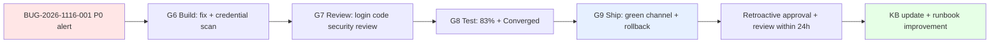

# Case 2 · Production Login Crash Hotfix: The Light Fast Lane

> This case demonstrates the [scale-adaptive principle](../docs/02-unified-framework/unified-workflow.en.md#scale-adaptive-borrowing-bmad--spec-kit-entry-points): a small change starts directly at **G6**, running G6→G7→G8→G9 without revisiting G0–G5. But **credential scanning, test evidence, and change approval are never skipped** — the green channel allows "fix first, approve later".

[Case index](./README.en.md) · [简体中文](./case-02-hotfix.md) · [Main case (full loop)](./case-01-ecommerce.en.md) · [Quality Gates](../docs/02-unified-framework/quality-gates.en.md)

---

## Why the light path

| Dimension | Conclusion |
|---|---|
| Change type | Urgent production bugfix (small change) |
| Suggested start | G6 (build) |
| Path | G6 → G7 → G8 → G9 (light gates, ~5k tokens) |
| Skipped stages | G0 governance (exists), G1 assessment (the incident is the evidence), G2 clarification (single root cause), G3/G4/G5 (no new requirement/architecture/breakdown) |
| Never skipped | G6 credential scan, G7 security review (login code!), G8 test evidence, G9 change approval + rollback |

> Guiding rule: **don't drag a typo fix through all 10 stages, and don't let a login crash skip security review.**

---

## Incident overview

| Item | Value |
|---|---|
| Defect ID | `BUG-2026-1116-001` |
| Title | All users get HTTP 500 after JWT key rotation |
| Detected | 2026-11-16 02:14:07 (P0 alert `AuthErrorBurst`) |
| Impact | Login endpoint 100% failure, ~42k active sessions affected; checkout entry disabled as a consequence |
| Severity | **P0 (critical)** |
| Root cause | Ops rotated JWT signing key at 02:00 (`jwt.kid=v2`), but the login service validated tokens trusting only `v1`; parsing a `kid=v2` token threw `NullPointerException` |
| Fix release | `v1.0.1-authfix-hotfix-2026-11-16` |
| Roles | Zhou Kai (on-call developer), Wang Qiang (Security), Li Na (QA), Sun Hao (Ops), Zhao Min (Release Manager, retroactive approval) |

---

## Hotfix sequence diagram (Mermaid)

```mermaid
sequenceDiagram
    autonumber
    participant Mon as Monitor/Alert
    participant Ops as Sun Hao·Ops
    participant Dev as Zhou Kai·Dev(on-call)
    participant Sec as Wang Qiang·Security
    participant QA as Li Na·QA
    participant PMO as Zhao Min·Release Mgr
    participant Git as CI/CD

    Mon->>Ops: 02:14 P0 AuthErrorBurst login 500 rate 100%
    Ops->>Dev: 02:16 page on-call + open incident channel
    Dev->>Dev: G6 locate root cause: kid=v2 not in trust chain
    Dev->>Git: HF-001 fix: trust dual key versions + null guard
    Git-->>Dev: credential scan PASS / build PASS
    Dev->>Sec: G7 emergency security review (login code)
    Sec-->>Dev: 02:38 approved: no new risk, signature check still enforced
    Dev->>QA: G8 affected-module tests
    QA-->>Dev: 02:52 coverage 83% / 42 regression cases pass / Converged
    Dev->>Ops: G9 emergency release (green channel)
    Ops->>Git: canary 5% → full, error rate to zero
    Git-->>Mon: 03:01 login success rate back to 99.98%
    PMO->>PMO: 05:47 retroactive: change ticket + AI assessment + approval archived
    Note over Mon,PMO: 3h33m total; approval loop closed within 24h
```

---

## G6 · Build & Implement (2026-11-16 02:16 → 02:34)

> On-call developer Zhou Kai takes over, locates and codes directly, skipping requirement/architecture/breakdown stages.

### Bug report (incident ticket excerpt)

```
BUG-2026-1116-001 | reporter=monitor | 2026-11-16 02:14:07
Severity: P0 | Component: auth-service | Env: production
Symptom: POST /api/v1/auth/login → HTTP 500 for 100% requests
Log excerpt:
  02:14:05 ERROR [JwtValidator] kid=v2 not in trusted keys, fallback=null
  02:14:05 ERROR [LoginController] NPE at JwtValidator.parse(JwtValidator.java:88)
Repro: any credentials fail; old token (kid=v1) still validates.
Suspected cause: 02:00 key rotation (jwt.kid v1→v2) but validator trusts only v1.
```

### Light fix task list

| Task ID | Content | Defect binding |
|---|---|---|
| HF-001 | `JwtValidator` trust v1+v2 + null guard | BUG-2026-1116-001 |
| HF-002 | Securely reject missing `kid` (no fallback to null) | BUG-2026-1116-001 |
| HF-003 | Add rotation-window dual-key config `jwt.trusted-kids=v1,v2` | BUG-2026-1116-001 |
| HF-004 | Regression tests + credential scan + release verification | BUG-2026-1116-001 |

### Representative fix code

```java
// auth-service/JwtValidator.java  (HF-001 + HF-002)
public Claims parse(String token) {
    Jws<Claims> jws = parser.parseSignedClaims(token);       // signature check still enforced
    String kid = jws.getHeader().getKeyId();
    if (kid == null || !trustedKids.contains(kid)) {           // no more null fallback
        throw new InvalidTokenException("untrusted kid=" + kid); // secure rejection
    }
    return jws.getPayload();
}
// jwt.trusted-kids=v1,v2  (HF-003), remove v1 after rotation window
```

### Credential scan (Gate 6, machine-enforced, never skipped)

```
$ python3 scan_credentials.py --root auth-service/
[SCAN] files=63 patterns=18 secrets_found=0
[PASS] Gate 6 credential check PASSED. (hotfix blocks leaks too)
$ mvn -q -DskipITs compile → BUILD SUCCESS
```

> **Gate 6: PASS** — fix complete, build passes, credential scan 0 leaks.

---

## G7 · Code Review (2026-11-16 02:34 → 02:38)

Login/auth code requires mandatory security review per the constitution; Wang Qiang performs an emergency review.

| Check | Result | Note |
|---|---|---|
| Signature verification still enforced | ✅ | `parseSignedClaims` not bypassed |
| No credential leakage introduced | ✅ None | keys from config, not hardcoded |
| Null `kid` securely rejected | ✅ | throws exception instead of passing through |
| Dual-key trust minimally necessary | ✅ | v1 enabled only during rotation window, with removal plan |
| No out-of-scope refactor | ✅ None | only `JwtValidator` + config changed |

```
review-evidence/BUG-2026-1116-001/review.md
reviewer: Wang Qiang(Security)  time: 02:38  verdict: APPROVED
source-bound: HF-001/HF-002 → commit 3f7c1a9 → review retained
```

> **Gate 7: PASS** — no blocking issues, security review evidence-backed (never skip review on login code just because it's urgent).

---

## G8 · Test & Verify (2026-11-16 02:38 → 02:52)

> Light path: only affected module (auth-service) runs; the full 148-case E2E suite is not run.

| Test type | Cases | Passed | Coverage | Note |
|---|---:|---:|---:|---|
| Unit | 28 | 28 | line 83% | includes `kid=v1/v2/missing` cases |
| Integration | 10 | 10 | branch 78% | key-rotation scenario |
| Regression | 4 | 4 | — | login main-path smoke |
| Total | 42 | 42 | 83% (≥80% ✅) | — |

```
$ python3 record_test_run.py --suite auth-module --gate 8
[TEST RUN] exit_code=0 tests=42 failures=0
[COVERAGE] line=83% (threshold 80 PASS)
[CONVERGE] status=Converged
[FINGERPRINT] sha256=bc23e8... locked at 2026-11-16 02:51
[PASS] Gate 8 PASSED — light gate still requires real run + Converged + fingerprint.
```

> **Gate 8: PASS** — coverage 83%≥80%, tests really run, Converged, fingerprint locked.

---

## G9 · Ship & Deploy (2026-11-16 02:52 → 03:01)

### Emergency channel release

| Field | Value |
|---|---|
| Change ticket (retroactive) | CR-2026-1116-021 |
| Release | `v1.0.1-authfix-hotfix-2026-11-16` |
| Channel | emergency green channel (ship first, approve within 24h) |
| Strategy | canary 5% → observe 3 min → full rollout |
| Rollback | previous image `auth-svc:v1.0.0` (retained 24h) |

**AI assessment (recorded retroactively)**:

```
[AI-ASSESS] CR-2026-1116-021 (retroactive)
  risk_level: HIGH (auth change, production incident)
  checks: gate6=pass, gate7=pass(security), gate8=pass(83%), rollback=ready
  recommendation: APPROVE (incident-driven, evidence complete)
  note: green-channel compliant — fix to stop the bleeding first, approval within 24h.
```

**Approval record (retroactive)**:

| Approver | Role | Decision | Time |
|---|---|---|---|
| Zhao Min | Release Manager | retroactive approval | 2026-11-16 05:47 (3h33m after incident) |

### Verification outcome (tri-state)

| Verification item | Outcome | Evidence |
|---|---|---|
| Login success rate recovered | **verified** | 99.98% (03:01, 5-min window) |
| Old token (kid=v1) compatibility | **verified** | regression ST-Token-011 PASS |
| Root cause fully eliminated (v1 removal) | **partial** | v1 kept during rotation window, removal + re-verify planned 2026-11-23 |
| Full-chain E2E re-run | **not-run** (light path exemption) | auth module only; exemption rationale recorded in change ticket |

> **Gate 9: PASS** — emergency channel release, valid test evidence, rollback ready, approval completed within 24h; P0 alert closed after go-live.

---

## Post-incident review and 48h escalation mechanism

| Item | Conclusion |
|---|---|
| MTTR | 47 minutes (02:14 alert → 03:01 recovery) |
| All gates evidenced | Yes — G6/G7/G8/G9 all have evidence; green channel bypassed no mandatory gate |
| Retroactive approval within 24h | Yes — completed 05:47, compliant with green-channel rule |
| 48h escalation | Not triggered; mechanism ready: if approval hadn't happened by 05:47 it would auto-escalate to the tech lead |
| Knowledge capture | New KB entry "JWT key rotation two-person checklist"; new alert `JwtKidUntrusted` |
| Driven improvement | Ops key-rotation runbook adds "expand trust chain first, then switch signing" step |

### Light-path summary



> **Bottom line**: light does not mean loose — what's trimmed is the paperwork of "requirement/architecture/breakdown", never the four hard gates: credential scan, security review, test evidence, change approval. That is the real meaning of scale-adaptivity.
