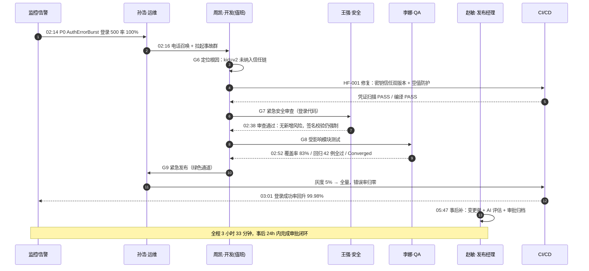
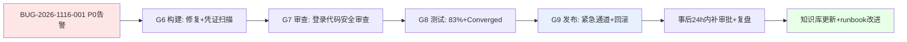

# 案例二 · 生产环境登录崩溃 Bug 的紧急修复：轻量快速通道

> 本案例演示[规模自适应原则](../docs/02-unified-framework/unified-workflow.md#规模自适应借鉴-bmad--spec-kit-的三条入口)：小改动从 **G6 直达**，走 G6→G7→G8→G9，不重走 G0–G5；但**凭证扫描、测试证据、变更审批一个都不能省**，紧急通道允许"先修复、后补审批"。

[案例集首页](./README.md) · [English](./case-02-hotfix.en.md) · [主案例（完整闭环）](./case-01-ecommerce.md) · [质量门禁](../docs/02-unified-framework/quality-gates.md)

---

## 为什么走轻量路径

| 判断维度 | 结论 |
|---|---|
| 变更类型 | 线上紧急 bugfix（小改动） |
| 建议起点 | G6（构建实现） |
| 路径 | G6 → G7 → G8 → G9（轻量门禁，约 5k tokens） |
| 省略阶段 | G0 治理（已存在）、G1 评估（事故即证据）、G2 澄清（单一根因）、G3/G4/G5（无新需求/架构/拆解） |
| 不可省略 | G6 凭证扫描、G7 安全审查（登录代码！）、G8 测试证据、G9 变更审批与回滚 |

> 参照铁律：**不要让一个 typo 修复走完 10 阶段，也不要让登录崩溃跳过安全审查。**

---

## 事故概况

| 项目 | 值 |
|---|---|
| 缺陷 ID | `BUG-2026-1116-001` |
| 标题 | JWT 密钥轮换后全量用户登录返回 500 |
| 发现时间 | 2026-11-16 02:14:07（P0 告警 `AuthErrorBurst`） |
| 影响面 | 登录接口 100% 失败，影响约 4.2 万在线会话；下单入口连带不可用 |
| 严重级别 | **P0（严重）** |
| 根因 | 02:00 运维轮换 JWT 签名密钥（`jwt.kid=v2`），但登录服务 token 校验仅信任 `v1`，解析 `kid=v2` 的 token 时抛 `NullPointerException` |
| 修复版本 | `v1.0.1-authfix-hotfix-2026-11-16` |
| 参与角色 | 周凯（开发，值班）、王强（安全）、李娜（QA）、孙浩（运维）、赵敏（发布经理，事后审批） |

---

## 修复时序图（Mermaid）



---

## G6 · 构建实现（2026-11-16 02:16 → 02:34）

> 值班开发周凯接手，直接定位并编码，省去需求/架构/拆解阶段。

### Bug 报告（事故单节选）

```
BUG-2026-1116-001 | reporter=monitor | 2026-11-16 02:14:07
Severity: P0 | Component: auth-service | Env: production
Symptom: POST /api/v1/auth/login → HTTP 500 for 100% requests
Log excerpt:
  02:14:05 ERROR [JwtValidator] kid=v2 not in trusted keys, fallback=null
  02:14:05 ERROR [LoginController] NPE at JwtValidator.parse(JwtValidator.java:88)
Repro: 任意账号密码登录均失败；解密旧 token(kid=v1) 仍可用。
Suspected cause: 02:00 密钥轮换 (jwt.kid v1→v2) 后校验器仅信任 v1。
```

### 修复任务清单（轻量）

| 任务 ID | 内容 | 绑定缺陷 |
|---|---|---|
| HF-001 | `JwtValidator` 信任 v1+v2 双版本 + null 防护 | BUG-2026-1116-001 |
| HF-002 | 补 `kid` 缺失时的安全拒绝（不 fallback 到 null） | BUG-2026-1116-001 |
| HF-003 | 添加轮换期双密钥配置 `jwt.trusted-kids=v1,v2` | BUG-2026-1116-001 |
| HF-004 | 回归测试 + 凭证扫描 + 发布验证 | BUG-2026-1116-001 |

### 代表性修复代码

```java
// auth-service/JwtValidator.java  (HF-001 + HF-002)
public Claims parse(String token) {
    Jws<Claims> jws = parser.parseSignedClaims(token);       // 验签仍强制
    String kid = jws.getHeader().getKeyId();
    if (kid == null || !trustedKids.contains(kid)) {           // 不再 null fallback
        throw new InvalidTokenException("untrusted kid=" + kid); // 安全拒绝
    }
    return jws.getPayload();
}
// jwt.trusted-kids=v1,v2  (HF-003)，轮换窗口过后移除 v1
```

### 凭证扫描（Gate 6，机器强制，不可省）

```
$ python3 scan_credentials.py --root auth-service/
[SCAN] files=63 patterns=18 secrets_found=0
[PASS] Gate 6 credential check PASSED. (紧急修复同样拦截凭证泄露)
$ mvn -q -DskipITs compile → BUILD SUCCESS
```

> **Gate 6 结论：PASS** — 修复完成、编译通过、凭证扫描 0 泄露。

---

## G7 · 代码审查（2026-11-16 02:34 → 02:38）

登录/鉴权代码按宪法强制安全审查，由王强执行紧急审查。

| 检查项 | 结果 | 说明 |
|---|---|---|
| 签名校验是否仍强制 | ✅ | `parseSignedClaims` 未绕过 |
| 是否引入凭证泄露 | ✅ 无 | 密钥来自配置，未硬编码 |
| `kid` 空值是否安全拒绝 | ✅ | 抛异常而非放行 |
| 双密钥信任是否最小必要 | ✅ | 仅轮换窗口临时开启 v1，附移除计划 |
| 是否越界重构 | ✅ 无 | 仅改 `JwtValidator` + 配置 |

```
review-evidence/BUG-2026-1116-001/review.md
reviewer: 王强(Security)  time: 02:38  verdict: APPROVED
source-bound: HF-001/HF-002 → commit 3f7c1a9 → 审查留痕
```

> **Gate 7 结论：PASS** — 无阻塞问题，安全审查有据可查（登录代码审查绝不能因紧急而省略）。

---

## G8 · 测试验证（2026-11-16 02:38 → 02:52）

> 轻量路径：只跑受影响模块（auth-service），不跑全量 148 例 E2E。

| 测试类型 | 用例数 | 通过 | 覆盖率 | 说明 |
|---|---:|---:|---:|---|
| 单元测试 | 28 | 28 | 行覆盖 83% | 含 `kid=v1/v2/缺失` 三类 |
| 集成测试 | 10 | 10 | 分支 78% | 密钥轮换场景 |
| 回归测试 | 4 | 4 | — | 登录主链路冒烟 |
| 合计 | 42 | 42 | 83%（≥80% ✅） | — |

```
$ python3 record_test_run.py --suite auth-module --gate 8
[TEST RUN] exit_code=0 tests=42 failures=0
[COVERAGE] line=83% (threshold 80 PASS)
[CONVERGE] status=Converged
[FINGERPRINT] sha256=bc23e8... locked at 2026-11-16 02:51
[PASS] Gate 8 PASSED — 轻量门禁同样要求真实运行 + Converged + 指纹。
```

> **Gate 8 结论：PASS** — 覆盖率 83%≥80%、测试真实运行、Converged、指纹固化。

---

## G9 · 发布交付（2026-11-16 02:52 → 03:01）

### 紧急通道发布

| 字段 | 值 |
|---|---|
| 变更单（事后补） | CR-2026-1116-021 |
| 版本 | `v1.0.1-authfix-hotfix-2026-11-16` |
| 通道 | 紧急绿色通道（先发布、24h 内补审批） |
| 策略 | 灰度 5% → 观察 3 分钟 → 全量 |
| 回滚 | 上一镜像 `auth-svc:v1.0.0`（保留 24h） |

**AI 评估（事后补录）**：

```
[AI-ASSESS] CR-2026-1116-021 (retroactive)
  risk_level: HIGH (auth change, production incident)
  checks: gate6=pass, gate7=pass(security), gate8=pass(83%), rollback=ready
  recommendation: APPROVE (incident-driven, evidence complete)
  note: 紧急通道合规——先修复止损，审批于 24h 内补齐。
```

**审批记录（事后补）**：

| 审批人 | 角色 | 结论 | 时间 |
|---|---|---|---|
| 赵敏 | 发布经理 | 追认同意 | 2026-11-16 05:47（事故后 3h33m） |

### 验证结论（三态）

| 验证项 | 结论 | 证据 |
|---|---|---|
| 登录成功率恢复 | **verified** | 99.98%（03:01，5 分钟窗口） |
| 旧 token(kid=v1) 兼容 | **verified** | 回归 ST-Token-011 PASS |
| 根因彻底消除（v1 移除） | **partial** | 轮换窗口期保留 v1，计划 2026-11-23 移除并复验 |
| 全链路 E2E 重跑 | **not-run**（轻量路径豁免） | 仅跑 auth 模块，已在变更单记录豁免理由 |

> **Gate 9 结论：PASS** — 紧急通道发布，测试证据有效、回滚就绪、事后 24h 内补齐审批；上线后 P0 告警关闭。

---

## 事后复盘与 48h 超时升级机制

| 事项 | 结论 |
|---|---|
| MTTR | 47 分钟（02:14 告警 → 03:01 恢复） |
| 门禁是否全部留痕 | 是——G6/G7/G8/G9 均有证据，紧急通道未绕过任何强制门禁 |
| 事后补审批是否在 24h 内 | 是——05:47 完成，符合紧急通道规则 |
| 48h 超时升级 | 未触发；但机制已就绪：若 05:47 前未审批，将自动升级至技术负责人 |
| 经验沉淀 | 新增知识库条目「JWT 密钥轮换双人检查清单」；新增告警 `JwtKidUntrusted` |
| 驱动改进 | 运维密钥轮换流程增加"先扩信任链、后切签名"步骤（写入 runbook） |

### 轻量路径小结



> **一句话总结**：轻量不等于松散——省掉的是"需求/架构/拆解"的文书工作，绝不省"凭证扫描、安全审查、测试证据、变更审批"这四道硬门禁。这就是规模自适应的真正含义。
