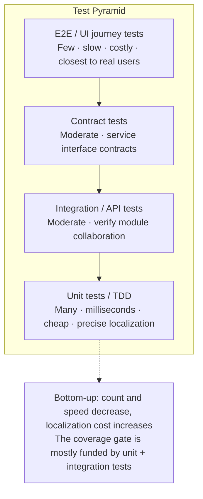
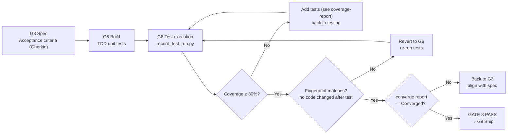

# Testing System & Examples

> "Tests passed, but nothing was really tested" is the single biggest quality trap in AI-generated code. This directory turns the unified workflow's [G8 Test & Verify gate](../docs/02-unified-framework/unified-workflow.md) into an **executable, auditable, machine-enforced** testing system: layering strategy, case design, coverage evidence, and gate validation — all backed by reusable examples and demonstrated end-to-end on an e-commerce order system, **OrderHub**.

[Home](../README.en.md) · [中文](./README.md) · [Quality Gates 0–10](../docs/02-unified-framework/quality-gates.en.md) · [Unified Workflow](../docs/02-unified-framework/unified-workflow.en.md) · [Closed-Loop System](../docs/03-user-system/closed-loop-system.en.md)

---

## 1. Testing Philosophy

In an AI development workflow, testing is not a closing ritual — it is the core mechanism that **turns AI output into verifiable evidence**. The system follows five principles:

| Principle | Description | Enforcing Mechanism |
|---|---|---|
| **Tests are evidence, not ceremony** | Tests must genuinely run and record their exit code; no "looks like it ran" | `record_test_run.py`, test-run fingerprint |
| **Coverage is a threshold, not a goal** | ≥80% is the release floor, not the quality ceiling; high coverage ≠ high quality | [coverage-report.md](./coverage-report.en.md), Gate 8 |
| **Every test is traceable** | Cases bind to requirement IDs, forming a requirement→task→code→test→ship chain | [test-cases.md](./test-cases.en.md) traceability matrix, ID traceability |
| **Machine-enforce what you can** | Credentials, coverage, stage evidence, and fingerprints are blocked by git hooks / CI automatically | [gate-validation.py](./gate-validation.py), Agentic OS |
| **Shift-left + shift-right** | Shift-left: TDD fixes acceptance criteria before coding; shift-right: production feedback feeds the next spec cycle | [test-strategy.md](./test-strategy.en.md), G10 loop |

> In short: **testing is the "evidence factory" of Gate 8** — what it produces is not a green checkmark, but traceable, reviewable, non-bypassable release evidence (work trail / coverage / fingerprint / Converged).

---

## 2. The Test Pyramid

Test layering follows the "many and fast at the bottom, few and stable at the top" pyramid. The lower the layer, the cheaper and faster; the higher, the closer to real users but slower and more brittle.



| Layer | Subject | Share | Speed | Primary Tools | Framework Counterpart |
|---|---|---:|---|---|---|
| Unit | Functions / classes / domain logic | Most (~70%) | Milliseconds | pytest / JUnit / Vitest | Spec Kit TDD, BMAD Dev |
| Integration | Module collaboration / API endpoints | Moderate (~20%) | Seconds | pytest + TestClient / Postman | AI-DLC test stage |
| Contract | Inter-service interface agreements | Moderate | Seconds | Pact / schemathesis | BMAD Test Architect |
| E2E / UI | Complete user journeys | Fewest (~10%) | Minutes | Playwright / Cypress | gstack role-based acceptance |
| Visual | Pixel regression of UIs | Few | Minutes | Playwright Snapshot | — |

> The pyramid is not a mandate to literally draw a triangle — it is a **decision principle for allocating effort**: put most verification in cheap lower layers, and reserve the top layer for irreplaceable end-to-end confidence.

---

## 3. Relationship to the G8 Test Gate

[quality-gates.md](../docs/02-unified-framework/quality-gates.en.md) defines five criteria for **Gate 8 · Test & Verify (machine-enforced)**. This directory supplies a concrete way to meet each one:

| G8 Criterion (Release Standard) | Enforcement | Coverage Here | Sample Artifact |
|---|---|---|---|
| Test coverage ≥80% | CI + coverage parsing | [coverage-report.md](./coverage-report.en.md), [gate-validation.py](./gate-validation.py) `coverage` | Per-module coverage table, 89% pass verdict |
| Tests genuinely run via `record_test_run.py`, exit code recorded | `record_test_run.py` | [gate-validation.md](./gate-validation.en.md) | `test-run.json` (exit=0, 214 passed) |
| Code fingerprint matches the test run (no code changed after testing) | Fingerprint check | [gate-validation.py](./gate-validation.py) `fingerprint` | expected/actual SHA256 match |
| `converge` report reads `Converged` | `/converge` | [test-strategy.md](./test-strategy.en.md) convergence check | Convergence report (Converged) |
| CI runs the real test suite | CI pipeline | [gate-validation.md](./gate-validation.en.md) CI config | GitHub Actions / pre-commit |



> **The key to machine enforcement**: the checks above are expressed as exit codes by [gate-validation.py](./gate-validation.py) (0 pass / 1 block / 2 warn), which CI consumes directly — an Agent cannot bypass the gate by saying "I promise I tested it."

---

## 4. File Navigation

| File | 中文 | English | Core Content |
|---|---|---|---|
| [README.md](./README.md) / [README.en.md](./README.en.md) | 测试体系总索引 | Testing System Index | Philosophy, pyramid, G8 mapping, navigation (this page) |
| [test-strategy.md](./test-strategy.md) / [.en.md](./test-strategy.en.md) | 测试策略 | Test Strategy | Layering, TDD, coverage strategy, AI-generated test review, shift left/right |
| [test-cases.md](./test-cases.md) / [.en.md](./test-cases.en.md) | 测试用例样例集 | Test Case Examples | Gherkin, unit/integration/E2E, boundary values, traceability matrix |
| [coverage-report.md](./coverage-report.md) / [.en.md](./coverage-report.en.md) | 覆盖率报告样例 | Coverage Report Sample | Per-module data, uncovered list, 76%→89% story, gate verdict |
| [gate-validation.py](./gate-validation.py) | 门禁校验脚本 | Gate Validator | Stdlib only, 4 checks, `--demo`, exit codes 0/1/2 |
| [gate-validation.md](./gate-validation.md) / [.en.md](./gate-validation.en.md) | 门禁校验说明 | Gate Validator Guide | Design, pre-commit / CI integration, machine-enforced vs advisory |

---

## 5. Alignment with the Five Frameworks

| Framework | Testing Practice | Where It Lands Here |
|---|---|---|
| Spec Kit | `/converge` convergence, `/test` | Converged report, test pyramid |
| BMAD | Test Architect role, Gherkin acceptance | Test layering, Gherkin scenarios, review checklist |
| AI-DLC | Test stage + reviewer Agents + 134-event audit | Work trail evidence, shift-left testing |
| gstack | Role-based acceptance perspective | E2E user journey tests |
| Agentic OS | `record_test_run.py` + code fingerprint + credential scan | [gate-validation.py](./gate-validation.py) machine-enforced checks |

---

## 6. Quick Start

```bash
cd ai-workflow-hub/tests

# 1. See the gate validator in action (built-in sample data, zero dependencies)
python3 gate-validation.py --demo

# 2. Validate a single dimension
python3 gate-validation.py coverage --file coverage.json --threshold 80
python3 gate-validation.py trail --file work-trail.json
python3 gate-validation.py credentials --path ./src
python3 gate-validation.py fingerprint --code app.py --expected <sha256>

# 3. Full validation (wire into CI / pre-commit)
python3 gate-validation.py all \
  --trail work-trail.json --coverage coverage.json \
  --path ./src --code app.py --expected <sha256>
```

> Exit codes: `0` = pass, `1` = error (block), `2` = warning (pass with attention) — consistent with [quality-gates.md](../docs/02-unified-framework/quality-gates.en.md).

---

## 7. Key Terms

| 中文 | English | Meaning |
|---|---|---|
| 测试门禁 | Test Gate | G8: no release below standard |
| 覆盖率 | Coverage | Share of code covered by tests; threshold ≥80% |
| 收敛 | Convergence | Implementation matches spec (`/converge` → Converged) |
| 测试运行指纹 | Test-run Fingerprint | Code SHA256 at test time, proving no post-test edits |
| 工作轨迹 | Work Trail | Stage and evidence records left by an Agent |
| 机器强制 | Machine-Enforced | Auto-blocked by git hooks / CI, unbypassable by Agents |
| ID 溯源 | Traceability | Requirement→task→code→test chain is queryable |

---

*This directory is the testing-dimension delivery patch of [AI Workflow Hub](../README.md) · Bilingual · All scripts run on the standard library*
