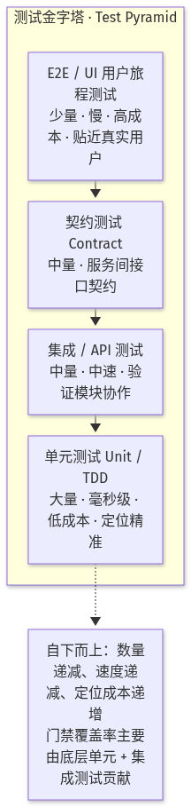
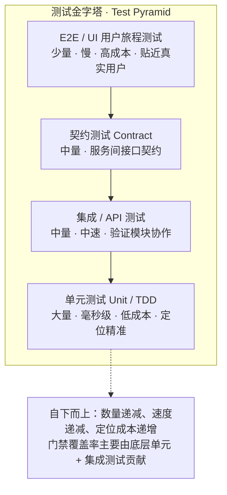
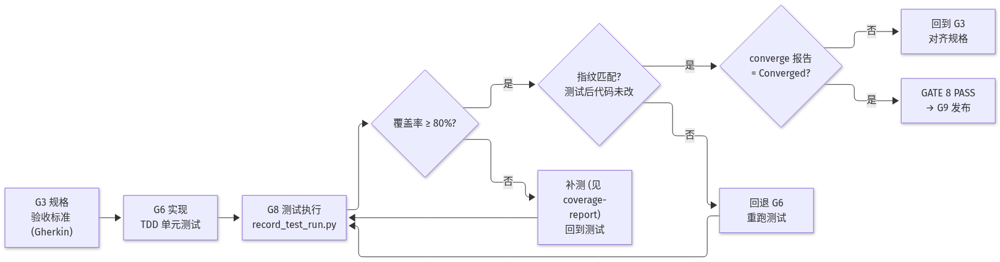
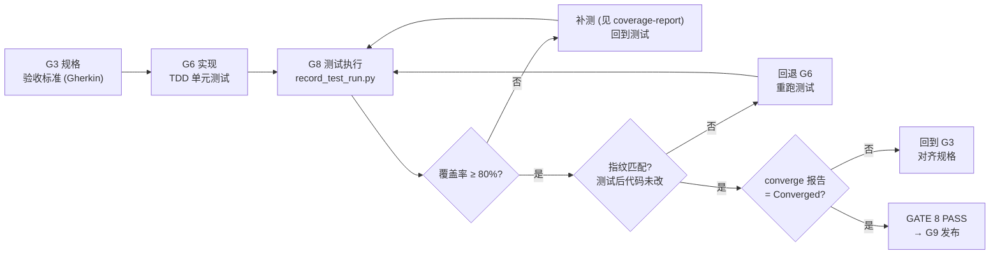

# 测试体系与测试示例（Testing System & Examples）

> "测试通过但没测试"是 AI 生成代码最大的质量陷阱。本目录把统一工作流 [G8 测试验证门禁](../docs/02-unified-framework/unified-workflow.md) 落成一套**可执行、可审计、机器强制**的测试体系：分层策略、用例设计、覆盖率证据、门禁校验，全部给出可复用示例，并以电商订单系统 **OrderHub** 贯穿演示。

[返回首页](../README.md) · [English](./README.en.md) · [质量门禁 Gate 0–10](../docs/02-unified-framework/quality-gates.md) · [统一工作流](../docs/02-unified-framework/unified-workflow.md) · [闭环落地体系](../docs/03-user-system/closed-loop-system.md)

---

## 一、测试理念（Testing Philosophy）

测试在 AI 开发工作流中不是"收尾仪式"，而是**把 AI 输出变成可验证证据**的核心机制。本体系遵循五条原则：

| 原则 | 说明 | 对应机制 |
|---|---|---|
| **测试是证据，不是仪式** | 测试必须真实运行并记录退出码，拒绝"看起来跑过" | `record_test_run.py`、测试运行指纹 |
| **覆盖率是门槛，不是目标** | ≥80% 是放行下限，不是质量终点；高覆盖不等于高质量 | [coverage-report.md](./coverage-report.md)、Gate 8 |
| **每个测试可溯源** | 测试用例绑定需求 ID，形成 需求→任务→代码→测试→发布 全链路 | [test-cases.md](./test-cases.md) 追踪矩阵、ID 溯源 |
| **能机器强制就不靠自觉** | 凭证、覆盖率、阶段证据、指纹由 git hook / CI 自动拦截 | [gate-validation.py](./gate-validation.py)、Agentic OS |
| **左移 + 右移** | 左移：TDD 在写码前定验收；右移：线上反馈回流下一轮规格 | [test-strategy.md](./test-strategy.md)、G10 闭环 |

> 一句话：**测试是 Gate 8 的"证据工厂"**——它产出的不是"绿勾"，而是可追溯、可复核、不可绕过的放行证据（work trail / coverage / fingerprint / Converged）。

---

## 二、测试金字塔（Test Pyramid）

测试分层遵循"底层多而快、顶层少而稳"的金字塔结构。越往下成本越低、反馈越快；越往上越贴近真实用户、但越慢越脆。

<!-- IMG-EMBED -->
**图 1 · flowchart**



<details>
<summary>查看 Mermaid 源码（可编辑）</summary>



</details>

| 层级 | 测试对象 | 数量占比 | 执行速度 | 主要工具 | 对应框架做法 |
|---|---|---:|---|---|---|
| 单元 Unit | 函数 / 类 / 领域逻辑 | 最多（~70%） | 毫秒级 | pytest / JUnit / Vitest | Spec Kit TDD、BMAD Dev |
| 集成 Integration | 模块协作 / API 端点 | 中等（~20%） | 秒级 | pytest + TestClient / Postman | AI-DLC 测试阶段 |
| 契约 Contract | 服务间接口约定 | 中量 | 秒级 | Pact / schemathesis | BMAD Test Architect |
| E2E / UI | 完整用户旅程 | 最少（~10%） | 分钟级 | Playwright / Cypress | gstack 角色验收 |
| 视觉 Visual | 界面像素回归 | 少量 | 分钟级 | Playwright Snapshot | — |

> 金字塔不是"必须画成三角形"，而是**投入配比的决策原则**：把大部分验证放在便宜的底层，顶层只保留不可替代的端到端信心。

---

## 三、与 G8 测试门禁的关系（Gate 8 Mapping）

[quality-gates.md](../docs/02-unified-framework/quality-gates.md) 为 **Gate 8 · 测试验证（机器强制）** 定义了五条判据。本目录逐条给出达成方式：

| G8 判据（放行标准） | 强制方式 | 本目录支撑 | 示例产物 |
|---|---|---|---|
| 测试覆盖率 ≥80% | CI + 覆盖率解析 | [coverage-report.md](./coverage-report.md)、[gate-validation.py](./gate-validation.py) `coverage` | 分模块覆盖率表、89% 通过判定 |
| 测试由 `record_test_run.py` 真实运行并记录退出码 | `record_test_run.py` | [gate-validation.md](./gate-validation.md) | `test-run.json`（exit=0, 214 passed） |
| 代码指纹与测试运行匹配（测试后未改代码） | 指纹校验 | [gate-validation.py](./gate-validation.py) `fingerprint` | expected/actual SHA256 一致 |
| `converge` 报告为 `Converged` | `/converge` | [test-strategy.md](./test-strategy.md) 收敛验证 | 收敛报告（Converged） |
| CI 跑的是真实测试套件 | CI 流水线 | [gate-validation.md](./gate-validation.md) CI 配置 | GitHub Actions / pre-commit |

<!-- IMG-EMBED -->
**图 2 · flowchart**



<details>
<summary>查看 Mermaid 源码（可编辑）</summary>



</details>

> **机器强制的关键**：上述判断由 [gate-validation.py](./gate-validation.py) 以退出码表达（0 通过 / 1 阻断 / 2 警告），CI 直接消费退出码——Agent 无法用"我保证测过了"绕过门禁。

---

## 四、文件导航（File Navigation）

| 文件 | 中文 | English | 核心内容 |
|---|---|---|---|
| [README.md](./README.md) / [README.en.md](./README.en.md) | 测试体系总索引 | Testing System Index | 理念、金字塔、G8 映射、导航（本文） |
| [test-strategy.md](./test-strategy.md) / [.en.md](./test-strategy.en.md) | 测试策略 | Test Strategy | 分层、TDD、覆盖率策略、AI 生成测试审查、左右移 |
| [test-cases.md](./test-cases.md) / [.en.md](./test-cases.en.md) | 测试用例样例集 | Test Case Examples | Gherkin、单元/集成/E2E、边界值、追踪矩阵 |
| [coverage-report.md](./coverage-report.md) / [.en.md](./coverage-report.en.md) | 覆盖率报告样例 | Coverage Report Sample | 分模块数据、未覆盖清单、76%→89% 故事、门禁判定 |
| [gate-validation.py](./gate-validation.py) | 门禁校验脚本 | Gate Validator | 纯标准库、4 项校验、`--demo`、退出码 0/1/2 |
| [gate-validation.md](./gate-validation.md) / [.en.md](./gate-validation.en.md) | 门禁校验说明 | Gate Validator Guide | 原理、pre-commit / CI 接入、机器强制 vs 规则提示 |

---

## 五、与五大框架的对应（Framework Alignment）

| 框架 | 测试相关做法 | 本体系落点 |
|---|---|---|
| Spec Kit | `/converge` 收敛验证、`/test` | Converged 报告、测试金字塔 |
| BMAD | Test Architect 角色、Gherkin 验收 | 测试分层、Gherkin 场景、审查要点 |
| AI-DLC | 测试阶段 + 审查 Agent + 134 事件审计 | work trail 证据、测试左移 |
| gstack | 角色工具验收视角 | E2E 用户旅程测试 |
| Agentic OS | `record_test_run.py` + 代码指纹 + 凭证扫描 | [gate-validation.py](./gate-validation.py) 机器强制校验 |

---

## 六、快速开始（Quick Start）

```bash
cd ai-workflow-hub/tests

# 1. 看门禁校验的真实效果（内置示例，无需任何依赖）
python3 gate-validation.py --demo

# 2. 单独校验某一项
python3 gate-validation.py coverage --file coverage.json --threshold 80
python3 gate-validation.py trail --file work-trail.json
python3 gate-validation.py credentials --path ./src
python3 gate-validation.py fingerprint --code app.py --expected <sha256>

# 3. 综合校验（接 CI / pre-commit）
python3 gate-validation.py all \
  --trail work-trail.json --coverage coverage.json \
  --path ./src --code app.py --expected <sha256>
```

> 退出码：`0` = 通过，`1` = 错误（阻断），`2` = 警告（放行但需关注）——与 [quality-gates.md](../docs/02-unified-framework/quality-gates.md) 一致。

---

## 七、关键术语（Key Terms）

| 中文 | English | 说明 |
|---|---|---|
| 测试门禁 | Test Gate | G8：不达标不放行 |
| 覆盖率 | Coverage | 测试覆盖代码的比例，门槛 ≥80% |
| 收敛 | Convergence | 实现与规格一致（`/converge` → Converged） |
| 测试运行指纹 | Test-run Fingerprint | 测试时的代码 SHA256，验证测试后代码未改 |
| 工作轨迹 | Work Trail | Agent 留下的阶段与证据记录 |
| 机器强制 | Machine-Enforced | git hook / CI 自动拦截，Agent 无法绕过 |
| ID 溯源 | Traceability | 需求→任务→代码→测试的链路可查 |

---

*本目录是 [AI Workflow Hub](../README.md) 测试维度落地补丁 · 中英双语 · 所有脚本纯标准库可运行*
