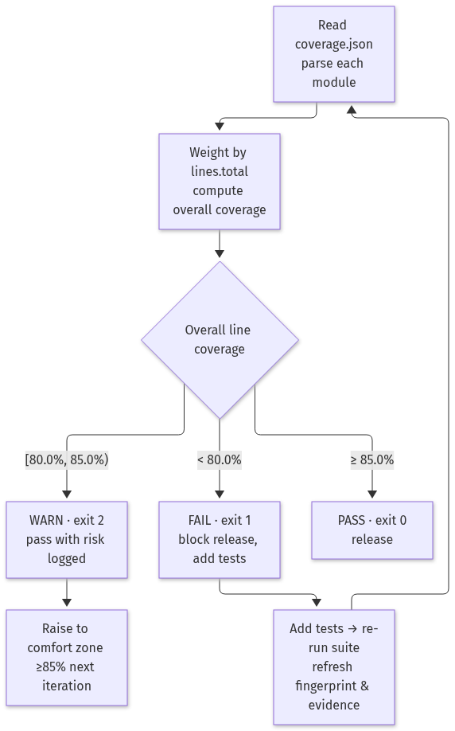
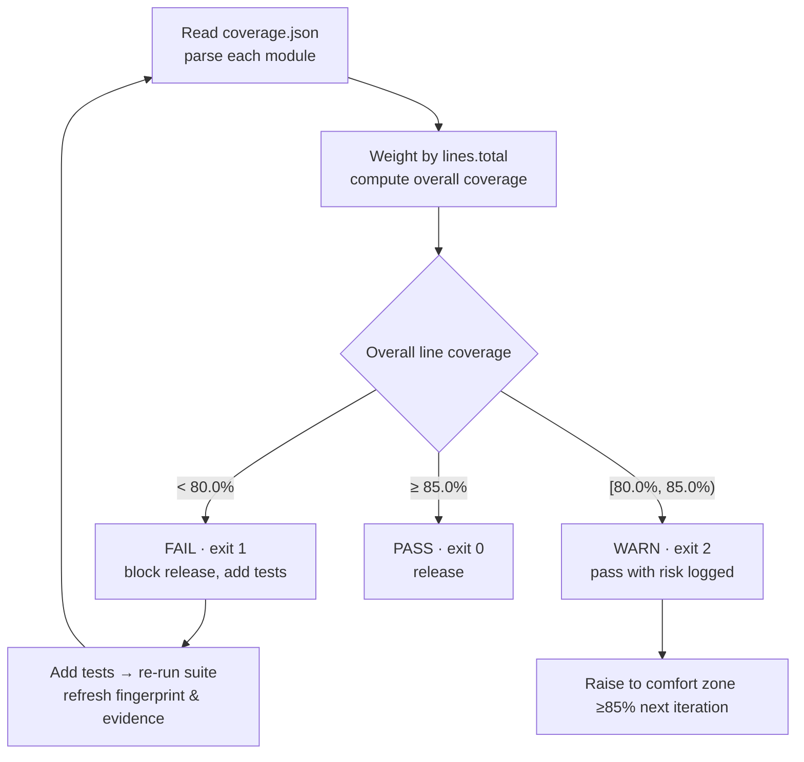
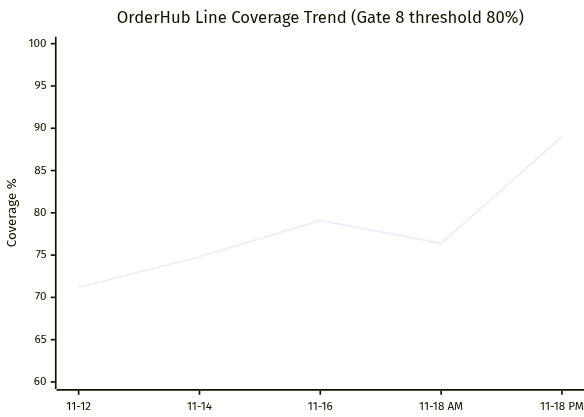
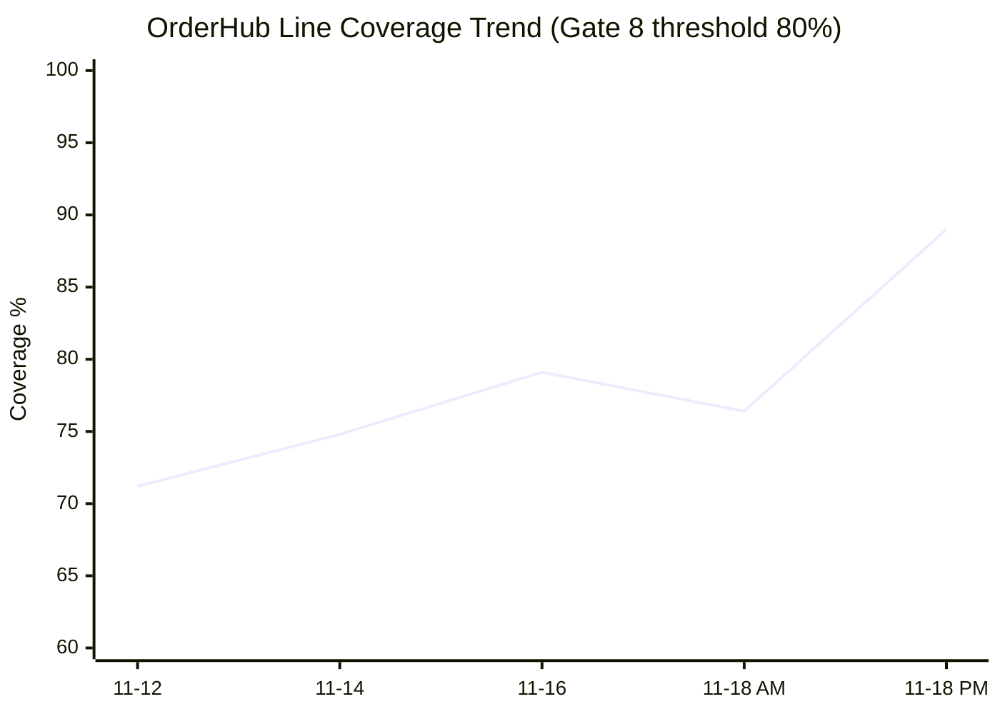

# Coverage Report Sample

> A coverage report "real enough to copy": per-module statement/branch/function coverage, an uncovered-code list with reasons, coverage trend, and gate verdicts — plus the full story of **76.4% coverage failing the gate → remediation → 89.0% passing**. Every figure is generated by [gate-validation.py](./gate-validation.py) and matches its `--demo` output item by item.

[Home](../README.en.md) · [中文](./coverage-report.md) · [Test Strategy](./test-strategy.en.md) · [Test Case Examples](./test-cases.en.md) · [Gate Validator](./gate-validation.py)

---

## 1. Executive Summary

| Item | Value |
|---|---|
| System under test | OrderHub order service |
| Gate | G8 Test & Verify (machine-enforced) |
| First commit | `9f3c1ab` (morning of 2026-11-18) |
| Fixed commit | `4e8d2f1` (afternoon of 2026-11-18) |
| Coverage tool | coverage.py + [gate-validation.py](./gate-validation.py) `coverage` |
| Line coverage threshold | **≥ 80.0%** (homegrown hard gate) |
| Initial verdict | **FAIL (76.4% < 80.0%, exit 1)** |
| Final verdict | **PASS (89.0% ≥ 80.0%, exit 0)** |
| Convergence status | Converged (`/converge` report) |

**Bottom line**: the first validation was blocked by Gate 8 for 76.4% coverage, a missing `ship` stage evidence record, three credential leaks, and a fingerprint mismatch. After targeted test additions and fixes, coverage rose to 89.0%, all four checks went green, and the gate passed.

---

## 2. Gate Verdict Rules

<!-- IMG-EMBED -->
**图 1 · flowchart**



<details>
<summary>查看 Mermaid 源码（可编辑）</summary>



</details>

| Verdict | Range | Exit Code | Gate Action | Scenario |
|---|---|---:|---|---|
| **FAIL** | `< 80.0%` | 1 | Block release; return to G6/G8 for tests | First validation, 76.4% |
| **WARN** | `[80.0%, 85.0%)` | 2 | Pass with risk registered; improve later | Intermediate build, 82.1% |
| **PASS** | `≥ 85.0%` | 0 | Normal release | After remediation, 89.0% |

> Note: the hard gate is 80% (below it = FAIL); 85% begins the "comfort zone" ([gate-validation.py](./gate-validation.py): `WARN_BAND = 5.0`).

---

## 3. First Coverage Report (commit `9f3c1ab`)

### 3.1 Per-Module Coverage

| Module | Lines | Branches | Functions | Lines (covered/total) |
|---|---:|---:|---:|---:|
| `order/domain.py` | 83.6% | 75.9% | 87.5% | 184/220 |
| `payment/gateway.py` | 60.0% | 43.8% | 57.7% | 108/180 |
| `inventory/stock.py` | 87.5% | 86.7% | 90.0% | 105/120 |
| `api/order_routes.py` | 85.6% | 82.5% | 88.0% | 154/180 |
| `notification/notify.py` | 60.0% | 50.0% | 50.0% | 60/100 |
| **Overall (weighted)** | **76.4%** | **68.0%** | **76.0%** | **611/800** |

> Weighting: overall line coverage = Σcovered ÷ Σtotal = 611 ÷ 800 = 76.375% ≈ **76.4%**. Branches/functions are weighted the same way by their own totals.

### 3.2 Uncovered Code List and Reasons

| Module | Lines | Uncovered Code | Reason | Owner |
|---|---|---|---|---|
| `payment/gateway.py` | 62–74 | `_handle_timeout()` retry branch | No gateway timeout simulated; missing exception case | Dev |
| `payment/gateway.py` | 88–95 | `refund()` refund logic | Out of this iteration's scope (not a defect, but inflates denominator) | Dev |
| `notification/notify.py` | 30–45 | `send_sms()` SMS channel | Needs external credentials; skipped in test env | QA |
| `notification/notify.py` | 50–58 | `_retry()` backoff | Boundary (3rd retry) not constructed | QA |
| `order/domain.py` | 118–122 | `apply_vip_discount()` | REQ-006 extension, next iteration | Product |
| `api/order_routes.py` | 140–150 | Admin endpoints `/admin/*` | RBAC role unconfigured, tests cannot authenticate | QA |

### 3.3 Gate Verdict

```
[FAIL] Overall coverage 76.4% < threshold 80.0%
→ Gate 8 blocks release
→ Back to G6/G8: add tests for payment/gateway.py and notification/notify.py
```

---

## 4. Remediation Plan

Target valuable gaps from the uncovered list; mark low-value code (e.g. `refund()`) as out-of-scope and accept it:

| Action ID | Target Module | Added Cases | Source | Expected Lines Added |
|---|---|---|---|---:|
| ACT-01 | `payment/gateway.py` | UT-011 timeout retry, UT-012 refund happy path | Uncovered 62–74, 88–95 | +48 |
| ACT-02 | `notification/notify.py` | UT-013 SMS (stub), UT-014 backoff retry | Uncovered 30–58 | +30 |
| ACT-03 | `order/domain.py` | UT-015 VIP discount | Uncovered 118–122 | +6 |
| ACT-04 | `api/order_routes.py` | IT-009 admin endpoint (configure RBAC test role) | Uncovered 140–150 | +12 |
| — | Total | 5 new cases | — | +96 lines (611→707 covered) |

> The other three gate failures were fixed in parallel: add `ship` evidence, remove three hardcoded credentials (switch to environment variables), and re-run tests to refresh the fingerprint.

---

## 5. Coverage Report After Remediation (commit `4e8d2f1`)

### 5.1 Per-Module Coverage

| Module | Lines | Branches | Functions | Lines (covered/total) | Change |
|---|---:|---:|---:|---:|---|
| `order/domain.py` | 86.4% | 82.8% | 93.8% | 190/220 | +2.8% |
| `payment/gateway.py` | 86.7% | 83.3% | 88.5% | 156/180 | +26.7% |
| `inventory/stock.py` | 91.7% | 93.3% | 95.0% | 110/120 | +4.2% |
| `api/order_routes.py` | 92.2% | 92.5% | 96.0% | 166/180 | +6.6% |
| `notification/notify.py` | 90.0% | 87.5% | 94.4% | 90/100 | +30.0% |
| **Overall (weighted)** | **89.0%** | **87.0%** | **93.4%** | **712/800** | **+12.6%** |

### 5.2 Gate Verdict

```
[PASS] Coverage 89.0% >= threshold 80.0%
[PASS] Tests genuinely run via record_test_run.py (exit=0, 214 passed)
[PASS] Code fingerprint matches: no code changed after testing
[PASS] converge report = Converged
→ Gate 8 passed, cleared for G9 Ship
```

---

## 6. Coverage Trend

| Date | Commit | Line Coverage | Gate Verdict | Event |
|---|---|---:|---|---|
| 2026-11-12 | `7a1b2c3` | 71.2% | FAIL | Project start, test skeleton |
| 2026-11-14 | `8d4e5f6` | 74.8% | FAIL | Some unit tests added |
| 2026-11-16 | `3c9d0e1` | 79.1% | FAIL | Near threshold, still 0.9% short |
| 2026-11-18 AM | `9f3c1ab` | 76.4% | FAIL | Refund module added; larger denominator caused a drop |
| 2026-11-18 PM | `4e8d2f1` | **89.0%** | **PASS** | 5 new cases + other gate fixes |
| Target baseline | — | ≥ 85.0% | Comfort zone | Future iterations must not fall below |

<!-- IMG-EMBED -->
**图 2 · xychart-beta**



<details>
<summary>查看 Mermaid 源码（可编辑）</summary>



</details>

> Trend reading: the morning of 11-18 saw coverage fall to 76.4% because the new refund module grew the denominator from 700 to 800, triggering the gate. Targeted remediation that afternoon pushed it to 89.0%, clearing the comfort zone.

---

## 7. Full Story Timeline (76% → 89%)

| Time | Event | Evidence Artifact | Gate Status |
|---|---|---|---|
| 09:12 | G3 spec frozen, 7 requirements bound to IDs | `spec.md`, traceability matrix | G3 PASS |
| 10:40 | G6 implementation done, TDD produced 214 tests | `PR #218 (/9f3c1ab)` | G6 PASS |
| 11:30 | First `record_test_run.py` run | `test-run.json` (exit=0) | — |
| 11:35 | First `gate-validation.py all` | 76.4% + missing evidence + 3 credentials + fingerprint mismatch | **GATE FAILED (1)** |
| 11:40 | Remediation plan ACT-01..04 from uncovered list | Sections 3 & 4 of this report | — |
| 12:10 | Add 5 cases, move credentials to env vars, re-run tests | `UT-011..015`, `IT-009` | — |
| 13:48 | Complete ship evidence, generate new fingerprint | `release-record.md`, `4e8d2f1` | — |
| 14:05 | Second `gate-validation.py all` | 89.0% + complete evidence + 0 credentials + fingerprint match | **GATE PASSED (0)** |
| 14:30 | `/converge` reports Converged, proceed to G9 | Convergence report + release ticket | G8 → G9 cleared |

---

## 8. Verified Script Output Excerpt

The following is real output from `python3 gate-validation.py --demo` (coverage sections), matching the tables in this report item by item:

```
  [2/4] 测试覆盖率 (Coverage, threshold 80.0%) [FAIL]
  MODULE                              LINES   BRANCH     FUNC
  order/domain.py                     83.6%    75.9%    87.5%
  payment/gateway.py                  60.0%    43.8%    57.7%
  inventory/stock.py                  87.5%    86.7%    90.0%
  api/order_routes.py                 85.6%    82.5%    88.0%
  notification/notify.py              60.0%    50.0%    50.0%
  OVERALL (weighted)                  76.4%    68.0%    76.0%
  [FAIL] 整体覆盖率 76.4% < 门槛 80.0%
```

```
  [2/4] 测试覆盖率 (Coverage, threshold 80.0%) [PASS]
  MODULE                              LINES   BRANCH     FUNC
  order/domain.py                     86.4%    82.8%    93.8%
  payment/gateway.py                  86.7%    83.3%    88.5%
  inventory/stock.py                  91.7%    93.3%    95.0%
  api/order_routes.py                 92.2%    92.5%    96.0%
  notification/notify.py              90.0%    87.5%    94.4%
  OVERALL (weighted)                  89.0%    87.0%    93.4%
  [PASS] 覆盖率 89.0% >= 门槛 80.0%
```

> For the complete output (work trail, credential scan, fingerprint check), see [gate-validation.md](./gate-validation.en.md).

---

## 9. Audit Trail

| Evidence Item | First (FAIL) | After Fix (PASS) |
|---|---|---|
| Coverage report | `coverage-9f3c1ab.json` (76.4%) | `coverage-4e8d2f1.json` (89.0%) |
| Test-run record | `test-run.json` (exit=0, 214 passed) | `test-run.json` (exit=0, 219 passed) |
| Code fingerprint | expected≠actual (code edited after test) | expected=actual (`c95abf6f…`) |
| Work trail | Missing ship evidence | All five stages have evidence |
| Credential scan | 3 hits | 0 hits |
| Gate verdict | GATE FAILED (exit 1) | GATE PASSED (exit 0) |

> All evidence is written to the work trail, satisfying the gate design principles of "quantifiable, traceable, machine-enforceable where possible" in [quality-gates.md](../docs/02-unified-framework/quality-gates.en.md).

---

*Coverage report sample is part of the [AI Workflow Hub](../README.en.md) testing system · Figures verified by gate-validation.py · Bilingual*
