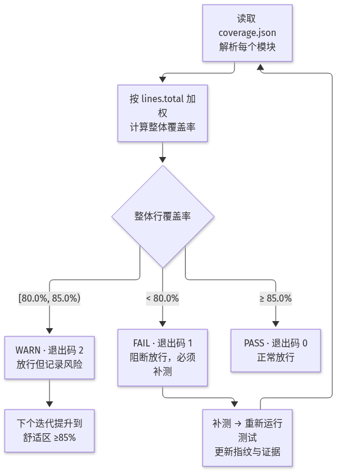
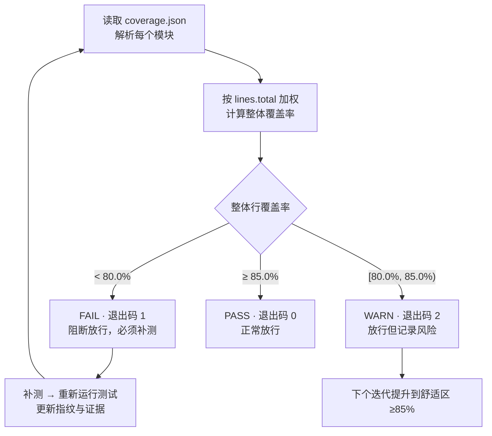
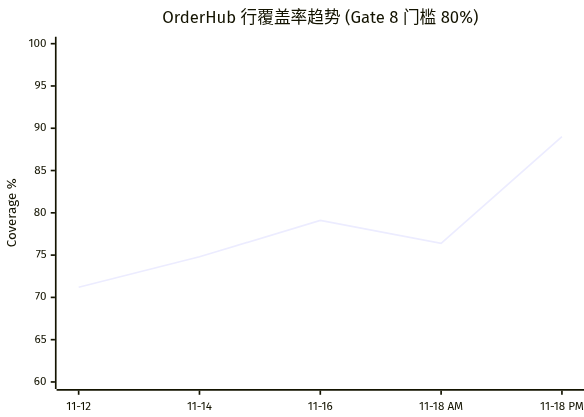
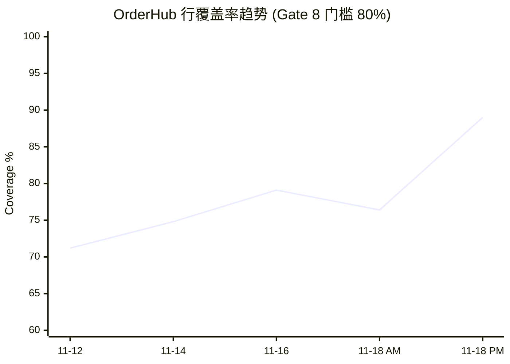

# 覆盖率报告样例（Coverage Report Sample）

> 一份"真实到可以照抄"的覆盖率报告：分模块的语句/分支/函数覆盖率、未覆盖代码清单及原因、覆盖率趋势、门禁判定，并完整演示 **覆盖率 76.4% 未通过门禁 → 补测 → 89.0% 通过** 的故事。报告数据由 [gate-validation.py](./gate-validation.py) 生成，与 `--demo` 输出逐项一致。

[返回首页](../README.md) · [English](./coverage-report.en.md) · [测试策略](./test-strategy.md) · [测试用例样例](./test-cases.md) · [门禁校验脚本](./gate-validation.py)

---

## 一、报告摘要（Executive Summary）

| 项目 | 值 |
|---|---|
| 被测项目 | OrderHub 订单服务 |
| 门禁 | G8 测试验证（机器强制） |
| 首次提交 | `9f3c1ab`（2026-11-18 上午） |
| 修复提交 | `4e8d2f1`（2026-11-18 下午） |
| 覆盖率工具 | coverage.py + [gate-validation.py](./gate-validation.py) `coverage` |
| 行覆盖门槛 | **≥ 80.0%**（自有体系硬门禁） |
| 首次判定 | **FAIL（76.4% < 80.0%，退出码 1）** |
| 最终判定 | **PASS（89.0% ≥ 80.0%，退出码 0）** |
| 收敛状态 | Converged（`/converge` 报告） |

**结论先行**：首次校验因覆盖率 76.4% 未达标、缺 ship 阶段证据、3 处凭证泄露、指纹不一致被 Gate 8 阻断；针对性补测 + 修复后，覆盖率升至 89.0%，四项校验全绿，门禁通过。

---

## 二、门禁判定规则（Gate Verdict Rules）

<!-- IMG-EMBED -->
**图 1 · flowchart**



<details>
<summary>查看 Mermaid 源码（可编辑）</summary>



</details>

| 判定 | 区间 | 退出码 | 门禁动作 | 对应场景 |
|---|---|---:|---|---|
| **FAIL** | `< 80.0%` | 1 | 阻断放行，回到 G6/G8 补测 | 首次校验 76.4% |
| **WARN** | `[80.0%, 85.0%)` | 2 | 放行但登记风险，限期提升 | 中间版本 82.1% |
| **PASS** | `≥ 85.0%` | 0 | 正常放行 | 补测后 89.0% |

> 注：硬门槛是 80%（低于即 FAIL），85% 是"舒适区"起点（[gate-validation.py](./gate-validation.py) 中 `WARN_BAND = 5.0`）。

---

## 三、首次覆盖率报告（commit `9f3c1ab`）

### 3.1 分模块覆盖率

| 模块 | 行覆盖 | 分支覆盖 | 函数覆盖 | 行数 (已覆盖/总) |
|---|---:|---:|---:|---:|
| `order/domain.py` | 83.6% | 75.9% | 87.5% | 184/220 |
| `payment/gateway.py` | 60.0% | 43.8% | 57.7% | 108/180 |
| `inventory/stock.py` | 87.5% | 86.7% | 90.0% | 105/120 |
| `api/order_routes.py` | 85.6% | 82.5% | 88.0% | 154/180 |
| `notification/notify.py` | 60.0% | 50.0% | 50.0% | 60/100 |
| **整体（加权）** | **76.4%** | **68.0%** | **76.0%** | **611/800** |

> 加权口径：整体行覆盖率 = Σ已覆盖行 ÷ Σ总行 = 611 ÷ 800 = 76.375% ≈ **76.4%**。分支/函数同理按各自 total 加权。

### 3.2 未覆盖代码清单及原因

| 模块 | 行号 | 未覆盖代码 | 原因 | 责任人 |
|---|---|---|---|---|
| `payment/gateway.py` | 62–74 | `_handle_timeout()` 超时重试分支 | 未模拟网关超时，缺异常用例 | 开发 |
| `payment/gateway.py` | 88–95 | `refund()` 退款逻辑 | 本迭代需求未纳入（非缺陷，但拉低分母） | 开发 |
| `notification/notify.py` | 30–45 | `send_sms()` 短信通道 | 需外部凭证，测试环境被跳过 | 测试 |
| `notification/notify.py` | 50–58 | `_retry()` 退避重试 | 边界条件（第 3 次重试）未构造 | 测试 |
| `order/domain.py` | 118–122 | `apply_vip_discount()` | 需求 REQ-006 扩展项，下迭代 | 产品 |
| `api/order_routes.py` | 140–150 | 管理员接口 `/admin/*` | RBAC 角色未配置，测试无法鉴权 | 测试 |

### 3.3 门禁判定

```
[FAIL] 整体覆盖率 76.4% < 门槛 80.0%
→ Gate 8 阻断，不予发布
→ 回退 G6/G8：补测 payment/gateway.py 与 notification/notify.py
```

---

## 四、补测行动（Remediation Plan）

针对"未覆盖清单"中有价值的缺口，制定补测动作（无业务价值的代码如 `refund()` 标记为"范围外"并接受）：

| 动作 ID | 目标模块 | 补充用例 | 来源 | 预期增加覆盖行 |
|---|---|---|---|---:|
| ACT-01 | `payment/gateway.py` | UT-011 超时重试、UT-012 退款主路径 | 未覆盖清单 62–74、88–95 | +48 |
| ACT-02 | `notification/notify.py` | UT-013 短信（stub）、UT-014 退避重试 | 未覆盖清单 30–58 | +30 |
| ACT-03 | `order/domain.py` | UT-015 VIP 折扣 | 未覆盖清单 118–122 | +6 |
| ACT-04 | `api/order_routes.py` | IT-009 管理员接口（配置 RBAC 测试角色） | 未覆盖清单 140–150 | +12 |
| — | 合计 | 5 个新用例 | — | +96 行（611→707 覆盖） |

> 同时修复其他三项门禁失败：补齐 `ship` 阶段证据、移除 3 处硬编码凭证（改用环境变量）、重跑测试并刷新指纹。

---

## 五、补测后覆盖率报告（commit `4e8d2f1`）

### 5.1 分模块覆盖率

| 模块 | 行覆盖 | 分支覆盖 | 函数覆盖 | 行数 (已覆盖/总) | 变化 |
|---|---:|---:|---:|---:|---|
| `order/domain.py` | 86.4% | 82.8% | 93.8% | 190/220 | +2.8% |
| `payment/gateway.py` | 86.7% | 83.3% | 88.5% | 156/180 | +26.7% |
| `inventory/stock.py` | 91.7% | 93.3% | 95.0% | 110/120 | +4.2% |
| `api/order_routes.py` | 92.2% | 92.5% | 96.0% | 166/180 | +6.6% |
| `notification/notify.py` | 90.0% | 87.5% | 94.4% | 90/100 | +30.0% |
| **整体（加权）** | **89.0%** | **87.0%** | **93.4%** | **712/800** | **+12.6%** |

### 5.2 门禁判定

```
[PASS] 覆盖率 89.0% >= 门槛 80.0%
[PASS] 测试由 record_test_run.py 真实运行（exit=0, 214 passed）
[PASS] 代码指纹匹配：测试后代码未变更
[PASS] converge 报告 = Converged
→ Gate 8 通过，准予进入 G9 发布
```

---

## 六、覆盖率趋势（Coverage Trend）

| 日期 | Commit | 行覆盖率 | 门禁判定 | 事件 |
|---|---|---:|---|---|
| 2026-11-12 | `7a1b2c3` | 71.2% | FAIL | 项目初期，测试骨架 |
| 2026-11-14 | `8d4e5f6` | 74.8% | FAIL | 补了一部分单元测试 |
| 2026-11-16 | `3c9d0e1` | 79.1% | FAIL | 接近门槛，仍差 0.9% |
| 2026-11-18 上午 | `9f3c1ab` | 76.4% | FAIL | 新增退款模块，分母增大导致回落 |
| 2026-11-18 下午 | `4e8d2f1` | **89.0%** | **PASS** | 补测 5 个用例 + 修复其他门禁项 |
| 目标基线 | — | ≥ 85.0% | 舒适区 | 约定后续迭代不得低于此线 |

<!-- IMG-EMBED -->
**图 2 · xychart-beta**



<details>
<summary>查看 Mermaid 源码（可编辑）</summary>



</details>

> 趋势解读：11-18 上午因新增退款模块（分母从 700 增到 800）导致覆盖率回落至 76.4%，触发门禁拦截；下午针对性补测后跃升至 89.0%，越过舒适区。

---

## 七、完整故事时间线（76% → 89%）

| 时间 | 事件 | 证据产物 | 门禁状态 |
|---|---|---|---|
| 09:12 | G3 规格冻结，7 条需求绑定 ID | `spec.md`、追踪矩阵 | G3 PASS |
| 10:40 | G6 实现完成，TDD 产出 214 个测试 | `PR #218 (/9f3c1ab)` | G6 PASS |
| 11:30 | 首次运行 `record_test_run.py` | `test-run.json` (exit=0) | — |
| 11:35 | 首次 `gate-validation.py all` | 76.4% + 缺证据 + 3 凭证 + 指纹不一致 | **GATE FAILED (1)** |
| 11:40 | 按未覆盖清单制定补测计划 ACT-01..04 | 本报告第三、四节 | — |
| 12:10 | 补 5 个用例，凭证改环境变量，重跑测试 | `UT-011..015`、`IT-009` | — |
| 13:48 | 补齐 ship 证据，生成新指纹 | `release-record.md`、`4e8d2f1` | — |
| 14:05 | 再次 `gate-validation.py all` | 89.0% + 证据齐全 + 0 凭证 + 指纹一致 | **GATE PASSED (0)** |
| 14:30 | `/converge` 输出 Converged，进入 G9 | 收敛报告 + 发布单 | G8 → G9 放行 |

---

## 八、真实脚本输出摘录（Verified Output）

以下内容摘自 `python3 gate-validation.py --demo` 的真实运行输出（覆盖率段落），与本报告表格逐项一致：

```
  [2/4] 测试覆盖率 (Coverage, threshold 80.0%) [FAIL]
  MODULE                              LINES   BRANCH     FUNC
  order/domain.py                     83.6%    75.9%    87.5%
  payment/gateway.py                  60.0%    43.8%    57.7%
  inventory/stock.py                  87.5%    86.7%    90.0%
  api/order_routes.py                 85.6%    82.5%    88.0%
  notification/notify.py              60.0%    50.0%    50.0%
  OVERALL (weighted)                  76.4%    68.0%    76.0%
  [FAIL] 整体覆盖率 76.4% < 门槛 80.0%
```

```
  [2/4] 测试覆盖率 (Coverage, threshold 80.0%) [PASS]
  MODULE                              LINES   BRANCH     FUNC
  order/domain.py                     86.4%    82.8%    93.8%
  payment/gateway.py                  86.7%    83.3%    88.5%
  inventory/stock.py                  91.7%    93.3%    95.0%
  api/order_routes.py                 92.2%    92.5%    96.0%
  notification/notify.py              90.0%    87.5%    94.4%
  OVERALL (weighted)                  89.0%    87.0%    93.4%
  [PASS] 覆盖率 89.0% >= 门槛 80.0%
```

> 完整输出（含工作轨迹、凭证扫描、指纹校验）见 [gate-validation.md](./gate-validation.md)。

---

## 九、审计与留痕（Audit Trail）

| 证据项 | 首次（FAIL） | 修复后（PASS） |
|---|---|---|
| 覆盖率报告 | `coverage-9f3c1ab.json`（76.4%） | `coverage-4e8d2f1.json`（89.0%） |
| 测试运行记录 | `test-run.json`（exit=0, 214 passed） | `test-run.json`（exit=0, 219 passed） |
| 代码指纹 | expected≠actual（测试后有改动） | expected=actual（`c95abf6f…`） |
| 工作轨迹 | 缺 ship 证据 | 五阶段证据齐全 |
| 凭证扫描 | 3 处命中 | 0 处命中 |
| 门禁结论 | GATE FAILED（退出码 1） | GATE PASSED（退出码 0） |

> 所有证据写入 work trail，符合 [quality-gates.md](../docs/02-unified-framework/quality-gates.md) "可量化、可追溯、能强制就强制"的门禁设计原则。

---

*覆盖率报告样例属 [AI Workflow Hub](../README.md) 测试体系 · 数据由 gate-validation.py 验证 · 中英双语*
