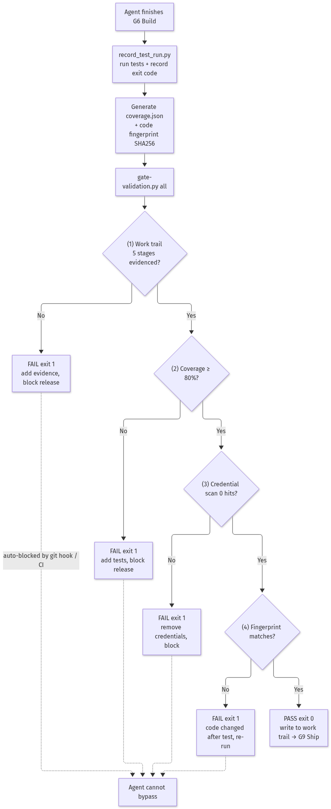
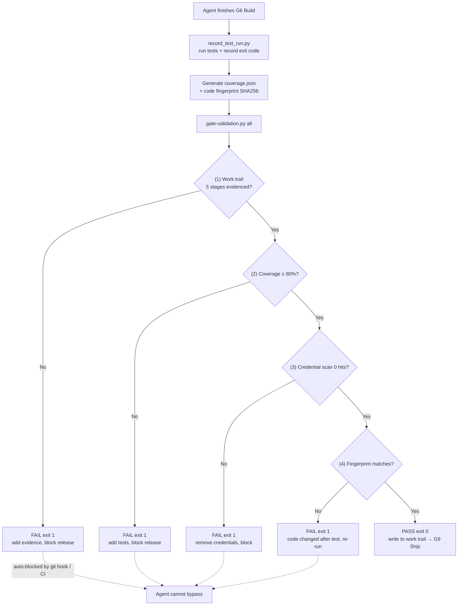

# Gate Validator Guide

> [gate-validation.py](./gate-validation.py) is the **machine-enforced executor** of the [G8 Test Gate](../docs/02-unified-framework/quality-gates.en.md): it turns "is coverage enough, did tests really run, are credentials leaking, was code changed after testing, is stage evidence complete" into a single exit code that git hooks / CI can consume directly. Pure standard library, zero dependencies, genuinely runnable.

[Home](../README.en.md) · [中文](./gate-validation.md) · [Testing System Index](./README.en.md) · [Coverage Report](./coverage-report.en.md)

---

## 1. Design Principles

The core lesson of Agentic OS: **an Agent saying "I tested it" doesn't count — the machine verifying it does**. The script reduces the abstract G8 criteria to four computable checks and expresses the verdict as an exit code.

<!-- IMG-EMBED -->
**图 1 · flowchart**



<details>
<summary>查看 Mermaid 源码（可编辑）</summary>



</details>

| Design Principle | Implementation |
|---|---|
| Quantifiable | Every check has a clear criterion: coverage ≥80%, non-empty evidence, 0 credential hits, equal fingerprints |
| Traceable | Output is evidence — paste it into the work trail / audit trail |
| Enforce where possible | Exit codes 0/1/2 consumed directly by pre-commit and CI |
| Zero dependencies | Only `argparse/json/re/pathlib/sys/hashlib`; works out of the box on Python 3 |
| Right-sized | Run `trail`/`coverage`/`credentials`/`fingerprint` individually, or `all` in one shot |

### The Four Checks and Criteria

| # | Check | Input | Criterion | Failure Consequence |
|---|---|---|---|---|
| 1 | Work trail `trail` | `work-trail.json` | `plan/build/review/test/ship` all have non-empty evidence; missing timestamp → WARN | Missing evidence → FAIL; missing timestamp → WARN |
| 2 | Coverage `coverage` | `coverage.json` | Weighted by `lines.total`: `<80%` FAIL, `[80,85)` WARN, `≥85%` PASS | Below threshold → block release |
| 3 | Credentials `credentials` | File / directory | Regex scan for AWS Key / private key / API key / Slack token / hardcoded password | Any hit → FAIL (P0 alert) |
| 4 | Fingerprint `fingerprint` | Code file + expected SHA256 | Current code SHA256 == expected value from the test run | Mismatch → FAIL (code changed after testing) |

### Exit Code Semantics (aligned with quality-gates.md)

| Exit Code | Meaning | CI Action |
|---:|---|---|
| `0` | PASS | Release, proceed to G9 |
| `1` | FAIL | Block release; must fix |
| `2` | WARN | Pass with risk recorded (e.g. coverage near threshold, missing timestamp) |

---

## 2. CLI Reference

| Subcommand | Key Arguments | Purpose |
|---|---|---|
| `--demo` | none | Built-in sample data; full report (76% FAIL → 89% PASS) |
| `trail` | `--file/-f` | Validate work-trail evidence |
| `coverage` | `--file/-f`, `--threshold/-t` (default 80) | Validate coverage |
| `credentials` | `--path/-p` | Scan for credential leaks |
| `fingerprint` | `--code/-c`, `--expected/-e` | Validate code fingerprint |
| `all` | `--trail --coverage --path --code --expected --threshold` | Full validation, worst status wins |

```bash
python3 gate-validation.py --help
python3 gate-validation.py --demo
python3 gate-validation.py coverage --file coverage.json --threshold 80
python3 gate-validation.py all --trail work-trail.json --coverage coverage.json \
  --path ./orderhub --code orderhub/domain.py --expected <sha256>
```

### Sample Input Data

`work-trail.json` (five-stage evidence; the Agent appends at each stage):

```json
{
  "project": "OrderHub",
  "gate": "G8",
  "stages": [
    {"stage": "plan",   "evidence": "plan.md (RewritePlan) @v1.4.0",        "timestamp": "2026-11-18T09:12:00Z"},
    {"stage": "build",  "evidence": "PR #218 / commit 9f3c1ab",             "timestamp": "2026-11-18T10:40:00Z"},
    {"stage": "review", "evidence": "review-report.md (2 findings resolved)","timestamp": "2026-11-18T11:05:00Z"},
    {"stage": "test",   "evidence": "test-run.json (exit=0, 214 passed)",   "timestamp": "2026-11-18T11:30:00Z"},
    {"stage": "ship",   "evidence": "release-record.md @4e8d2f1",           "timestamp": "2026-11-18T13:48:00Z"}
  ]
}
```

`coverage.json` (from coverage.py `--cov-report=json`, with covered/total per module for lines/branches/functions):

```json
{
  "project": "OrderHub",
  "modules": [
    {"name": "order/domain.py", "lines": {"covered": 190, "total": 220},
     "branches": {"covered": 48, "total": 58}, "functions": {"covered": 30, "total": 32}}
  ]
}
```

---

## 3. Wiring into a git pre-commit Hook

The example below re-runs tests and enforces the gate before each commit. **Key point**: exit `1` blocks the commit, exit `2` only warns — preserving the documented semantics.

`.git/hooks/pre-commit`:

```bash
#!/usr/bin/env bash
set -uo pipefail

echo "[gate] Running tests and generating coverage report ..."
python3 -m pytest --cov=orderhub --cov-report=json:coverage.json tests/ || {
  echo "[gate] Tests failed, blocking commit"; exit 1; }

python3 scripts/record_test_run.py --out test-run.json || exit 1

# Code fingerprint at the moment tests passed
EXPECTED=$(shasum -a 256 orderhub/domain.py | awk '{print $1}')

python3 tests/gate-validation.py all \
  --trail work-trail.json \
  --coverage coverage.json \
  --path ./orderhub \
  --code orderhub/domain.py \
  --expected "$EXPECTED"

STATUS=$?
if [ "$STATUS" -eq 1 ]; then
  echo "[gate] G8 validation failed (exit 1), commit blocked"
  exit 1
elif [ "$STATUS" -eq 2 ]; then
  echo "[gate] G8 warning (exit 2), commit allowed — please fix soon"
fi
exit 0
```

If your team uses the pre-commit framework, `.pre-commit-config.yaml`:

```yaml
repos:
  - repo: local
    hooks:
      - id: g8-coverage-gate
        name: G8 coverage >= 80%
        entry: python3 tests/gate-validation.py coverage --file coverage.json --threshold 80
        language: system
        pass_filenames: false
        stages: [pre-commit]
      - id: g8-credential-scan
        name: G8 credential scan
        entry: python3 tests/gate-validation.py credentials --path ./orderhub
        language: system
        pass_filenames: false
        stages: [pre-commit]
```

> Install with `pre-commit install`; from then on every `git commit` runs the gate automatically, and no Agent can bypass it with natural language.

---

## 4. Wiring into CI (GitHub Actions)

`.github/workflows/gate8.yml`:

```yaml
name: G8 Gate Validation
on: [push, pull_request]

jobs:
  validate:
    runs-on: ubuntu-latest
    steps:
      - uses: actions/checkout@v4
      - uses: actions/setup-python@v5
        with:
          python-version: '3.11'

      - name: Install test deps
        run: pip install pytest pytest-cov

      - name: Run real test suite + coverage
        run: pytest --cov=orderhub --cov-report=json:coverage.json tests/

      - name: Machine-enforced gate
        id: gate
        shell: bash
        run: |
          EXPECTED=$(sha256sum orderhub/domain.py | cut -d' ' -f1)
          set +e
          python3 tests/gate-validation.py all \
            --trail work-trail.json \
            --coverage coverage.json \
            --path ./orderhub \
            --code orderhub/domain.py \
            --expected "$EXPECTED"
          STATUS=$?
          set -e
          echo "status=$STATUS" >> "$GITHUB_OUTPUT"
          case "$STATUS" in
            0) echo "G8 PASSED" ;;
            1) echo "::error::G8 FAILED — coverage/evidence/credentials/fingerprint"; exit 1 ;;
            2) echo "::warning::G8 passed with warnings" ;;
          esac

      - name: Converge & ship
        if: steps.gate.outputs.status == '0'
        run: echo "converge = Converged → cleared for G9 Ship"
```

**CI essentials**:

| Essential | Description |
|---|---|
| Run the real suite | `pytest --cov`, not a fabricated coverage file; matches G8 "CI runs the real test suite" |
| Consume exit codes | Use `set +e` to capture the code, then branch on 0/1/2 |
| Blocking works | exit 1 fails the job, so the PR cannot merge |
| Evidence trail | Output is written to job logs, traceable as part of the work trail |

---

## 5. Machine-Enforced vs Advisory (The Agentic OS Idea)

This is the essential difference between this script and "rules written in a document":

| Dimension | Advisory (Rule Hint) | Machine-Enforced |
|---|---|---|
| Form | Doc says "coverage should be ≥80%" | CI parses coverage, `<80%` exits 1 |
| Bypass cost | Near zero: Agent just says "I tested it" | Extremely high: must add tests or change code, no discretion |
| Evidence | Promises / screenshots, hard to review | Work trail + fingerprint + exit code, auditable |
| Failure handling | Human reminder, may be ignored | Automatic block + 48-hour escalation (homegrown system) |
| Consistency | Different Agents interpret differently | Same code, same criteria, reproducible result |
| Representative tools | Checklists, READMEs | [gate-validation.py](./gate-validation.py), git hooks, CI |
| Agentic OS view | "Rules are suggestions; Agents rationalize skipping them" | "A gate must be unbypassable, or it is worthless" |

> **Conclusion**: push every machine-judgeable gate (coverage, credentials, evidence, fingerprint) down into hooks/CI; leave human-judgment decisions (architecture trade-offs, requirement trade-offs) to the human gates in G4/G7. This is exactly what "enforce what you can" means in practice.

---

## 6. Verified Demo Output

Run `python3 gate-validation.py --demo` — no dependencies, no data preparation. The following is **actual output** (the script's UI is in Chinese), showing both the "before remediation failure" and "after remediation pass" validations:

```
════════════════════════════════════════════════════════════════════════
  GATE VALIDATOR · DEMO · Agentic OS 机器强制门禁
  项目: OrderHub  |  门禁: G8 测试验证  |  门槛: 覆盖率 >= 80.0%
════════════════════════════════════════════════════════════════════════
  本演示内置样例数据，依次展示「补测前失败」与「补测后通过」两段校验。

▶
  场景 A · 首次校验（补测前，commit 9f3c1ab）
  覆盖率 76.4% 未达标 + 缺 ship 证据 + 3 处凭证泄露 + 指纹不一致
────────────────────────────────────────────────────────────────────────
  [1/4] 工作轨迹证据 (Work Trail) [FAIL]
  STAGE     EVIDENCE                                        TIMESTAMP
  plan      plan.md (RewritePlan) @v1.4.0                   2026-11-18T09:12:00Z
  build     PR #218 / commit 9f3c1ab                        2026-11-18T10:40:00Z
  review    review-report.md (2 findings resolved)          2026-11-18T11:05:00Z
  test      test-run.json (pytest exit=0, 214 passed)       2026-11-18T11:30:00Z
  [FAIL] 阶段 'ship' 无任何轨迹记录 (missing trail)

  [2/4] 测试覆盖率 (Coverage, threshold 80.0%) [FAIL]
  MODULE                              LINES   BRANCH     FUNC
  order/domain.py                     83.6%    75.9%    87.5%
  payment/gateway.py                  60.0%    43.8%    57.7%
  inventory/stock.py                  87.5%    86.7%    90.0%
  api/order_routes.py                 85.6%    82.5%    88.0%
  notification/notify.py              60.0%    50.0%    50.0%
  OVERALL (weighted)                  76.4%    68.0%    76.0%
  [FAIL] 整体覆盖率 76.4% < 门槛 80.0%

  [3/4] 凭证泄露扫描 (Credential Scan) [FAIL]
  已扫描 1 个文件，命中 3 处
  [HIT]  payment/gateway.py:2  AWS Access Key  | API_KEY = "AKIA1234567890ABCDEF"
  [HIT]  payment/gateway.py:4  Generic API Key  | api_key = "sk_live_51H8xY2eZvKYlo2C9qW3rTn"
  [HIT]  payment/gateway.py:5  Hardcoded Password  | password = "sup3rS3cretPwd!"
```

```
  [4/4] 测试运行指纹 (Test-run Fingerprint) [FAIL]
  expected: c95abf6f8c5520459e5fad1bfb7bc5932aa5e68cf9870b6e1a652ff2bc7f1d69
  actual  : c260a18bfee98bff086497264c9ca0b6840fbd6622761ac417730dd4b46ead39
  [FAIL] 指纹不一致：测试后代码被改动 (code changed after test run)

────────────────────────────────────────────────────────────────────────
  场景判定: GATE FAILED  (退出码 1)
────────────────────────────────────────────────────────────────────────

▶
  场景 B · 补测修复后重新校验（commit 4e8d2f1）
  覆盖率 89.0% 达标 + 证据齐全 + 凭证清零 + 指纹一致
────────────────────────────────────────────────────────────────────────
  [1/4] 工作轨迹证据 (Work Trail) [PASS]
  STAGE     EVIDENCE                                        TIMESTAMP
  plan      plan.md (RewritePlan) @v1.4.0                   2026-11-18T09:12:00Z
  build     PR #218 / commit 9f3c1ab                        2026-11-18T10:40:00Z
  review    review-report.md (2 findings resolved)          2026-11-18T11:05:00Z
  test      test-run.json (pytest exit=0, 214 passed)       2026-11-18T11:30:00Z
  ship      release-record.md (dry-run ok) @4e8d2f1         2026-11-18T13:48:00Z

  [2/4] 测试覆盖率 (Coverage, threshold 80.0%) [PASS]
  MODULE                              LINES   BRANCH     FUNC
  order/domain.py                     86.4%    82.8%    93.8%
  payment/gateway.py                  86.7%    83.3%    88.5%
  inventory/stock.py                  91.7%    93.3%    95.0%
  api/order_routes.py                 92.2%    92.5%    96.0%
  notification/notify.py              90.0%    87.5%    94.4%
  OVERALL (weighted)                  89.0%    87.0%    93.4%
  [PASS] 覆盖率 89.0% >= 门槛 80.0%

  [3/4] 凭证泄露扫描 (Credential Scan) [PASS]
  已扫描 1 个文件，命中 0 处
  [PASS] 未发现凭证泄露

  [4/4] 测试运行指纹 (Test-run Fingerprint) [PASS]
  expected: c95abf6f8c5520459e5fad1bfb7bc5932aa5e68cf9870b6e1a652ff2bc7f1d69
  actual  : c95abf6f8c5520459e5fad1bfb7bc5932aa5e68cf9870b6e1a652ff2bc7f1d69
  [PASS] 指纹一致：测试后代码未变更

────────────────────────────────────────────────────────────────────────
  场景判定: GATE PASSED  (退出码 0)
────────────────────────────────────────────────────────────────────────

════════════════════════════════════════════════════════════════════════
  DEMO 完成
  场景 A 退出码 = 1 (FAIL)  →  场景 B 退出码 = 0 (PASS)
════════════════════════════════════════════════════════════════════════
  门禁规则: 0=通过 / 1=错误 / 2=警告  —— 与 quality-gates.md 一致
════════════════════════════════════════════════════════════════════════
```

> The credential strings in the output are **fake sample values** for demonstration, not real secrets.

---

## 7. FAQ

| Question | Answer |
|---|---|
| No third-party dependencies — will it run anywhere? | Yes. Python 3 and the standard library are all you need. |
| Where does the coverage report come from? | `pytest --cov=... --cov-report=json:coverage.json`, or any tool producing the same structure. |
| How is the fingerprint recorded? | At the moment tests pass, hash the code with `shasum -a 256` / `sha256sum` and store it as the expected value in `test-run.json`. |
| Does WARN (exit 2) block? | No by default (see hook/CI configs), but the risk is logged and must be fixed within a set period. |
| Can I run only one check? | Yes — use the `trail`/`coverage`/`credentials`/`fingerprint` subcommands individually. |
| Are the credential regexes enough? | They are demo-grade, covering AWS Key/private key/API key/Slack token/password. In production, layer in a dedicated scanner. |

---

*Gate validator guide is part of the [AI Workflow Hub](../README.en.md) testing system · Stdlib-only runnable script · Bilingual*
