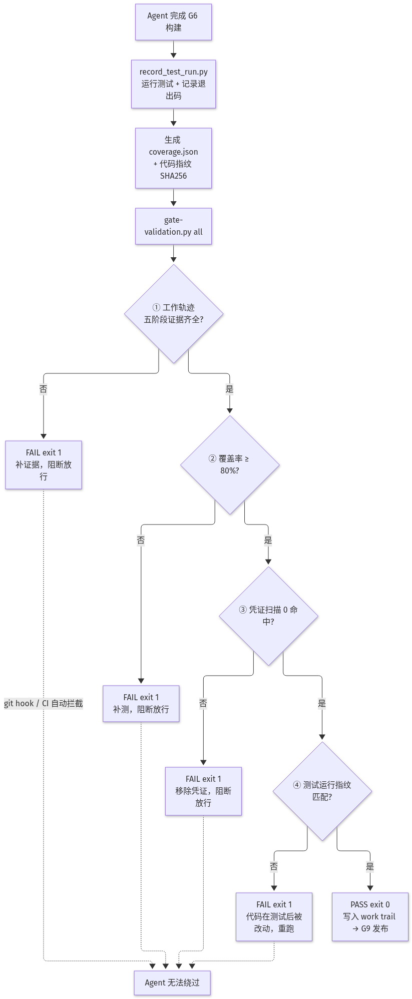
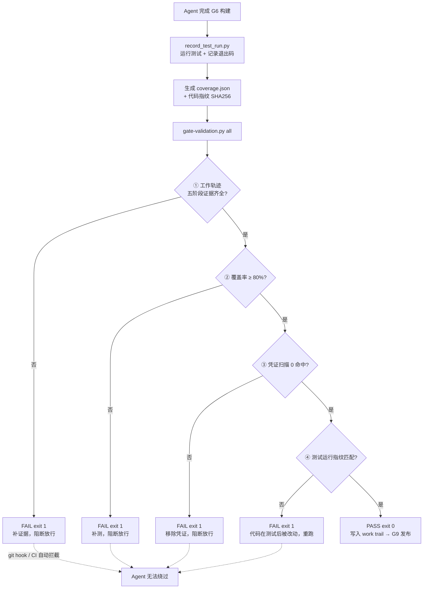

# 门禁校验脚本说明（Gate Validator Guide）

> [gate-validation.py](./gate-validation.py) 是 [G8 测试门禁](../docs/02-unified-framework/quality-gates.md) 的**机器强制执行器**：它把"覆盖率够不够、测试有没有真跑、凭证有没有泄露、代码有没有在测试后被改动、阶段证据齐不齐"变成一条可被 git hook / CI 直接消费的退出码。纯标准库、零依赖、真实可运行。

[返回首页](../README.md) · [English](./gate-validation.en.md) · [测试体系总索引](./README.md) · [覆盖率报告](./coverage-report.md)

---

## 一、设计原理（Design Principles）

Agentic OS 的核心教训是：**Agent 说"我测过了"不算数，机器验过才算数**。脚本把 G8 门禁的抽象判据落为四项可计算检查，并用退出码表达结论。

<!-- IMG-EMBED -->
**图 1 · flowchart**



<details>
<summary>查看 Mermaid 源码（可编辑）</summary>



</details>

| 设计原则 | 落地方式 |
|---|---|
| 可量化 | 每项检查有明确判据：覆盖率 ≥80%、证据非空、凭证 0 命中、指纹相等 |
| 可追溯 | 输出即证据，可粘贴进 work trail / 审计轨迹 |
| 能强制就强制 | 退出码 0/1/2 直接被 pre-commit 与 CI 消费 |
| 零依赖 | 仅用 `argparse/json/re/pathlib/sys/hashlib`，Python 3 开箱即用 |
| 按规模裁剪 | 可单独跑 `trail`/`coverage`/`credentials`/`fingerprint`，也可 `all` 一次跑完 |

### 四项检查与判据

| # | 检查项 | 输入 | 判据 | 失败后果 |
|---|---|---|---|---|
| 1 | 工作轨迹 `trail` | `work-trail.json` | `plan/build/review/test/ship` 五阶段均有非空 evidence；缺 timestamp 记 WARN | 缺证据 → FAIL；时间戳缺失 → WARN |
| 2 | 覆盖率 `coverage` | `coverage.json` | 按 `lines.total` 加权：`<80%` FAIL，`[80,85)` WARN，`≥85%` PASS | 低于门槛 → 阻断放行 |
| 3 | 凭证 `credentials` | 文件/目录 | 正则扫描 AWS Key / 私钥 / API Key / Slack Token / 硬编码密码 | 任一命中 → FAIL（P0 告警） |
| 4 | 指纹 `fingerprint` | 代码文件 + 期望 SHA256 | 当前代码 SHA256 == 测试运行记录的期望值 | 不一致 → FAIL（测试后改了代码） |

### 退出码语义（与 quality-gates.md 对齐）

| 退出码 | 含义 | CI 动作 |
|---:|---|---|
| `0` | 通过 PASS | 放行，进入 G9 |
| `1` | 错误 FAIL | 阻断放行，必须修复 |
| `2` | 警告 WARN | 放行但记录风险（如覆盖率贴线、缺 timestamp） |

---

## 二、命令行接口（CLI Reference）

| 子命令 | 关键参数 | 作用 |
|---|---|---|
| `--demo` | 无 | 内置示例数据，输出完整校验报告（76% FAIL → 89% PASS） |
| `trail` | `--file/-f` | 校验工作轨迹证据 |
| `coverage` | `--file/-f`、`--threshold/-t`（默认 80） | 校验覆盖率 |
| `credentials` | `--path/-p` | 扫描凭证泄露 |
| `fingerprint` | `--code/-c`、`--expected/-e` | 校验代码指纹 |
| `all` | `--trail --coverage --path --code --expected --threshold` | 综合校验，取最严重状态 |

```bash
python3 gate-validation.py --help
python3 gate-validation.py --demo
python3 gate-validation.py coverage --file coverage.json --threshold 80
python3 gate-validation.py all --trail work-trail.json --coverage coverage.json \
  --path ./orderhub --code orderhub/domain.py --expected <sha256>
```

### 输入数据格式示例

`work-trail.json`（五阶段证据，可由 Agent 每阶段自动追加）：

```json
{
  "project": "OrderHub",
  "gate": "G8",
  "stages": [
    {"stage": "plan",   "evidence": "plan.md (RewritePlan) @v1.4.0",        "timestamp": "2026-11-18T09:12:00Z"},
    {"stage": "build",  "evidence": "PR #218 / commit 9f3c1ab",             "timestamp": "2026-11-18T10:40:00Z"},
    {"stage": "review", "evidence": "review-report.md (2 findings resolved)","timestamp": "2026-11-18T11:05:00Z"},
    {"stage": "test",   "evidence": "test-run.json (exit=0, 214 passed)",   "timestamp": "2026-11-18T11:30:00Z"},
    {"stage": "ship",   "evidence": "release-record.md @4e8d2f1",           "timestamp": "2026-11-18T13:48:00Z"}
  ]
}
```

`coverage.json`（coverage.py `--cov-report=json` 产物，按模块给出 lines/branches/functions 的 covered 与 total）：

```json
{
  "project": "OrderHub",
  "modules": [
    {"name": "order/domain.py", "lines": {"covered": 190, "total": 220},
     "branches": {"covered": 48, "total": 58}, "functions": {"covered": 30, "total": 32}}
  ]
}
```

---

## 三、接入 git pre-commit hook

以下示例在提交前重跑测试并强制校验。**关键**：退出码 `1` 阻断提交，`2` 仅警告放行，保持语义一致。

`.git/hooks/pre-commit`：

```bash
#!/usr/bin/env bash
set -uo pipefail

echo "[gate] 运行测试并生成覆盖率报告 ..."
python3 -m pytest --cov=orderhub --cov-report=json:coverage.json tests/ || {
  echo "[gate] 测试失败，提交阻断"; exit 1; }

python3 scripts/record_test_run.py --out test-run.json || exit 1

# 测试通过那一刻的代码指纹
EXPECTED=$(shasum -a 256 orderhub/domain.py | awk '{print $1}')

python3 tests/gate-validation.py all \
  --trail work-trail.json \
  --coverage coverage.json \
  --path ./orderhub \
  --code orderhub/domain.py \
  --expected "$EXPECTED"

STATUS=$?
if [ "$STATUS" -eq 1 ]; then
  echo "[gate] G8 校验失败（exit 1），提交已阻断"
  exit 1
elif [ "$STATUS" -eq 2 ]; then
  echo "[gate] G8 警告（exit 2），允许提交但请尽快修复"
fi
exit 0
```

若团队使用 pre-commit 框架，`.pre-commit-config.yaml`：

```yaml
repos:
  - repo: local
    hooks:
      - id: g8-coverage-gate
        name: G8 coverage >= 80%
        entry: python3 tests/gate-validation.py coverage --file coverage.json --threshold 80
        language: system
        pass_filenames: false
        stages: [pre-commit]
      - id: g8-credential-scan
        name: G8 credential scan
        entry: python3 tests/gate-validation.py credentials --path ./orderhub
        language: system
        pass_filenames: false
        stages: [pre-commit]
```

> 安装：`pre-commit install`；此后每次 `git commit` 自动执行，Agent 无法用自然语言绕过。

---

## 四、接入 CI（GitHub Actions）

`.github/workflows/gate8.yml`：

```yaml
name: G8 Gate Validation
on: [push, pull_request]

jobs:
  validate:
    runs-on: ubuntu-latest
    steps:
      - uses: actions/checkout@v4
      - uses: actions/setup-python@v5
        with:
          python-version: '3.11'

      - name: Install test deps
        run: pip install pytest pytest-cov

      - name: Run real test suite + coverage
        run: pytest --cov=orderhub --cov-report=json:coverage.json tests/

      - name: Machine-enforced gate
        id: gate
        shell: bash
        run: |
          EXPECTED=$(sha256sum orderhub/domain.py | cut -d' ' -f1)
          set +e
          python3 tests/gate-validation.py all \
            --trail work-trail.json \
            --coverage coverage.json \
            --path ./orderhub \
            --code orderhub/domain.py \
            --expected "$EXPECTED"
          STATUS=$?
          set -e
          echo "status=$STATUS" >> "$GITHUB_OUTPUT"
          case "$STATUS" in
            0) echo "G8 PASSED" ;;
            1) echo "::error::G8 FAILED — 覆盖率/证据/凭证/指纹不达标"; exit 1 ;;
            2) echo "::warning::G8 passed with warnings" ;;
          esac

      - name: Converge & ship
        if: steps.gate.outputs.status == '0'
        run: echo "converge = Converged → 允许进入 G9 发布"
```

**CI 要点**：

| 要点 | 说明 |
|---|---|
| 跑真实测试套件 | `pytest --cov`，不是伪造的覆盖率文件；对应 G8 "CI 跑的是真实测试" |
| 退出码消费 | `set +e` 捕获退出码后按 0/1/2 分支处理 |
| 阻断生效 | exit 1 时 job 失败，PR 无法合并 |
| 证据留痕 | 输出写入 job 日志，可追溯为 work trail 的一部分 |

---

## 五、机器强制 vs 规则提示（Agentic OS 核心思想）

这是本脚本与"写在文档里的规范"的本质区别：

| 维度 | 规则提示（Advisory） | 机器强制（Machine-Enforced） |
|---|---|---|
| 形式 | 文档写"覆盖率应该 ≥80%" | CI 解析覆盖率，`<80%` 直接 exit 1 |
| 绕过成本 | 近乎为零：Agent 说"我测了"即可 | 极高：必须补测或改代码，无自由裁量 |
| 证据 | 口头承诺 / 截图，难以复核 | work trail + 指纹 + 退出码，可审计 |
| 失败处理 | 人工提醒，可能石沉大海 | 自动阻断 + 48 小时超时升级（自有体系） |
| 一致性 | 不同 Agent 理解不同 | 同一份代码、同一套判据，结果可复现 |
| 代表工具 | checklist、README | [gate-validation.py](./gate-validation.py)、git hook、CI |
| Agentic OS 观点 | "规则只是建议，Agent 会自我合理化跳过" | "门禁必须不可绕过，否则形同虚设" |

> **结论**：把能机器判定的门禁（覆盖率、凭证、证据、指纹）全部下沉到 hook/CI；把需要人类判断的部分（架构权衡、需求取舍）留给 G4/G7 人工门禁。这正是"能强制就强制"原则的落地。

---

## 六、Demo 真实输出（Verified Demo Output）

运行 `python3 gate-validation.py --demo`，无依赖、无需准备数据。以下为**实际运行输出**（脚本界面为中文），完整展示"补测前失败 → 补测后通过"两段校验：

```
════════════════════════════════════════════════════════════════════════
  GATE VALIDATOR · DEMO · Agentic OS 机器强制门禁
  项目: OrderHub  |  门禁: G8 测试验证  |  门槛: 覆盖率 >= 80.0%
════════════════════════════════════════════════════════════════════════
  本演示内置样例数据，依次展示「补测前失败」与「补测后通过」两段校验。

▶
  场景 A · 首次校验（补测前，commit 9f3c1ab）
  覆盖率 76.4% 未达标 + 缺 ship 证据 + 3 处凭证泄露 + 指纹不一致
────────────────────────────────────────────────────────────────────────
  [1/4] 工作轨迹证据 (Work Trail) [FAIL]
  STAGE     EVIDENCE                                        TIMESTAMP
  plan      plan.md (RewritePlan) @v1.4.0                   2026-11-18T09:12:00Z
  build     PR #218 / commit 9f3c1ab                        2026-11-18T10:40:00Z
  review    review-report.md (2 findings resolved)          2026-11-18T11:05:00Z
  test      test-run.json (pytest exit=0, 214 passed)       2026-11-18T11:30:00Z
  [FAIL] 阶段 'ship' 无任何轨迹记录 (missing trail)

  [2/4] 测试覆盖率 (Coverage, threshold 80.0%) [FAIL]
  MODULE                              LINES   BRANCH     FUNC
  order/domain.py                     83.6%    75.9%    87.5%
  payment/gateway.py                  60.0%    43.8%    57.7%
  inventory/stock.py                  87.5%    86.7%    90.0%
  api/order_routes.py                 85.6%    82.5%    88.0%
  notification/notify.py              60.0%    50.0%    50.0%
  OVERALL (weighted)                  76.4%    68.0%    76.0%
  [FAIL] 整体覆盖率 76.4% < 门槛 80.0%

  [3/4] 凭证泄露扫描 (Credential Scan) [FAIL]
  已扫描 1 个文件，命中 3 处
  [HIT]  payment/gateway.py:2  AWS Access Key  | API_KEY = "AKIA1234567890ABCDEF"
  [HIT]  payment/gateway.py:4  Generic API Key  | api_key = "sk_live_51H8xY2eZvKYlo2C9qW3rTn"
  [HIT]  payment/gateway.py:5  Hardcoded Password  | password = "sup3rS3cretPwd!"
```

```
  [4/4] 测试运行指纹 (Test-run Fingerprint) [FAIL]
  expected: c95abf6f8c5520459e5fad1bfb7bc5932aa5e68cf9870b6e1a652ff2bc7f1d69
  actual  : c260a18bfee98bff086497264c9ca0b6840fbd6622761ac417730dd4b46ead39
  [FAIL] 指纹不一致：测试后代码被改动 (code changed after test run)

────────────────────────────────────────────────────────────────────────
  场景判定: GATE FAILED  (退出码 1)
────────────────────────────────────────────────────────────────────────

▶
  场景 B · 补测修复后重新校验（commit 4e8d2f1）
  覆盖率 89.0% 达标 + 证据齐全 + 凭证清零 + 指纹一致
────────────────────────────────────────────────────────────────────────
  [1/4] 工作轨迹证据 (Work Trail) [PASS]
  STAGE     EVIDENCE                                        TIMESTAMP
  plan      plan.md (RewritePlan) @v1.4.0                   2026-11-18T09:12:00Z
  build     PR #218 / commit 9f3c1ab                        2026-11-18T10:40:00Z
  review    review-report.md (2 findings resolved)          2026-11-18T11:05:00Z
  test      test-run.json (pytest exit=0, 214 passed)       2026-11-18T11:30:00Z
  ship      release-record.md (dry-run ok) @4e8d2f1         2026-11-18T13:48:00Z

  [2/4] 测试覆盖率 (Coverage, threshold 80.0%) [PASS]
  MODULE                              LINES   BRANCH     FUNC
  order/domain.py                     86.4%    82.8%    93.8%
  payment/gateway.py                  86.7%    83.3%    88.5%
  inventory/stock.py                  91.7%    93.3%    95.0%
  api/order_routes.py                 92.2%    92.5%    96.0%
  notification/notify.py              90.0%    87.5%    94.4%
  OVERALL (weighted)                  89.0%    87.0%    93.4%
  [PASS] 覆盖率 89.0% >= 门槛 80.0%

  [3/4] 凭证泄露扫描 (Credential Scan) [PASS]
  已扫描 1 个文件，命中 0 处
  [PASS] 未发现凭证泄露

  [4/4] 测试运行指纹 (Test-run Fingerprint) [PASS]
  expected: c95abf6f8c5520459e5fad1bfb7bc5932aa5e68cf9870b6e1a652ff2bc7f1d69
  actual  : c95abf6f8c5520459e5fad1bfb7bc5932aa5e68cf9870b6e1a652ff2bc7f1d69
  [PASS] 指纹一致：测试后代码未变更

────────────────────────────────────────────────────────────────────────
  场景判定: GATE PASSED  (退出码 0)
────────────────────────────────────────────────────────────────────────

════════════════════════════════════════════════════════════════════════
  DEMO 完成
  场景 A 退出码 = 1 (FAIL)  →  场景 B 退出码 = 0 (PASS)
════════════════════════════════════════════════════════════════════════
  门禁规则: 0=通过 / 1=错误 / 2=警告  —— 与 quality-gates.md 一致
════════════════════════════════════════════════════════════════════════
```

> 输出中的凭证字符串均为演示用的**假凭证**（测试样本），不是真实密钥。

---

## 七、常见问题（FAQ）

| 问题 | 回答 |
|---|---|
| 没有第三方依赖，能在任意环境跑吗？ | 可以，只需 Python 3（标准库即可）。 |
| 覆盖率报告从哪来？ | `pytest --cov=... --cov-report=json:coverage.json`，或任意能产出同名结构的工具。 |
| 指纹怎么记录？ | 测试通过那一刻用 `shasum -a 256` / `sha256sum` 算代码哈希，写入 `test-run.json` 的期望值。 |
| WARN（退出码 2）会阻断吗？ | 默认放行（见 pre-commit / CI 配置），但会记录风险，需限期修复。 |
| 能只跑其中一项吗？ | 可以，用 `trail`/`coverage`/`credentials`/`fingerprint` 子命令单独跑。 |
| 凭证扫描规则够用吗？ | 演示级正则，覆盖 AWS Key/私钥/API Key/Slack Token/密码；生产建议叠加专用扫描器。 |

---

*门禁校验脚本说明属 [AI Workflow Hub](../README.md) 测试体系 · 脚本纯标准库可运行 · 中英双语*
