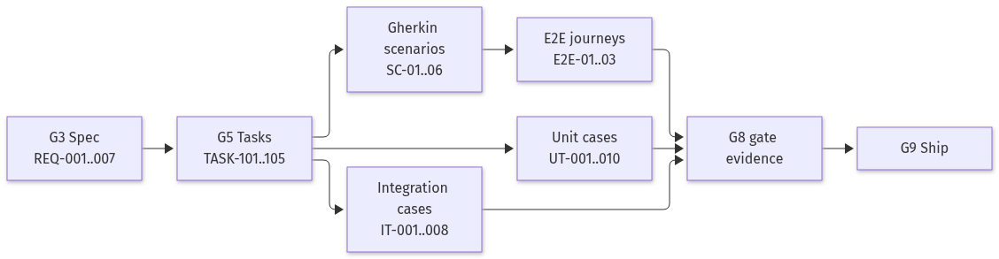
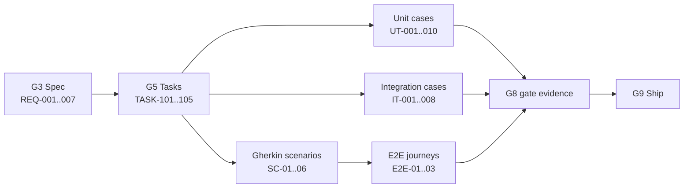

# Test Case Examples

> Using the e-commerce order system **OrderHub** (aligned with the case repository) as the system under test, this document provides a reusable set of samples from Gherkin acceptance scenarios through unit/integration/E2E cases to the requirement-ID traceability matrix. All numbers, IDs, and paths are concrete examples you can adapt directly.

[Home](../README.en.md) · [中文](./test-cases.md) · [Test Strategy](./test-strategy.en.md) · [Coverage Report](./coverage-report.en.md)

---

## 1. SUT & Requirement Baseline

**OrderHub** is an order microservice. Core flow: place order → reserve stock → pay → order state transitions → query/cancel.

| Req ID | User Story | Acceptance Point | Linked Task ID |
|---|---|---|---|
| REQ-001 | As a buyer, I can submit an order | Generate a unique order number; initial status `PENDING_PAYMENT` | TASK-101 |
| REQ-002 | As the system, reserve stock when ordering | Reject if insufficient; deduct only after successful payment | TASK-102 |
| REQ-003 | As a buyer, I can pay for an order | Success → `PAID` and stock deducted; failure → status unchanged | TASK-103 |
| REQ-004 | As a buyer, I can cancel an unpaid order | Cancel → `CANCELLED` and stock released; paid orders cannot be cancelled | TASK-101 |
| REQ-005 | As a buyer, I can only query my own orders | Auth check; 403 on unauthorized; 404 on not found | TASK-104 |
| REQ-006 | As the system, order totals must be computed correctly | unit price × qty; free shipping at ≥99, else 10.00; coupon discount | TASK-105 |
| REQ-007 | As the system, duplicate submissions must not create duplicate orders | Idempotency key dedup; return the same order | TASK-104 |

**Baseline test data**: product `SKU-A` at `50.00`, initial stock `100`, user `U-1001`, free-shipping threshold `99.00` / shipping `10.00`.

### Traceability Flow

<!-- IMG-EMBED -->
**图 1 · flowchart**



<details>
<summary>查看 Mermaid 源码（可编辑）</summary>



</details>

---

## 2. Gherkin Acceptance Scenarios

In Given / When / Then format, covering **happy-path, boundary, and exception** cases. These scenarios are the testable acceptance criteria of the G3 spec (required by Gate 3).

### SC-01 Happy path: create order successfully

```gherkin
Feature: Create Order (REQ-001 / REQ-002 / REQ-006)
  Scenario: Buyer creates an order successfully with free shipping over threshold
    Given user "U-1001" is logged in
      And product "SKU-A" costs 50.00 with stock 100
    When the user submits an order: SKU-A quantity 2, idempotency key "K-1001"
    Then the system returns a unique order number starting with "ORD-" with status 201
      And the order status is "PENDING_PAYMENT"
      And subtotal is 100.00, shipping is 0.00 (free over 99), total is 100.00
      And stock is reserved by 2 units, available stock becomes 98
```

### SC-02 Boundary: free-shipping threshold

```gherkin
  Scenario Outline: Totals on both sides of the free-shipping threshold
    Given product "SKU-A" costs 50.00
    When the user submits an order with quantity <quantity>
    Then subtotal is <subtotal>, shipping is <shipping>, total is <total>

    Examples:
      | quantity | subtotal | shipping | total  | note                    |
      | 1        | 50.00    | 10.00    | 60.00  | 98.99 < 99, shipping on |
      | 2        | 100.00   | 0.00     | 100.00 | exactly 99, free ship   |
```

### SC-03 Exception: insufficient stock

```gherkin
  Scenario: Reject an order when stock is insufficient
    Given product "SKU-A" has 100 units available
    When the user submits an order: SKU-A quantity 200
    Then the system rejects the order with status 409
      And the error code is "INSUFFICIENT_STOCK"
      And no order is created and stock stays unchanged
```

### SC-04 Exception: payment failure leaves state unchanged

```gherkin
  Scenario: Order state and stock reservation survive a payment gateway failure
    Given order "ORD-20261118-001" is "PENDING_PAYMENT" with 2 units reserved
    When the payment gateway fails (insufficient balance)
    Then the payment endpoint returns a failure result
      And the order status remains "PENDING_PAYMENT"
      And the 2 reserved units are neither deducted nor released
```

### SC-05 Exception: idempotent duplicate submission

```gherkin
  Scenario: Reusing an idempotency key produces only one order
    Given user "U-1001" created order "ORD-20261118-001" with key "K-1001"
    When the user submits the same order again with key "K-1001"
    Then the system returns the same order number "ORD-20261118-001"
      And stock was reserved only once (available stock is still 98)
```

### SC-06 Boundary: cancelling an unpaid order releases stock

```gherkin
  Scenario: Cancelling an unpaid order rolls stock back
    Given order "ORD-20261118-002" is "PENDING_PAYMENT" with 2 units reserved
    When the user cancels the order
    Then the order status becomes "CANCELLED"
      And the reservation is released, available stock recovers from 98 to 100
```

---

## 3. Unit Test Cases

Functions under test: `calculateTotal`, `reserveStock`, `payOrder`, `cancelOrder`, `createOrder`.

| Case ID | Function | Input | Expected Output | Req ID |
|---|---|---|---|---|
| UT-001 | `calculateTotal` | qty=2, price=50.00, coupon=null | subtotal=100.00, shipping=0.00, total=100.00 | REQ-006 |
| UT-002 | `calculateTotal` | qty=1, price=50.00, coupon=null | subtotal=50.00, shipping=10.00, total=60.00 | REQ-006 |
| UT-003 | `calculateTotal` | qty=2, price=50.00, coupon=10.00 | total=90.00 (discount before shipping) | REQ-006 |
| UT-004 | `reserveStock` | qty=200, available=100 | raises `InsufficientStock` | REQ-002 |
| UT-005 | `reserveStock` | qty=100, available=100 | success, remaining=0 (exact boundary) | REQ-002 |
| UT-006 | `payOrder` | status=PENDING_PAYMENT, gateway=FAILED | status stays PENDING_PAYMENT, reservation unchanged | REQ-003 |
| UT-007 | `payOrder` | status=PENDING_PAYMENT, gateway=SUCCESS | status becomes PAID, stock deducted by 2 | REQ-003 / REQ-002 |
| UT-008 | `cancelOrder` | status=PENDING_PAYMENT | status becomes CANCELLED, stock released by 2 | REQ-004 |
| UT-009 | `cancelOrder` | status=PAID | raises `InvalidStateTransition` | REQ-004 |
| UT-010 | `createOrder` | idempotencyKey="K-1001" (exists) | returns existing orderId, no new order | REQ-007 |

**Parameterized unit test example (pytest)**:

```python
import pytest
from orderhub.domain import calculate_total, InsufficientStock, reserve_stock

@pytest.mark.parametrize("qty,price,coupon,expected_total", [
    (2, 50.00, None, 100.00),   # UT-001 free shipping over 99
    (1, 50.00, None, 60.00),    # UT-002 shipping under 99
    (2, 50.00, 10.00, 90.00),   # UT-003 coupon
])
def test_calculate_total(qty, price, coupon, expected_total):
    # Requirement ID: REQ-006 — expected comes from the requirement, not implementation
    assert calculate_total(qty, price, coupon) == pytest.approx(expected_total)

def test_reserve_stock_insufficient():  # UT-004 / REQ-002
    with pytest.raises(InsufficientStock):
        reserve_stock(qty=200, available=100)
```

---

## 4. Integration Test Cases (API Level)

| Case ID | Endpoint & Method | Request Highlights | Expected Status | Expected Response | Req ID |
|---|---|---|---:|---|---|
| IT-001 | `POST /api/v1/orders` | U-1001, SKU-A×2, key=K1 | 201 | orderId, total=100.00, status=PENDING_PAYMENT | REQ-001/002/006 |
| IT-002 | `POST /api/v1/orders` | SKU-A×200 (insufficient) | 409 | `{"code":"INSUFFICIENT_STOCK"}` | REQ-002 |
| IT-003 | `POST /api/v1/orders` | duplicate key=K1 | 200 | same orderId as IT-001 | REQ-007 |
| IT-004 | `GET /api/v1/orders/{id}` | using another user's token | 403 | `{"code":"FORBIDDEN"}` | REQ-005 |
| IT-005 | `POST /api/v1/orders/{id}/pay` | payment succeeds | 200 | status=PAID, stock deducted | REQ-003 |
| IT-006 | `POST /api/v1/orders/{id}/pay` | gateway failure | 200 | status=PENDING_PAYMENT, stock unchanged | REQ-003 |
| IT-007 | `DELETE /api/v1/orders/{id}` | unpaid order | 204 | empty body; stock released | REQ-004 |
| IT-008 | `GET /api/v1/orders/NOPE` | non-existent order | 404 | `{"code":"ORDER_NOT_FOUND"}` | REQ-005 |

> Integration tests boot the real API and an in-memory database via TestClient; only the **payment gateway** is stubbed to avoid external dependencies.

---

## 5. End-to-End Journeys

| Journey ID | User Journey Steps | Key Verification Points | Req ID |
|---|---|---|---|
| E2E-01 | Login → view SKU-A → add 2 → checkout (free ship over 99) → pay → order detail | Status `PAID`; page shows 100.00; stock 98 in backend | REQ-001/002/003/006 |
| E2E-02 | Login → order → payment fails → back to order page → retry payment | Status stays `PENDING_PAYMENT` after failure; `PAID` after retry; stock deducted once | REQ-003/007 |
| E2E-03 | Login → order → cancel → check stock | Order `CANCELLED`; product page stock restored to 100 | REQ-004/002 |

---

## 6. Boundary & Equivalence Partitioning

### 6.1 Equivalence Classes

| Input Domain | Valid Class | Invalid Class | Covered By |
|---|---|---|---|
| Purchase quantity | 1 ≤ qty ≤ 99 | 0, negative, ≥100 | UT-004, UT-005, IT-002 |
| Unit price | price > 0 | 0, negative | UT-001 (valid representative) |
| Coupon | valid & unexpired | expired code, invalid code | UT-003 |
| Payment method | balance, card, third-party | unsupported method | IT-005/006 |
| Idempotency key | non-empty string | empty, overlong | IT-003, UT-010 |

### 6.2 Boundary Value Analysis

| Field | Boundary Point | Test Value | Expected Result |
|---|---|---|---|
| Quantity | lower bound | 1 | Order succeeds |
| Quantity | lower − 1 | 0 | Validation fails (400) |
| Quantity | upper bound | 99 | Order succeeds |
| Quantity | upper + 1 | 100 | Validation fails (400) |
| Order amount | free-ship threshold | 99.00 | Shipping 0 (UT-001 scenario) |
| Order amount | threshold − 0.01 | 98.99 | Shipping 10 (SC-02) |
| Available stock | exactly depleted | qty=100, avail=100 | Success, remaining=0 (UT-005) |
| Available stock | just short | qty=101, avail=100 | Rejected (UT-004 class) |

---

## 7. Test Case → Requirement ID Traceability Matrix

> Gate requirement: no empty IDs or orphan requirements. Each row must be covered by at least one case to satisfy ID traceability in Gate 3 / Gate 8.

| Req ID | Gherkin Scenarios | Unit Cases | Integration Cases | E2E Journeys | Status |
|---|---|---|---|---|---|
| REQ-001 | SC-01 | UT-010 | IT-001 | E2E-01 | Covered |
| REQ-002 | SC-01, SC-03, SC-06 | UT-004, UT-005, UT-007 | IT-001, IT-002 | E2E-01, E2E-03 | Covered |
| REQ-003 | SC-04 | UT-006, UT-007 | IT-005, IT-006 | E2E-01, E2E-02 | Covered |
| REQ-004 | SC-06 | UT-008, UT-009 | IT-007 | E2E-03 | Covered |
| REQ-005 | — | — | IT-004, IT-008 | E2E-01 | Covered |
| REQ-006 | SC-02 | UT-001, UT-002, UT-003 | IT-001 | E2E-01 | Covered |
| REQ-007 | SC-05 | UT-010 | IT-003 | E2E-02 | Covered |

**Coverage statistics**: 7/7 requirements covered (100%); 6 Gherkin scenarios, 10 unit cases, 8 integration cases, 3 E2E journeys — **27 test cases** in total.

> The traceability matrix is one data source for the `trail` subcommand of [gate-validation.py](./gate-validation.py) when checking "stage evidence" — the evidence for the test stage is "this matrix + the test-run record".

---

*Test case examples are part of the [AI Workflow Hub](../README.en.md) testing system · SUT: OrderHub · Bilingual*
