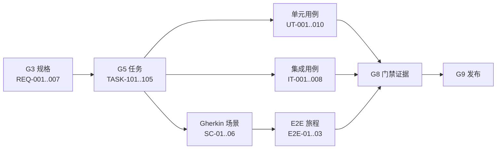

# 测试用例样例集（Test Case Examples）

> 以电商订单系统 **OrderHub**（与案例仓库呼应）为被测对象，给出一套从 Gherkin 验收场景到单元/集成/E2E 用例、再到需求 ID 追踪矩阵的可复用样例。所有数字、ID、路径均为具体示例，可直接照搬改造。

[返回首页](../README.md) · [English](./test-cases.en.md) · [测试策略](./test-strategy.md) · [覆盖率报告](./coverage-report.md)

---

## 一、被测对象与需求基线（SUT & Requirement Baseline）

**OrderHub** 是一个订单微服务，核心链路：下单 → 库存预留 → 支付 → 订单状态流转 → 查询/取消。

| 需求 ID | 用户故事 | 验收要点 | 关联任务 ID |
|---|---|---|---|
| REQ-001 | 作为买家，我能提交订单 | 生成唯一订单号，初始状态 `PENDING_PAYMENT` | TASK-101 |
| REQ-002 | 作为系统，下单时预留库存 | 库存不足则拒绝；支付成功后才真正扣减 | TASK-102 |
| REQ-003 | 作为买家，我能支付订单 | 成功→`PAID` 且扣减库存；失败→状态不变 | TASK-103 |
| REQ-004 | 作为买家，我能取消未支付订单 | 取消→`CANCELLED` 且释放库存；已支付不可取消 | TASK-101 |
| REQ-005 | 作为买家，我只能查询自己的订单 | 鉴权；越权返回 403；不存在返回 404 | TASK-104 |
| REQ-006 | 作为系统，订单金额需正确计算 | 单价×数量；满 99 包邮，否则运费 10 元；优惠券折扣 | TASK-105 |
| REQ-007 | 作为系统，重复提交不产生重复订单 | 幂等键去重，返回同一订单 | TASK-104 |

**测试基线数据**：商品 `SKU-A` 单价 `50.00`，初始库存 `100`，用户 `U-1001`，运费门槛 `99.00` / 运费 `10.00`。

### ID 溯源流向（Traceability Flow）



---

## 二、Gherkin 验收场景（Acceptance Scenarios）

采用 Given / When / Then 格式，覆盖**正常、边界、异常**三类。这些场景即 G3 规格的可测试验收标准（Gate 3 要求）。

### SC-01 正常场景：成功创建订单

```gherkin
Feature: 创建订单 (REQ-001 / REQ-002 / REQ-006)
  Scenario: 买家成功创建订单并享受满额包邮
    Given 用户 "U-1001" 已登录
      And 商品 "SKU-A" 单价 50.00、库存 100
    When 用户提交订单：SKU-A 数量 2，使用幂等键 "K-1001"
    Then 系统返回订单号 "ORD-" 开头的唯一订单，状态码 201
      And 订单状态为 "PENDING_PAYMENT"
      And 商品小计为 100.00，运费为 0.00（满 99 包邮），应付总额 100.00
      And 库存被预留 2 件，可用库存变为 98
```

### SC-02 边界场景：包邮临界值

```gherkin
  Scenario Outline: 金额恰好在包邮门槛两侧
    Given 商品 "SKU-A" 单价 50.00
    When 用户提交订单，数量为 <quantity>
    Then 商品小计为 <subtotal>，运费为 <shipping>，应付总额 <total>

    Examples:
      | quantity | subtotal | shipping | total  | 说明               |
      | 1        | 50.00    | 10.00    | 60.00  | 98.99<99，不包邮    |
      | 2        | 100.00   | 0.00     | 100.00 | 刚好满 99，包邮     |
```

### SC-03 异常场景：库存不足

```gherkin
  Scenario: 库存不足时拒绝下单
    Given 商品 "SKU-A" 可用库存为 100
    When 用户提交订单：SKU-A 数量 200
    Then 系统拒绝下单，状态码 409
      And 错误码为 "INSUFFICIENT_STOCK"
      And 不生成订单，库存保持不变
```

### SC-04 异常场景：支付失败状态不变

```gherkin
  Scenario: 支付网关失败时订单状态与库存预留不变
    Given 订单 "ORD-20261118-001" 状态为 "PENDING_PAYMENT"，已预留库存 2 件
    When 支付网关返回失败（余额不足）
    Then 支付接口返回失败结果
      And 订单状态仍为 "PENDING_PAYMENT"
      And 预留库存仍为 2 件，未被扣减也未被释放
```

### SC-05 异常场景：重复提交幂等

```gherkin
  Scenario: 使用相同幂等键重复提交只产生一个订单
    Given 用户 "U-1001" 已用幂等键 "K-1001" 创建订单 "ORD-20261118-001"
    When 用户再次用幂等键 "K-1001" 提交相同订单
    Then 系统返回同一个订单号 "ORD-20261118-001"
      And 库存只被预留一次（可用库存仍为 98）
```

### SC-06 边界场景：取消未支付订单释放库存

```gherkin
  Scenario: 取消未支付订单后库存回滚
    Given 订单 "ORD-20261118-002" 状态为 "PENDING_PAYMENT"，已预留库存 2 件
    When 用户取消该订单
    Then 订单状态变为 "CANCELLED"
      And 预留库存被释放，可用库存从 98 恢复为 100
```

---

## 三、单元测试用例（Unit Test Cases）

被测函数：`calculateTotal`、`reserveStock`、`payOrder`、`cancelOrder`、`createOrder`。

| 用例 ID | 被测函数 | 输入 | 预期输出 | 覆盖需求 ID |
|---|---|---|---|---|
| UT-001 | `calculateTotal` | qty=2, price=50.00, coupon=null | subtotal=100.00, shipping=0.00, total=100.00 | REQ-006 |
| UT-002 | `calculateTotal` | qty=1, price=50.00, coupon=null | subtotal=50.00, shipping=10.00, total=60.00 | REQ-006 |
| UT-003 | `calculateTotal` | qty=2, price=50.00, coupon=10.00 | total=90.00（先减免后算运费） | REQ-006 |
| UT-004 | `reserveStock` | qty=200, available=100 | 抛出 `InsufficientStock` 异常 | REQ-002 |
| UT-005 | `reserveStock` | qty=100, available=100 | 成功，remaining=0（边界：刚好扣完） | REQ-002 |
| UT-006 | `payOrder` | status=PENDING_PAYMENT, gateway=FAILED | 状态保持 PENDING_PAYMENT，预留库存不变 | REQ-003 |
| UT-007 | `payOrder` | status=PENDING_PAYMENT, gateway=SUCCESS | 状态变为 PAID，库存实际扣减 2 件 | REQ-003 / REQ-002 |
| UT-008 | `cancelOrder` | status=PENDING_PAYMENT | 状态变为 CANCELLED，库存释放 2 件 | REQ-004 |
| UT-009 | `cancelOrder` | status=PAID | 抛出 `InvalidStateTransition` 异常 | REQ-004 |
| UT-010 | `createOrder` | idempotencyKey="K-1001"（已存在） | 返回既有 orderId，不新建订单 | REQ-007 |

**参数化单元测试示例（pytest）**：

```python
import pytest
from orderhub.domain import calculate_total, InsufficientStock, reserve_stock

@pytest.mark.parametrize("qty,price,coupon,expected_total", [
    (2, 50.00, None, 100.00),   # UT-001 满 99 包邮
    (1, 50.00, None, 60.00),    # UT-002 不满 99 收运费
    (2, 50.00, 10.00, 90.00),   # UT-003 优惠券
])
def test_calculate_total(qty, price, coupon, expected_total):
    # 需求 ID: REQ-006 —— 断言来自需求，而非实现返回值
    assert calculate_total(qty, price, coupon) == pytest.approx(expected_total)

def test_reserve_stock_insufficient():  # UT-004 / REQ-002
    with pytest.raises(InsufficientStock):
        reserve_stock(qty=200, available=100)
```

---

## 四、集成测试用例（API Level）

| 用例 ID | 端点与方法 | 请求要点 | 预期状态码 | 预期响应 | 覆盖需求 ID |
|---|---|---|---:|---|---|
| IT-001 | `POST /api/v1/orders` | U-1001, SKU-A×2, key=K1 | 201 | orderId, total=100.00, status=PENDING_PAYMENT | REQ-001/002/006 |
| IT-002 | `POST /api/v1/orders` | SKU-A×200（库存不足） | 409 | `{"code":"INSUFFICIENT_STOCK"}` | REQ-002 |
| IT-003 | `POST /api/v1/orders` | 重复 key=K1 | 200 | 与 IT-001 相同的 orderId | REQ-007 |
| IT-004 | `GET /api/v1/orders/{id}` | 使用他人 token | 403 | `{"code":"FORBIDDEN"}` | REQ-005 |
| IT-005 | `POST /api/v1/orders/{id}/pay` | 支付成功 | 200 | status=PAID，库存已扣减 | REQ-003 |
| IT-006 | `POST /api/v1/orders/{id}/pay` | 网关返回失败 | 200 | status=PENDING_PAYMENT，库存未变 | REQ-003 |
| IT-007 | `DELETE /api/v1/orders/{id}` | 未支付订单 | 204 | 无响应体；库存已释放 | REQ-004 |
| IT-008 | `GET /api/v1/orders/NOPE` | 不存在的订单 | 404 | `{"code":"ORDER_NOT_FOUND"}` | REQ-005 |

> 集成测试使用 TestClient 拉起真实 API 与内存数据库，仅对**支付网关**做 stub，避免依赖外部系统。

---

## 五、E2E 用户旅程测试（End-to-End Journeys）

| 旅程 ID | 用户旅程步骤 | 关键验证点 | 覆盖需求 ID |
|---|---|---|---|
| E2E-01 | 登录 → 浏览 SKU-A → 加购 2 件 → 结算（满 99 包邮）→ 支付成功 → 查看订单详情 | 订单状态 `PAID`；页面显示应付 100.00；后台库存 98 | REQ-001/002/003/006 |
| E2E-02 | 登录 → 下单 → 支付失败 → 返回订单页 → 重新支付成功 | 失败后状态仍 `PENDING_PAYMENT`；重试后 `PAID`，库存仅扣一次 | REQ-003/007 |
| E2E-03 | 登录 → 下单 → 取消订单 → 查看库存 | 订单 `CANCELLED`；商品详情页库存恢复为 100 | REQ-004/002 |

---

## 六、边界值与等价类划分（Boundary & Equivalence Partitioning）

### 6.1 等价类划分

| 输入域 | 有效等价类 | 无效等价类 | 覆盖用例 |
|---|---|---|---|
| 购买数量 | 1 ≤ qty ≤ 99 | 0、负数、≥100 | UT-004、UT-005、IT-002 |
| 商品单价 | price > 0 | 0、负数 | UT-001（有效类代表） |
| 优惠券 | 有效且未过期 | 过期码、无效码 | UT-003 |
| 支付方式 | 余额、银行卡、第三方 | 不支持的方式 | IT-005/006 |
| 幂等键 | 非空字符串 | 空串、超长 | IT-003、UT-010 |

### 6.2 边界值分析

| 字段 | 边界点 | 测试值 | 预期结果 |
|---|---|---|---|
| 购买数量 | 下界 | 1 | 下单成功 |
| 购买数量 | 下界−1 | 0 | 参数校验失败（400） |
| 购买数量 | 上界 | 99 | 下单成功 |
| 购买数量 | 上界+1 | 100 | 参数校验失败（400） |
| 订单金额 | 包邮临界 | 99.00 | 运费 0（UT-001 场景） |
| 订单金额 | 临界−0.01 | 98.99 | 运费 10（SC-02） |
| 可用库存 | 刚好扣完 | qty=100, avail=100 | 成功，remaining=0（UT-005） |
| 可用库存 | 刚好不足 | qty=101, avail=100 | 拒绝（UT-004 同类） |

---

## 七、测试用例 → 需求 ID 追踪矩阵（Traceability Matrix）

> 门禁要求：矩阵中不得有空 ID 或孤立需求。每行至少被一个用例覆盖，方可满足 Gate 3 / Gate 8 的 ID 溯源要求。

| 需求 ID | Gherkin 场景 | 单元用例 | 集成用例 | E2E 旅程 | 覆盖状态 |
|---|---|---|---|---|---|
| REQ-001 | SC-01 | UT-010 | IT-001 | E2E-01 | 已覆盖 |
| REQ-002 | SC-01, SC-03, SC-06 | UT-004, UT-005, UT-007 | IT-001, IT-002 | E2E-01, E2E-03 | 已覆盖 |
| REQ-003 | SC-04 | UT-006, UT-007 | IT-005, IT-006 | E2E-01, E2E-02 | 已覆盖 |
| REQ-004 | SC-06 | UT-008, UT-009 | IT-007 | E2E-03 | 已覆盖 |
| REQ-005 | — | — | IT-004, IT-008 | E2E-01 | 已覆盖 |
| REQ-006 | SC-02 | UT-001, UT-002, UT-003 | IT-001 | E2E-01 | 已覆盖 |
| REQ-007 | SC-05 | UT-010 | IT-003 | E2E-02 | 已覆盖 |

**覆盖统计**：7/7 需求被覆盖（100%）；6 个 Gherkin 场景、10 个单元用例、8 个集成用例、3 个 E2E 旅程，共 **27 个测试用例**。

> 追踪矩阵是 [gate-validation.py](./gate-validation.py) `trail` 子命令检查"阶段证据"的数据来源之一——测试阶段的证据即"本矩阵 + 测试运行记录"。

---

*测试用例样例属 [AI Workflow Hub](../README.md) 测试体系 · 被测对象 OrderHub · 中英双语*
