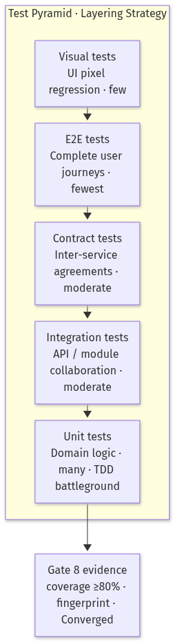
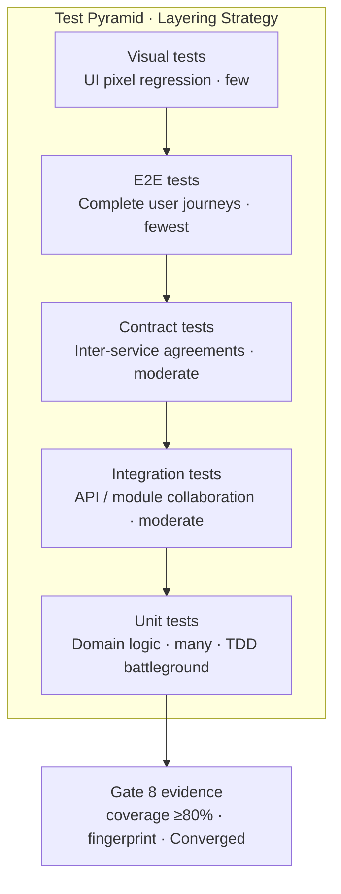
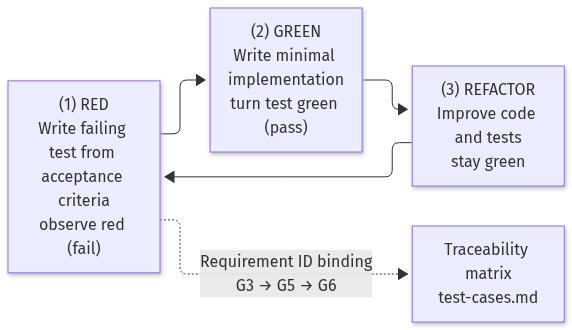
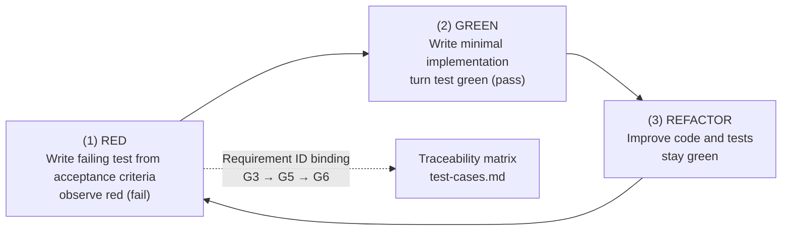
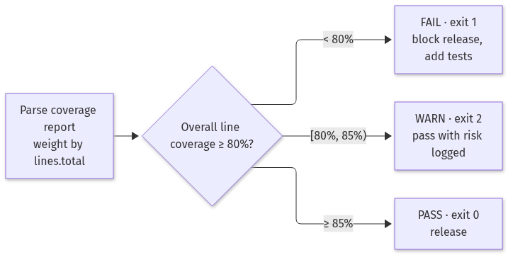
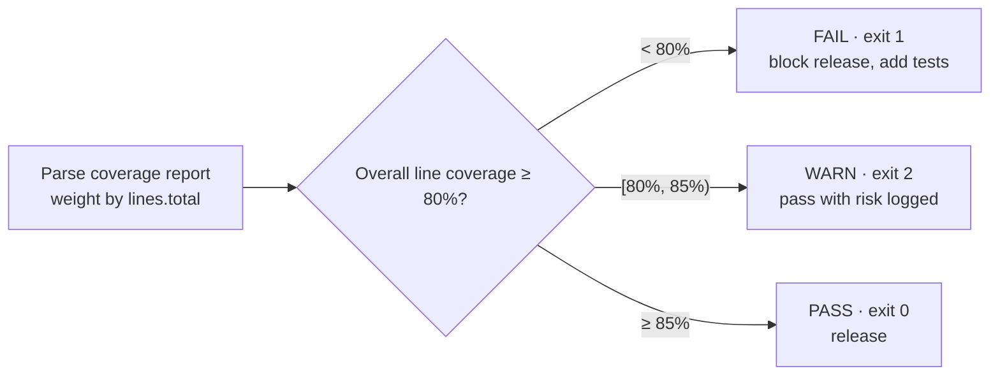
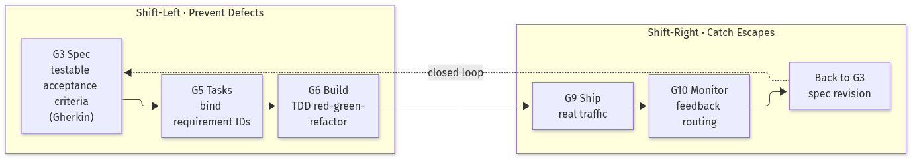
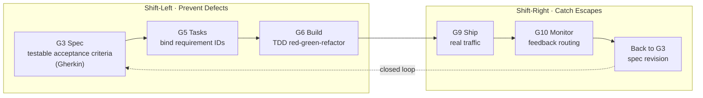

# Test Strategy

> Strategy answers not "what to test", but **"at which layer, to what depth, and who decides release"**. This document turns strategy into executable rules wired directly into the [G8 Test Gate](../docs/02-unified-framework/quality-gates.en.md): coverage ≥80%, tests genuinely run, `Converged`, and a matching code fingerprint.

[Home](../README.en.md) · [中文](./test-strategy.md) · [Testing System Index](./README.en.md) · [Test Case Examples](./test-cases.en.md) · [Coverage Report](./coverage-report.en.md)

---

## 1. Strategy at a Glance

| Dimension | Decision | Rationale |
|---|---|---|
| Layering | Five layers: unit / integration / contract / E2E / visual | Test pyramid: cheap at the bottom, user-realistic at the top |
| Development | TDD mandatory for feature work (red → green → refactor) | Spec Kit `/implement`, BMAD Dev |
| Coverage threshold | Line coverage ≥80% (Gate 8 hard gate), branch ≥70%, critical paths 100% | Homegrown rule: "coverage <80% means no pass" |
| AI-generated tests | Mandatory human review, hunting for "fake green" | Machine-enforced vs advisory |
| Scope | Shift-left into specs, shift-right into production feedback | G3 → G6 → G10 loop |
| Release evidence | Coverage report + test-run record + fingerprint + Converged | G8 release criteria |

---

## 2. Layering & Tooling

<!-- IMG-EMBED -->
**图 1 · flowchart**

查看 Mermaid 源码（可编辑）

| Layer | Test Objective | Granularity | Tooling | Authored By | Commit Policy | Stability |
|---|---|---|---|---|---|---|
| **Unit** | Single responsibility and boundaries of functions/classes | Method level | pytest, JUnit, Vitest, Jest | Dev + AI (TDD) | Mandatory, with code | High |
| **Integration** | Module collaboration, API endpoints, DB reads/writes | Module / interface level | pytest + TestClient, Spring Boot Test, Postman/Newman | Dev + QA | Mandatory | Med-high |
| **Contract** | Provider/consumer interface agreements | Interface protocol level | Pact, Schemathesis, OpenAPI Validator | QA + Architect | Mandatory for microservices | Med-high |
| **E2E** | Critical user journeys work end-to-end | Scenario level | Playwright, Cypress, Selenium | QA | Mandatory for key journeys | Medium |
| **Visual** | Pixel-level UI regressions | Page snapshot level | Playwright Snapshot, Percy, Chromatic | QA + Design | Mandatory when UI exists | Medium |

### Layer-by-Layer Guidance

| Layer | Must Test | Delegate Upward | Typical Assertions |
|---|---|---|---|
| Unit | Domain rules, boundary values, exception branches, pure functions | Cross-service calls, real DB, UI | Return values, exception types, state changes |
| Integration | API status codes, request/response shape, transactions, DB mapping | Real third-party interaction (use mock/stub) | HTTP 200/400, JSON schema, persisted state |
| Contract | Request/response schema, field types, error-code conventions | Business logic (belongs to unit layer) | Pact verification, schema consistency |
| E2E | Login → order → payment → view-order main journey | Exhaustive boundaries (already at unit layer) | Page state, key copy, navigation result |
| Visual | Baseline snapshots of key pages | Functional correctness | Pixel diff within threshold |

> **Allocation principle**: unit and integration contribute the vast majority of coverage (matching the 89% pass verdict in [coverage-report.md](./coverage-report.en.md)); E2E/visual provide the final confidence and should not be used to pad coverage.

---

## 3. Test-Driven Development (TDD)

Feature work uses mandatory TDD: write a failing acceptance test first, then the minimal implementation, then refactor — repeating the cycle. Every cycle must **bind a requirement ID** so ID traceability stays intact.

<!-- IMG-EMBED -->
**图 2 · flowchart**

查看 Mermaid 源码（可编辑）

| Step | Activity | Done Criterion | Stage | Artifact |
|---|---|---|---|---|
| (1) RED | Write tests from Gherkin criteria; they must fail first | Test fails for the right reason: feature not implemented | G5→G6 | Failing test case (with requirement ID) |
| (2) GREEN | Write minimal implementation to pass | All tests green, no extra features | G6 | Implementation + passing tests |
| (3) REFACTOR | Improve structure without changing behavior | Tests still green, no code smells | G6/G7 | Clean refactored code |
| (4) Record | `record_test_run.py` logs exit code and fingerprint | Auditable run record exists | G8 | `test-run.json`, code SHA256 |

**TDD discipline (from Agentic OS)**:

1. Plan before editing; do no unrequested refactoring.
2. Never weaken an assertion just to turn red to green.
3. Every test must trace to a requirement ID or acceptance criterion.
4. After refactoring, re-run all tests and refresh the fingerprint.

---

## 4. Coverage Strategy

### 4.1 Coverage Types and Thresholds

| Coverage Type | Definition | Formula | Best For | Gate Requirement |
|---|---|---|---|---|
| **Line** | Share of source lines executed | `covered lines ÷ total lines` | General baseline | **≥80% (Gate 8 hard gate)** |
| **Branch** | Share of if/else, switch branches taken | `covered branches ÷ total branches` | Condition-heavy modules | ≥70% (recommended) |
| **Path** | Share of all entry-to-exit paths taken | `covered paths ÷ total paths` | Critical payment/auth algorithms | 100% for critical paths |
| **Function** | Share of functions invoked | `covered funcs ÷ total funcs` | Module API completeness | ≥90% (recommended) |

> The sample coverage report (per-module line/branch/function coverage and the weighting formula) is in [coverage-report.md](./coverage-report.en.md); machine verdicts come from the `coverage` subcommand of [gate-validation.py](./gate-validation.py).

### 4.2 Gate Verdict Rules

<!-- IMG-EMBED -->
**图 3 · flowchart**

查看 Mermaid 源码（可编辑）

| Range | Verdict | Exit Code | Action |
|---|---|---:|---|
| `< 80%` | FAIL | 1 | Block release; go back to G6/G8 to add tests |
| `[80%, 85%)` | WARN | 2 | Pass with risk noted; raise next iteration |
| `≥ 85%` | PASS | 0 | Normal release |

> Thresholds are defined in [gate-validation.py](./gate-validation.py): `DEFAULT_THRESHOLD = 80.0`, `WARN_BAND = 5.0`, overridable with `--threshold`.

### 4.3 The Right Way to Raise Coverage

| Wrong Approach | Why It's Wrong | Correct Approach |
|---|---|---|
| Assertion-free tests to inflate numbers | "Tested but not verified" — fake green | Every test has a real behavioral assertion |
| Happy path only | Exception branches leak to production | Use boundary values + equivalence classes (see [test-cases.md](./test-cases.en.md)) |
| Skipping/deleting failing tests | Breaks work trail; fingerprint exposes it | Fix the implementation or honestly flag known defects |
| Over-mocking to "test yourself" | Tests pass but integration is broken | Use real dependencies or contract tests on critical paths |

---

## 5. Reviewing AI-Generated Tests

AI is good at rapidly scaffolding tests but tends to produce suites that look comprehensive yet are "fake green". Reviews must focus on this checklist:

| # | Risk | Review Method | Verdict |
|---|---|---|---|
| 1 | No / weak assertions | Check every test has `assert` targeting behavior | No assert → reject |
| 2 | Happy path only | Compare against acceptance criteria; check exception/boundary branches | Missing branches → add tests |
| 3 | Expected value copied from implementation | Verify expected comes from the requirement, not the code | Self-confirming → reject |
| 4 | Tests skipped / xfailed away | Search for `skip`, `xfail`, commented-out tests | Unjustified → reject |
| 5 | Over-mocking | Check mocks aren't replacing the logic under test | Testing nothing → rewrite |
| 6 | No requirement ID | Verify traceability matrix (see [test-cases.md](./test-cases.en.md)) | No ID → complete the chain |
| 7 | Hardcoded credentials / sensitive data | Scan with [gate-validation.py](./gate-validation.py) `credentials` | Any hit → block (P0 alert) |
| 8 | Non-isolated test data | Check for shared mutable state between cases | Interdependent → isolate |
| 9 | Coverage numbers not matching tests | Re-run with `record_test_run.py` to cross-check | Fabricated → block |

> **Principle**: AI-generated tests are only a "draft". They become Gate 8 evidence only after human review plus machine checks (coverage, fingerprint, credential scan).

---

## 6. Shift-Left & Shift-Right

<!-- IMG-EMBED -->
**图 4 · flowchart**

查看 Mermaid 源码（可编辑）

| Direction | Meaning | Concrete Practice | Stage | Value |
|---|---|---|---|---|
| **Shift-Left** | Move testing before defect creation | Write Gherkin at spec time; bind IDs to tasks; TDD test-first; static scan + pre-commit | G3/G5/G6 | Earlier detection, lower fix cost |
| **Shift-Right** | Extend testing into production | Canary/blue-green; monitoring & alerts; production feedback routing; defect-escape rate back to G3 | G9/G10 | Catch real issues tests missed |
| **Closed Loop** | Right-side findings drive left-side spec revision | G10 feedback → G3 new acceptance criteria → new tests | G10→G3 | Forms the "requirement-landing feedback iteration" loop |

---

## 7. Enforcement Checklist

| Check | Quantified Criterion | Enforcement | Owner |
|---|---|---|---|
| Layering complete | Unit/integration/E2E cases all present | Checklist | QA Engineer |
| Line coverage | ≥80% | [gate-validation.py](./gate-validation.py) `coverage` (CI) | QA |
| Tests genuinely run | `test-run.json` exists, exit=0 | `record_test_run.py` | QA |
| Fingerprint match | expected == actual | `gate-validation.py` `fingerprint` | CI |
| No credential leaks | 0 scan hits | `gate-validation.py` `credentials` (pre-commit) | Dev |
| Convergence report | `Converged` | `/converge` | QA |
| Traceable cases | No empty IDs in matrix | [test-cases.md](./test-cases.en.md) | QA Engineer |
| AI tests reviewed | All 9 review items pass | Human + [gate-validation.py](./gate-validation.py) | Reviewer |

---

*Test strategy is part of the [AI Workflow Hub](../README.en.md) testing system · All thresholds align with [Quality Gates](../docs/02-unified-framework/quality-gates.en.md) · Bilingual*
