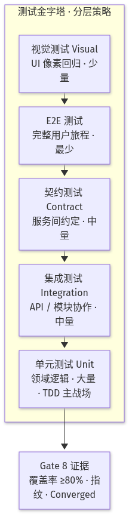
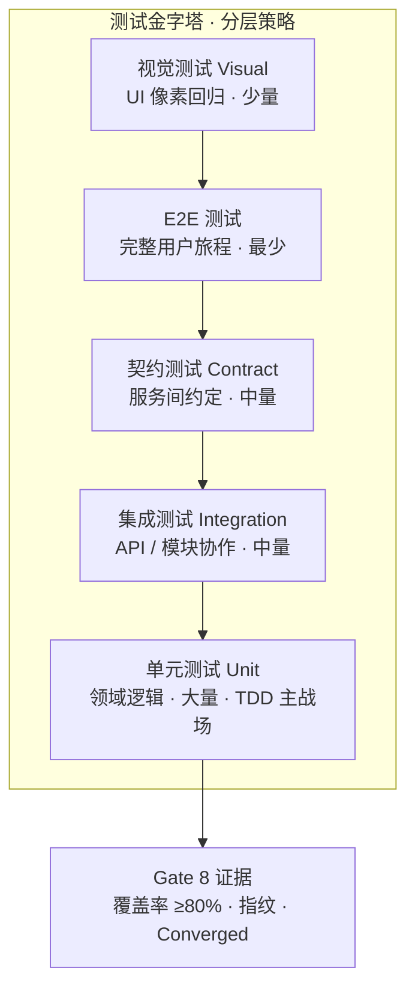
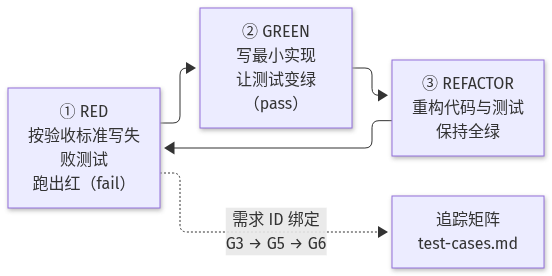
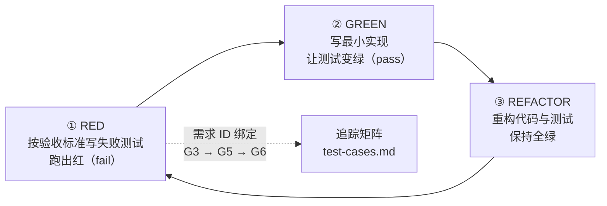
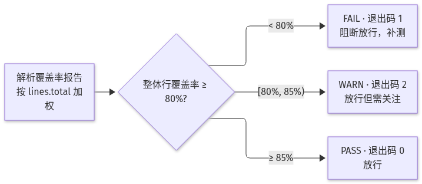
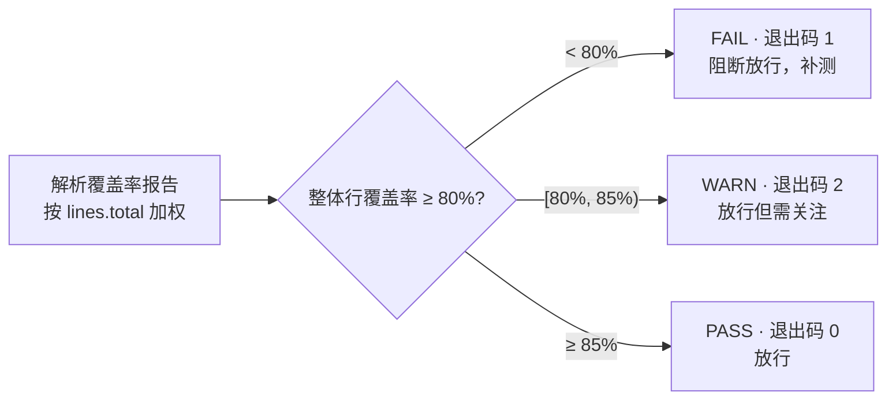
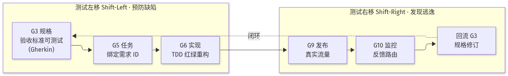
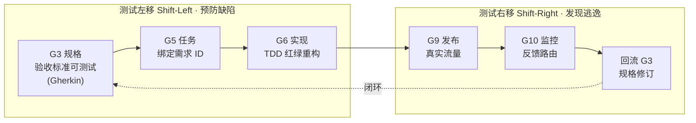

# 测试策略（Test Strategy）

> 策略回答的不是"测什么"，而是**"在哪一层测、测到什么程度、由谁判定放行"**。本文把策略固化成可执行规则，并直接对接 [G8 测试门禁](../docs/02-unified-framework/quality-gates.md)：覆盖率 ≥80%、测试真实运行、`Converged`、代码指纹匹配。

[返回首页](../README.md) · [English](./test-strategy.en.md) · [测试体系总索引](./README.md) · [测试用例样例](./test-cases.md) · [覆盖率报告](./coverage-report.md)

---

## 一、策略总览（Strategy at a Glance）

| 维度 | 决策 | 依据 |
|---|---|---|
| 分层 | 五层：单元 / 集成 / 契约 / E2E / 视觉 | 测试金字塔：底层便宜、顶层贴近用户 |
| 开发方式 | 功能开发强制 TDD（红→绿→重构） | Spec Kit `/implement`、BMAD Dev |
| 覆盖率门槛 | 行覆盖 ≥80%（Gate 8 硬门禁），分支 ≥70%，关键路径 100% | 自有体系"覆盖率 <80% 不通过" |
| AI 生成测试 | 必须人工审查，重点查"假绿" | 机器强制 vs 规则提示 |
| 测试范围 | 左移到规格，右移到线上反馈 | G3 → G6 → G10 闭环 |
| 放行证据 | 覆盖率报告 + 测试运行记录 + 指纹 + Converged | G8 放行标准 |

---

## 二、测试分层与工具选型（Layering & Tooling）

<!-- IMG-EMBED -->
**图 1 · flowchart**

查看 Mermaid 源码（可编辑）

| 层级 | 测试目标 | 粒度 | 工具选型 | 谁编写 | 入库要求 | 稳定性 |
|---|---|---|---|---|---|---|
| **单元 Unit** | 验证函数/类的单一职责与边界 | 方法级 | pytest、JUnit、Vitest、Jest | 开发 + AI（TDD） | 必须，随代码提交 | 高 |
| **集成 Integration** | 验证模块协作、API 端点、数据库读写 | 模块/接口级 | pytest + TestClient、Spring Boot Test、Postman/Newman | 开发 + 测试 | 必须 | 中高 |
| **契约 Contract** | 验证服务提供方与消费方接口约定 | 接口协议级 | Pact、Schemathesis、OpenAPI Validator | 测试 + 架构 | 微服务必选 | 中高 |
| **E2E** | 验证关键用户旅程端到端可用 | 场景级 | Playwright、Cypress、Selenium | 测试（QA） | 关键旅程必选 | 中 |
| **视觉 Visual** | 捕获 UI 像素级回归 | 页面快照级 | Playwright Snapshot、Percy、Chromatic | 测试 + 设计 | 有 UI 必选 | 中 |

### 各层落地要点

| 层级 | 必测内容 | 不测内容（交给上一层） | 典型断言 |
|---|---|---|---|
| 单元 | 领域规则、边界值、异常分支、纯函数 | 跨服务调用、真实 DB、UI | 返回值、异常类型、状态变更 |
| 集成 | API 状态码、请求/响应结构、事务、DB 映射 | 第三方系统真实交互（用 mock/stub） | HTTP 200/400、JSON schema、落库结果 |
| 契约 | 请求/响应 schema、字段类型、错误码约定 | 业务逻辑（属于单元层） | Pact verification、schema 一致 |
| E2E | 登录→下单→支付→查看订单 主旅程 | 穷举边界（已在单元层覆盖） | 页面状态、关键文案、跳转结果 |
| 视觉 | 关键页面基线快照 | 功能正确性 | 像素 diff 阈值内 |

> **配比原则**：单元与集成贡献绝大部分覆盖率（对应 [coverage-report.md](./coverage-report.md) 的 89% 通过判定）；E2E/视觉只做"最后一道信心"，不用来凑覆盖率。

---

## 三、TDD 流程（Test-Driven Development）

功能开发采用强制 TDD：先写失败的验收测试，再写最小实现，最后重构，循环推进。每个循环都必须**绑定需求 ID**，保证 ID 溯源不断链。

<!-- IMG-EMBED -->
**图 2 · flowchart**

查看 Mermaid 源码（可编辑）

| 步骤 | 活动 | 完成判据 | 对应阶段 | 产出物 |
|---|---|---|---|---|
| ① RED | 依据 Gherkin 验收标准写测试，先跑必失败 | 测试失败且失败原因=功能未实现 | G5→G6 | 失败测试用例（含需求 ID） |
| ② GREEN | 写最小可运行实现，让测试通过 | 测试全绿，无多余功能 | G6 | 实现代码 + 通过的测试 |
| ③ REFACTOR | 在不改变行为前提下优化结构 | 测试仍全绿，代码无坏味道 | G6/G7 | 重构后的干净代码 |
| ④ 记录 | `record_test_run.py` 记录退出码与指纹 | 有可审计的运行记录 | G8 | `test-run.json`、代码 SHA256 |

**TDD 纪律（来自 Agentic OS）**：

1. 先规划后编辑，不做未被要求的重构。
2. 红灯阶段不允许为了让测试通过而弱化断言。
3. 每个测试必须能追溯到一条需求 ID 或验收标准。
4. 重构后必须重跑全部测试并更新指纹。

---

## 四、覆盖率策略（Coverage Strategy）

### 4.1 覆盖类型与门槛

| 覆盖类型 | 定义 | 计算口径 | 适用场景 | 门禁要求 |
|---|---|---|---|---|
| **行覆盖 Line** | 被执行过的源码行占比 | `covered lines ÷ total lines` | 通用基础指标 | **≥80%（Gate 8 硬门槛）** |
| **分支覆盖 Branch** | if/else、switch 等分支被走过的占比 | `covered branches ÷ total branches` | 条件逻辑密集模块 | ≥70%（建议） |
| **路径覆盖 Path** | 从入口到出口所有可能路径占比 | `covered paths ÷ total paths` | 支付、鉴权等关键算法 | 关键路径 100% |
| **函数覆盖 Function** | 被调用过的函数占比 | `covered funcs ÷ total funcs` | 模块 API 完备性 | ≥90%（建议） |

> 覆盖率报告样例（含分模块行/分支/函数覆盖率与加权算法）见 [coverage-report.md](./coverage-report.md)；机器判定见 [gate-validation.py](./gate-validation.py) 的 `coverage` 子命令。

### 4.2 门禁判定规则

<!-- IMG-EMBED -->
**图 3 · flowchart**

查看 Mermaid 源码（可编辑）

| 区间 | 判定 | 退出码 | 处理 |
|---|---|---:|---|
| `< 80%` | FAIL | 1 | 阻断放行，回到 G6/G8 补测 |
| `[80%, 85%)` | WARN | 2 | 放行但记录风险，下个迭代提升 |
| `≥ 85%` | PASS | 0 | 正常放行 |

> 门槛常量定义于 [gate-validation.py](./gate-validation.py)：`DEFAULT_THRESHOLD = 80.0`、`WARN_BAND = 5.0`，可用 `--threshold` 覆盖。

### 4.3 提高覆盖率的正确姿势

| 错误做法 | 为什么错 | 正确做法 |
|---|---|---|
| 为凑数字写无断言测试 | "测了但没验"，假绿 | 每个测试有明确断言，覆盖真实分支 |
| 只测 happy path | 异常分支裸奔，线上逃逸 | 用边界值 + 等价类补齐异常路径（见 [test-cases.md](./test-cases.md)） |
| 屏蔽/删除失败测试 | 破坏 work trail，指纹暴露 | 修复实现或如实标注已知缺陷 |
| 过度 mock 到"自娱自乐" | 测试通过但集成是坏的 | 关键路径用真实依赖或契约测试 |

---

## 五、AI 生成测试的审查要点（Reviewing AI-Generated Tests）

AI 善于快速铺开测试用例，但倾向产生"看起来很全、实则假绿"的测试。审查必须聚焦以下清单：

| # | 风险点 | 审查方法 | 判定标准 |
|---|---|---|---|
| 1 | 无断言 / 弱断言 | 检查每个测试是否有 `assert`，断言是否针对行为 | 无断言 → 打回 |
| 2 | 只测 happy path | 对照需求验收标准，检查异常/边界分支 | 缺异常分支 → 补测 |
| 3 | 期望值被写成实现返回值 | 核对 expected 是否来自需求而非代码 | 自我印证 → 打回 |
| 4 | 测试被 skip / xfail 掩盖 | 搜索 `skip`、`xfail`、注释掉的测试 | 无正当理由 → 打回 |
| 5 | 过度 mock | 检查 mock 是否替代了被测逻辑本身 | 测了个寂寞 → 重写 |
| 6 | 未绑定需求 ID | 核对追踪矩阵（见 [test-cases.md](./test-cases.md)） | 无 ID → 补链 |
| 7 | 硬编码凭证 / 敏感数据 | 用 [gate-validation.py](./gate-validation.py) `credentials` 扫描 | 命中 → 阻断（P0 告警） |
| 8 | 测试数据不独立 | 检查用例间是否共享可变状态 | 相互依赖 → 隔离 |
| 9 | 覆盖率数字与测试不匹配 | 用 `record_test_run.py` 重跑核对 | 数字造假 → 阻断 |

> **原则**：AI 生成测试只是"草稿"，人工审查 + 机器校验（覆盖率、指纹、凭证扫描）双重把关后，才可作为 Gate 8 证据。

---

## 六、测试左移与右移（Shift-Left & Shift-Right）

<!-- IMG-EMBED -->
**图 4 · flowchart**

查看 Mermaid 源码（可编辑）

| 方向 | 含义 | 具体实践 | 对应阶段 | 价值 |
|---|---|---|---|---|
| **左移 Shift-Left** | 把测试活动提前到缺陷产生之前 | 规格阶段写 Gherkin；任务绑定 ID；TDD 先写测试；静态扫描 + pre-commit | G3/G5/G6 | 更早发现、修复成本更低 |
| **右移 Shift-Right** | 把测试延伸到生产环境 | 灰度/金丝雀；监控告警；线上反馈路由；缺陷逃逸率回流 | G9/G10 | 发现测试未覆盖的真实问题 |
| **闭环** | 右移发现的缺陷驱动左移的规格修订 | G10 反馈 → G3 新验收标准 → 新测试用例 | G10→G3 | 形成"需求落地反馈迭代"闭环 |

---

## 七、策略落地清单（Enforcement Checklist）

| 检查项 | 量化判据 | 强制方式 | 负责人 |
|---|---|---|---|
| 测试分层完整 | 单元/集成/E2E 用例均存在 | 清单 | 测试工程师 |
| 行覆盖率 | ≥80% | [gate-validation.py](./gate-validation.py) `coverage`（CI） | QA |
| 测试真实运行 | `test-run.json` 存在且 exit=0 | `record_test_run.py` | QA |
| 代码指纹一致 | expected == actual | `gate-validation.py` `fingerprint` | CI |
| 无凭证泄露 | 扫描 0 命中 | `gate-validation.py` `credentials`（pre-commit） | 开发 |
| 收敛报告 | `Converged` | `/converge` | QA |
| 用例可追溯 | 追踪矩阵无空 ID | [test-cases.md](./test-cases.md) | 测试工程师 |
| AI 测试已审查 | 审查清单 9 项全过 | 人工 + [gate-validation.py](./gate-validation.py) | 代码审查者 |

---

*测试策略属 [AI Workflow Hub](../README.md) 测试体系 · 所有门槛与 [质量门禁](../docs/02-unified-framework/quality-gates.md) 对齐 · 中英双语*
